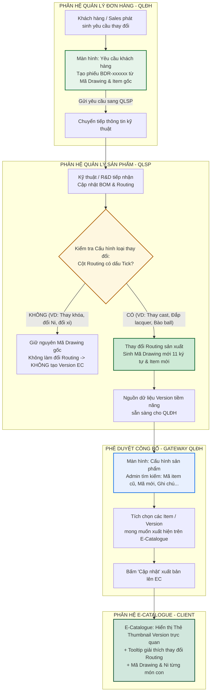

# TÀI LIỆU QUY ĐỊNH & HƯỚNG DẪN TÁC NGHIỆP: QUY TRÌNH ĐƯA DRAWING VERSION LÊN E-CATALOGUE (EC)
**Mã tài liệu:** `HDSD-EC-01` | **Phân hệ:** Quản lý đơn hàng (OMS) - Quản lý sản phẩm (PDM) - E-Catalogue (EC) | **Phiên bản:** `2.0`

---

## PHẦN I: THÔNG TIN CHUNG & NỘI DUNG BÀI VIẾT (Article Meta)

### 1. Tên bài hướng dẫn (*)
**Quy trình Phối hợp Liên phân hệ Đưa Phiên bản Bản vẽ Thiết kế (Drawing Version) lên E-Catalogue**

### 2. Màn hình áp dụng & Danh mục (*)
* **Màn hình áp dụng:**
  1. `Quản lý đơn hàng > Yêu cầu khách hàng` (`/dashboard/request-customer`)
  2. `Quản lý sản phẩm > Yêu cầu thiết kế > Cấu hình loại thay đổi` (`/pdm/change-type-config`)
  3. `Quản lý sản phẩm > BOM/Routing` (`/pdm/bom-routing`)
  4. `Quản lý đơn hàng > Cấu hình > Cấu hình sản phẩm` (`/dashboard/config-product`)
  5. `E-Catalogue > Chi tiết sản phẩm` (`/catalogue/product/[id]`)
* **Danh mục (*):** Quản lý Danh mục Chào hàng & Cấu hình Phiên bản Sản phẩm (E-Catalogue & Order Management)

### 3. Mô tả ngắn (*)
Hướng dẫn chi tiết luồng nghiệp vụ phối hợp liên phân hệ giữa **Quản lý đơn hàng (QLĐH)** và **Quản lý sản phẩm (QLSP)** để quản lý và công bố các phiên bản thiết kế (Drawing Version) lên **E-Catalogue (EC)**. Quy trình bắt đầu từ việc tiếp nhận Yêu cầu khách hàng gửi sang QLSP cập nhật kỹ thuật BOM/Routing; căn cứ cấu hình loại thay đổi có ảnh hưởng Routing để sinh Mã Drawing mới; và bước phê duyệt có điều kiện tại màn hình Cấu hình sản phẩm (QLĐH) để quyết định item/version nào được phép xuất hiện trên E-Catalogue chào hàng.

### 4. Video hướng dẫn
* **Tên file video:** `HDSD_LienPhanHe_QuanLy_Drawing_Version_EC_v2.mp4`
* **Thời lượng:** `07:15`
* **Ảnh thumbnail:** `thumb_drawing_version_lifecycle.jpg`

---

### 5. Nội dung tổng quát

#### 5.1. MỤC ĐÍCH & PHẠM VI ÁP DỤNG
* **Mục đích:**
  1. **Đồng bộ hóa luồng nghiệp vụ liên phòng ban:** Tạo sự kết nối liền mạch từ Sales (ghi nhận yêu cầu khách) $\rightarrow$ Kỹ thuật R&D/BOM/Routing (xử lý kỹ thuật và cấp mã drawing mới) $\rightarrow$ Admin Bán hàng (chọn lọc version hiển thị) $\rightarrow$ Khách hàng & Sales trên E-Catalogue.
  2. **Kiểm soát chặt chẽ nguồn sinh Version:** Chỉ những yêu cầu thay đổi được gắn cờ **Ảnh hưởng Routing** tại QLSP mới làm đổi mã Drawing và trở thành nguồn Version tiềm năng trên E-Catalogue.
  3. **Cung cấp cơ chế chọn lọc chủ động (Publishing Gate):** E-Catalogue không tự động hiển thị tràn lan mọi mã item kỹ thuật, mà phải qua bước rà soát, tìm kiếm (theo mã item cũ, mã mới, ghi chú) và tích chọn tại màn hình **Cấu hình sản phẩm** thuộc QLĐH.
* **Phạm vi áp dụng:**
  - Bộ phận Kinh doanh & Bán hàng (tiếp nhận yêu cầu khách hàng, lập đơn hàng).
  - Bộ phận Kỹ thuật Thiết kế 3D CAD, Định mức BOM & Quy trình Routing (QLSP).
  - Bộ phận Master Data & Quản trị Bán hàng (QLĐH).

#### 5.2. QUY ĐỊNH BỔ SUNG & THUẬT NGỮ CHUYÊN MÔN
* **Yêu cầu khách hàng (Customer Request):** Phiếu yêu cầu kỹ thuật (mã `BDR-xxxxxx`) do Sales khởi tạo khi khách hàng muốn chỉnh sửa mẫu có sẵn từ Mã Drawing gốc và Mã Item gốc.
* **Cấu hình loại thay đổi (Change Type Config):** Danh mục master data tại QLSP định nghĩa các dạng chỉnh sửa (Thay kích thước ball, Thay màu dây, Thay kiểu bào ball, Đắp lacquer, Thay Khóa, Cast...). Cột **Routing** là cờ quyết định việc thay đổi đó có làm đổi quy trình công nghệ hay không.
* **Mã Drawing (11 ký tự):** Mã định danh cấu trúc khuôn đúc và routing sản xuất. Khi loại thay đổi có tick **Routing**, hệ thống bắt buộc sinh Mã Drawing mới (Ví dụ: `BE000148A00` $\longrightarrow$ `BE000148B01`).
* **Cấu hình sản phẩm (Product Configuration - QLĐH):** Cổng kiểm soát (Publishing Gate) cho phép tìm kiếm theo `Mã item cũ`, `Mã item mới`, `Mã Drawing`, `Ghi chú` để tích chọn chính xác item/version nào được kích hoạt hiển thị trên E-Catalogue.

#### 5.3. SƠ ĐỒ LUỒNG THỰC HIỆN CHÍNH (END-TO-END WORKFLOW)

#### 5.4. BÀI VIẾT LIÊN QUAN
* `HDSD-EC-02`: Hướng dẫn cấu hình hiển thị Sản phẩm Bộ (Suites) và Cặp nhẫn cưới trên E-Catalogue.
* `HDSD-DH-01`: Quy trình xử lý Phiếu Yêu cầu khách hàng (BDR) và Tích hợp Tồn kho Thành phẩm.
* `HDSD-SP-03`: Quy chuẩn thiết lập BOM và Routing sản xuất tại phân hệ Quản lý sản phẩm.

---

## PHẦN II: ĐĂNG & TÀI LIỆU (4 Tabs chuẩn Form Admin)

### TAB 1: CÁC BƯỚC THỰC HIỆN (Milestones)

| Bước số | Tiêu đề bước | Phân hệ / Màn hình thực hiện | Mô tả thao tác chi tiết | Điểm lưu ý quan trọng | Mốc video |
| :---: | :--- | :--- | :--- | :--- | :---: |
| **1** | **Tiếp nhận & Tạo Yêu cầu khách hàng** | `QLĐH > Yêu cầu khách hàng` (`/dashboard/request-customer`) | 1. Nhấn `+ Tạo yêu cầu` từ đơn hàng hoặc chào hàng.  2. Chọn `Mã Drawing gốc` và `Mã Item gốc`.  3. Chọn `Loại thay đổi` mong muốn (ví dụ: `Cast`, `Đắp lacquer - móc máy`...).  4. Ghi chú yêu cầu cụ thể của khách và gửi phê duyệt. | Phiếu tạo ra có mã định dạng `BDR-xxxxxx` với trạng thái `Chờ xử lý`. | `00:40` |
| **2** | **Xử lý Kỹ thuật & Đối chiếu Cấu hình Loại thay đổi** | `QLSP > Yêu cầu thiết kế > Cấu hình loại thay đổi` & `BOM/Routing` | 1. Kỹ thuật viên R&D mở phiếu yêu cầu từ khách hàng.  2. Đối chiếu mã loại thay đổi trong bảng `Cấu hình loại thay đổi`:  • Kiểm tra cột **Routing** có dấu check xanh hay không.  3. Tiến hành cập nhật định mức BOM và các bước công nghệ trong Routing. | Chỉ loại thay đổi có **check ở cột Routing** mới được phép sinh Mã Drawing mới. | `02:15` |
| **3** | **Khởi tạo Mã Drawing mới & Sinh Mã Item mới** | `QLSP > Drawing No` & `Item` | Khi loại thay đổi có tick Routing:  1. Hệ thống tự động/cho phép cấp **Mã Drawing mới 11 ký tự** (ví dụ: `BE000148A00` $\longrightarrow$ `BE000148B01`).  2. Cập nhật các thông số kỹ thuật (file 3D, khuôn cast, ảnh render 4view, trọng lượng vàng dự kiến).  3. Tạo ra bản ghi Mã Item mới và chuyển trạng thái phiếu BDR sang `Hoàn thành`. | Mã Drawing mới 11 ký tự này là nguồn dữ liệu chuẩn bị đưa lên E-Catalogue. | `03:45` |
| **4** | **Phê duyệt & Chọn Item hiển thị trên E-Catalogue** | `QLĐH > Cấu hình > Cấu hình sản phẩm` (`/dashboard/config-product`) | 1. Admin truy cập màn hình **Cấu hình sản phẩm**.  2. Sử dụng ô tìm kiếm đa năng: gõ tìm theo `Mã item cũ`, `Mã item mới`, `Mã Drawing`, hoặc `Ghi chú...`  3. Kiểm tra thông tin hình ảnh render, hình 4view, trọng lượng và phụ liệu.  4. **Tích chọn (Checkbox)** vào các Item/Version muốn công bố lên E-Catalogue.  5. Bấm nút **Cập nhật** (góc trên bên phải). | Bước này là chốt chặn (Gateway) bắt buộc, không cấu hình thì item/version sẽ KHÔNG hiện lên EC. | `05:10` |
| **5** | **Kiểm thử hiển thị & Vận hành Chào hàng trên E-Catalogue** | `E-Catalogue > Chi tiết sản phẩm` (`/catalogue/product/[id]`) | 1. Mở trang chi tiết sản phẩm trên EC.  2. Kiểm tra thanh Thumbnail Drawing Version dưới ảnh chính đã xuất hiện phiên bản mới hay chưa.  3. Rê chuột vào Thumbnail: kiểm tra Tooltip hiển thị chuẩn tên phiên bản và tóm tắt sự thay đổi routing.  4. Thử chọn phiên bản và đối chiếu Mã Item 30 ký tự cùng bộ chọn kích thước Ni của từng món con. | Đảm bảo Khách hàng và Sales nhận biết rõ ràng các phiên bản thiết kế cải tiến. | `06:30` |

---

### TAB 2: QUY ĐỊNH NGHIỆP VỤ (Business Rules & Prerequisites)

#### Quy định 1: Nguyên tắc Cốt lõi của Cột "Routing" tại QLSP
Hệ thống căn cứ vào cột **Routing** trong bảng `Quản lý sản phẩm > Cấu hình loại thay đổi` để phân định luồng xử lý:

$$\begin{aligned}
\mathbf{Cột\ Routing\ [CHECK\ \checkmark]} &\Longrightarrow \text{Làm thay đổi quy trình công nghệ / Khuôn 3D} \Longrightarrow \mathbf{SINH\ MÃ\ DRAWING\ MỚI} \Longrightarrow \mathbf{NGUỒN\ VERSION\ EC} \\
\mathbf{Cột\ Routing\ [TRỐNG\ ---]} &\Longrightarrow \text{Tùy biến phụ kiện / Kích thước thông thường} \Longrightarrow \mathbf{GIỮ\ MÃ\ DRAWING\ GỐC} \Longrightarrow \mathbf{KHÔNG\ TẠO\ VERSION\ EC}
\end{aligned}$$

* **Danh mục loại thay đổi làm đổi Routing (CÓ SINH VERSION):**
  - `Cast`: Thay đổi khuôn đúc, sửa kết cấu ổ chấu đá, sửa file 3D.
  - `Đắp lacquer - móc máy`: Thêm công đoạn xử lý men sứ nung nhiệt hoặc móc máy hoa văn chuyên dụng.
  - `Thay Pearl sang Ball`: Thay đổi kết cấu gắn giữ từ ngọc trai sang bi đúc kim loại trên khuôn.
  - `Thay kiểu bào ball`: Can thiệp trực tiếp cấu trúc bề mặt khuôn đúc.
* **Danh mục loại thay đổi KHÔNG đổi Routing (KHÔNG SINH VERSION):**
  - `Thay Khóa`: Đổi phụ kiện khóa tròn, khóa càng cua, khóa hộp (lắp ráp phụ kiện hoàn thiện).
  - `Thay kích thước dây HTJ`: Cắt ngắn hoặc nối dài đoạn dây tiêu chuẩn.
  - `Thay kích thước ball`: Điều chỉnh bi phụ kiện lắp ghép.
  - `Thay màu dây / Thay màu xi`: Chọn màu trong bể xi tiêu chuẩn có sẵn.
  - `Kích thước Ni`: Chọn size nhẫn, size lắc, chiều dài dây (xử lý ở ô Kích thước).

#### Quy định 2: Điều kiện Tiên quyết đưa Item/Version lên E-Catalogue
Một Drawing Version chỉ được phép xuất hiện trên giao diện E-Catalogue khi thỏa mãn đồng thời **4 điều kiện**:
1. **Điều kiện 1 (Kỹ thuật):** Loại thay đổi phát sinh từ phiếu `Yêu cầu khách hàng` đã được QLSP cập nhật BOM/Routing và được xác nhận có cờ `Routing = TRUE`.
2. **Điều kiện 2 (Mã hóa):** Đã được cấp Mã Drawing mới hợp lệ gồm **đúng 11 ký tự** và Mã Item 30 ký tự hoàn chỉnh.
3. **Điều kiện 3 (Tài sản số):** Đã có tối thiểu 01 ảnh Render Visual hoặc 4view đạt chuẩn phông nền studio SEVAGO.
4. **Điều kiện 4 (Phê duyệt Bán hàng):** Đã được **Tích chọn (Checkbox)** và bấm **Cập nhật** tại màn hình `Quản lý đơn hàng > Cấu hình > Cấu hình sản phẩm`.

#### Quy định 3: Ràng buộc Tính năng Tìm kiếm tại Màn hình Cấu hình sản phẩm
* Ô tìm kiếm tại màn hình `Cấu hình sản phẩm` bắt buộc hỗ trợ tìm kiếm linh hoạt đa trường:
  - Tìm theo **Mã item cũ** (mã gốc trước khi thay đổi).
  - Tìm theo **Mã item mới** (mã mới sinh ra sau khi duyệt yêu cầu kỹ thuật).
  - Tìm theo **Mã Drawing** (11 ký tự).
  - Tìm theo **Ghi chú** (nội dung diễn giải yêu cầu kỹ thuật hoặc mô tả phiên bản).

#### Quy định 4: Chuẩn hóa Trải nghiệm Khách hàng & Sales trên E-Catalogue
1. Các version được phê duyệt hiển thị dưới dạng **Thẻ Thumbnail hình ảnh trực quan (Visual Cards)** đặt dưới ảnh chính sản phẩm.
2. Thẻ phiên bản được chọn phải có **viền xanh Emerald (#00594c), viền ring nổi bật và dấu Checkmark nhận diện**.
3. Khi rê chuột (Hover) vào Thumbnail, hiển thị **Tooltip nổi bật** giải thích: `[Mã Version] • [Tên phiên bản]` kèm dòng mô tả ngắn về sự thay đổi routing (ví dụ: *A01 • Đắp Lacquer men sứ - Đắp men sứ viền hoa văn*).
4. Tại khu vực chọn kích thước cho từng món con trong Bộ: Hiển thị sóng đôi **Mã Drawing kỹ thuật** bên cạnh **Dropdown chọn Ni**, giữ nguyên **Trường Trọng lượng** ở góc phụ.

#### Quy định 5: Cơ chế Cấu hình Thu thập Chi tiết Thay đổi trên Client (Form Admin QLSP)
Tại Modal Cập nhật / Thêm mới loại thay đổi (`QLSP > Cấu hình loại thay đổi`), Admin cấu hình cách thức người dùng cung cấp thông tin chi tiết cho từng loại thay đổi:
1. **Nhập chi tiết thay đổi (hasTextInput):**
   * **Mục đích:** Dành cho các loại thay đổi không có danh mục cố định, cần người dùng tự gõ diễn giải chi tiết (ví dụ: `Cast` - khuôn đúc cần ghi rõ hạ chấu nhẫn 0.8mm hay đổi dáng chấu...).
   * **Hiển thị trên Client:** Tự động mở trường bắt buộc **"Mô tả thay đổi *"** với ô văn bản (Textarea) *"Nhập mô tả thay đổi..."*.
2. **Chọn chi tiết thay đổi (hasCustomSelection):**
   * **Mục đích:** Dành cho các loại thay đổi đã có danh mục kỹ thuật định sẵn trong hệ thống (Nhóm kỹ thuật, Hiệu ứng, Item phụ kiện...).
   * **Hiển thị trên Client:** Tự động mở trường chọn dạng **Dropdown list** (ví dụ: *"Nhóm kỹ thuật"*, *"Hiệu ứng"*, *"Item phụ kiện"*) để khách hàng chọn nhanh chuẩn xác.
3. **Quy tắc phối hợp:** Loại thay đổi có thể kích hoạt đồng thời cả 2 trường nếu vừa cần chọn nhóm danh mục vừa cho phép ghi chú mô tả bổ sung.

---

### TAB 3: LỖI THƯỜNG GẶP & CÁCH XỬ LÝ (Troubleshooting)

| STT | Hiện tượng / Tên lỗi | Nguyên nhân | Cách xử lý |
| :---: | :--- | :--- | :--- |
| **1** | **Item/Version đã tạo ở QLSP nhưng không hiển thị trên E-Catalogue** | Admin bán hàng chưa thực hiện bước tích chọn và nhấn "Cập nhật" tại màn hình `Cấu hình sản phẩm` (QLĐH). | Truy cập `QLĐH > Cấu hình > Cấu hình sản phẩm`, tìm kiếm theo mã item mới hoặc mã drawing, tích chọn checkbox và nhấn nút **Cập nhật**. |
| **2** | **Loại thay đổi chỉ đổi khóa hoặc đổi xi nhưng bị sinh mã drawing mới** | Khi cấu hình loại thay đổi tại QLSP, người thiết lập lỡ tay tích dấu check vào cột **Routing**. | Truy cập `QLSP > Yêu cầu thiết kế > Cấu hình loại thay đổi`, bỏ dấu check ở cột Routing đối với các loại thay đổi không can thiệp kết cấu khuôn (như Thay Khóa, Thay màu dây). |
| **3** | **Không tìm thấy Item mới trong màn hình Cấu hình sản phẩm** | Phiếu `Yêu cầu khách hàng` bên QLSP chưa hoàn tất hoặc gõ sai từ khóa tìm kiếm. | 1. Kiểm tra trạng thái phiếu yêu cầu khách hàng xem đã chuyển sang `Hoàn thành` chưa.  2. Sử dụng chức năng tìm kiếm theo `Mã item cũ` hoặc `Ghi chú` để truy xuất bản ghi kế thừa. |
| **4** | **Ảnh Thumbnail phiên bản trên E-Catalogue bị lỗi hoặc hiển thị placeholder** | Khi tạo Item tại QLSP chưa đính kèm ảnh Render Visual hoặc đường dẫn ảnh bị lỗi. | Vào chi tiết Item bên QLSP hoặc tải ảnh lên mục tài nguyên visual của Drawing Version tương ứng, đảm bảo ảnh tỷ lệ 1:1 dưới 500KB. |
| **5** | **Tooltip trên E-Catalogue không giải thích được lý do thay đổi** | Khi cấu hình không nhập trường mô tả kỹ thuật (Technical Description) cho version. | Bổ sung mô tả ngắn gọn về nguyên công routing thay đổi (ví dụ: *Thay đổi kết cấu khuôn ổ đá 6 chấu sang chấu chìm*). |

---

### TAB 4: BIỂU MẪU ĐÍNH KÈM (Attached Documents)

| STT | Tên tài liệu / Biểu mẫu | Định dạng | Dung lượng | Mục đích sử dụng |
| :---: | :--- | :---: | :---: | :--- |
| **1** | `BM-EC-01_Quy_Trinh_Lien_Phan_He_CustomerRequest_To_EC.pdf` | PDF | 680 KB | Sơ đồ BPMN chi tiết luồng luân chuyển chứng từ từ Yêu cầu khách hàng đến công bố E-Catalogue. |
| **2** | `BM-EC-02_Danh_Muc_Loai_Thay_Doi_Va_Routing_Sevago.xlsx` | XLSX | 290 KB | Bảng danh mục chuẩn hóa các loại thay đổi kỹ thuật và cờ đánh dấu ảnh hưởng Routing tại QLSP. |
| **3** | `BM-EC-03_Checklist_Phe_Duyet_Cong_Bo_SanPham_EC.docx` | DOCX | 160 KB | Bảng kiểm soát (Checklist) dành cho Admin bán hàng trước khi bấm "Cập nhật" hiển thị Item lên E-Catalogue. |

---
*Tài liệu được cập nhật và ban hành theo chuẩn nghiệp vụ liên phân hệ SEVAGO (QLĐH - QLSP - EC).*
