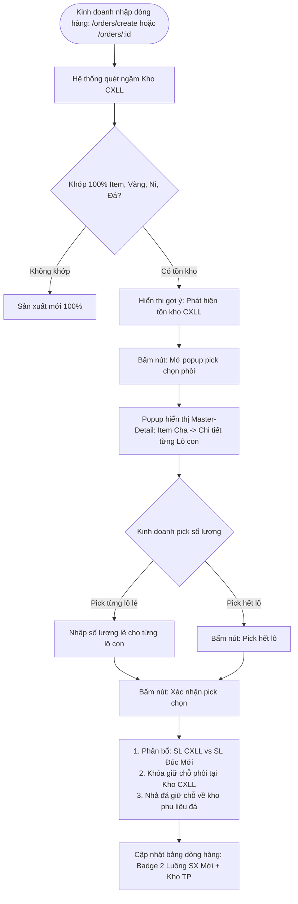

# US-DH-04: Gán Phôi Chờ Xử Lý Lại (CXLL) Vào Đơn Hàng Khi Tạo Mới Hoặc Chỉnh Sửa

> **Mã Story:** `US-DH-04`  
> **Epic:** Epic 02: Quản Trị Đơn Hàng (SO)  
> **Module / Feature:** Quản Lý Đơn Hàng / Gán Phôi Kho Chờ Xử Lý Lại  
> **Actor chính:** Nhân viên Kinh doanh (Sales) / Cán bộ Quản lý đơn hàng (Sale Admin)  
> **Tài liệu tham chiếu:** [Prototype Chi Tiết Đơn Hàng: /orders/SO2608011](http://localhost:3000/orders/SO2608011)  
> **Trạng thái:** `Ready for Review`  

---

## 1. USER STORY *

*   **Là một (As a):** Nhân viên Kinh doanh (Sales) / Sale Admin
*   **Tôi muốn (I want):** 
    1. Khi tạo đơn hàng mới (`/orders/create`) hoặc khi chỉnh sửa đơn hàng (`/orders/[id]`), hệ thống tự động nhận diện nếu có sản phẩm trùng khớp 100% trong Kho Thành Phẩm Chờ Xử Lý Lại (CXLL) và hiển thị chỉ báo gợi ý cho phép pick vào đơn.
    2. Popup gán phôi (`WarehouseSyncPopup`) hiển thị theo phân cấp rõ ràng: Item Cha ➔ Các Lô con (≤ 10 món/lô), cho phép tùy chọn pick số lượng cho từng lô lẻ hoặc pick hết lô.
    3. Hệ thống hỗ trợ phân bổ linh hoạt (Split Allocation): Nếu khách đặt số lượng lớn hơn số lượng tồn phôi CXLL, phần lấy phôi CXLL được tách riêng, và phần còn lại tự động đưa sang luồng sản xuất mới hoàn toàn.
    4. Ngay khi xác nhận gán: Hệ thống tự động khóa giữ chỗ (`Allocated`) phôi tại Kho CXLL và **nhả 100% lượng đá giữ chỗ tương ứng** về kho phụ liệu đá khả dụng.
*   **Để (So that):** Tận dụng tối đa thành phẩm có sẵn trong kho, rút ngắn thời gian giao hàng từ 10-15 ngày xuống còn 1-2 ngày, tiết kiệm chi phí đúc mới và tránh giam giữ đá ảo.

---

## 2. TIÊU CHÍ CHẤP NHẬN (ACCEPTANCE CRITERIA - AC) *

*   **AC 1: Nhận diện tự động & Gợi ý khớp 100% thuộc tính**
    *   **Given (Biết rằng):** Kinh doanh vừa nhập xong dòng hàng: Mã Item, Tuổi vàng, Ni tay/Size, Màu đá.
    *   **When (Khi):** Hệ thống quét Kho CXLL và phát hiện có phôi khớp 100% thuộc tính.
    *   **Then (Thì):** Dòng hàng hiển thị banner gợi ý màu xanh ngọc: *"💡 Phát hiện tồn kho CXLL: Có sẵn M món khớp 100% thuộc tính. [Mở popup pick chọn]"*.

*   **AC 2: Tùy chọn số lượng từng Lô con trong Popup mở rộng**
    *   **Biết rằng (Given):** Người dùng mở popup `WarehouseSyncPopup`.
    *   **When (Khi):** Người dùng nhập số lượng lẻ cho từng lô con (≤ 10 món/lô) hoặc bấm nút `[⚡ Pick hết lô]`.
    *   **Then (Thì):** Hệ thống tự động tính toán: Tổng SL pick kho CXLL và SL còn lại chuyển sang Sản xuất mới.

*   **AC 3: Khóa giữ chỗ phôi & Nhả đá kho phụ liệu**
    *   **Biết rằng (Given):** Người dùng bấm `[Xác nhận pick chọn M món]`.
    *   **Then (Thì):** M món phôi trong Kho CXLL chuyển sang trạng thái `Đã giữ chỗ` (kèm mã SO mới).
    *   **And (Và):** Hệ thống lập tức phát lệnh nhả $M$ suất đá giữ chỗ về lại Kho Đá khả dụng.

*   **AC 4: Cho phép gán phôi cả khi Tạo mới và khi Chỉnh sửa đơn**
    *   **Given (Biết rằng):** Đơn hàng đang ở màn hình Tạo mới (`/orders/create`) hoặc Chỉnh sửa (`/orders/[id]`).
    *   **Then (Thì):** Tính năng quét và gán phôi CXLL hoạt động đồng nhất, hỗ trợ Bán hàng tối ưu tồn kho ở mọi khâu tiền sản xuất.

---

## 3. THIẾT KẾ (UX/UI) *

*   **Link Figma / Prototype:** [Chi Tiết Đơn Hàng SO2608011: /orders/SO2608011](http://localhost:3000/orders/SO2608011)
*   **Ảnh đính kèm:**
    *   *Popup chi tiết mặt hàng trong Kho CXLL và pick chọn theo cấp Lô:*

---

## 4. QUY TẮC NGHIỆP VỤ (BUSINESS RULES) *

*   **BR-DH-01 (Exact Match 100%):** Bắt buộc khớp đồng thời 4 thuộc tính kỹ thuật: Mã Item, Tuổi vàng, Ni tay/Size, Quy cách đá. Tuyệt đối không nong/cắt ni hay cạy đá.
*   **BR-DH-02 (Cấp Lô nhỏ $\le 10$ món):** Phản ánh đúng thực tế xưởng kim hoàn, mỗi lô trong kho thường $\le 10$ món. Popup phải hỗ trợ pick từ nhiều lô khác nhau.
*   **BR-DH-03 (Split Allocation Mandatory):** Khi $\text{SL Đặt} > \text{SL Tồn CXLL}$, hệ thống bắt buộc phân bổ: Tối đa số lượng kho có sẵn và phần thiếu hụt chuyển sang sản xuất mới.
*   **BR-DH-04 (Stone Delta Release):** Tự động nhả số lượng đá giữ chỗ tương ứng với số lượng phôi lấy từ kho CXLL về kho phụ liệu đá khả dụng.

---

## 5. DANH MỤC DỮ LIỆU & RÀNG BUỘC

### 5.1 Popup Gán Phôi Kho CXLL (`WarehouseSyncPopup`)

| Fields (Tên trường) | Type (Kiểu dữ liệu) | Required (Bắt buộc) | Default value (Giá trị mặc định) | Rules (Quy tắc & Nghiệp vụ) |
| :--- | :--- | :---: | :--- | :--- |
| **Mã Item & Thuộc tính** | Text | Có | Kế thừa | Mã 30 ký tự, Tên sản phẩm, Ni tay, Đá. |
| **Mã Lô (Bag)** | Text / Font-mono | Có | Kế thừa | Định danh lô cũ trong kho (VD: `SO-260800001`). |
| **Mã Đơn Cũ** | Text / Font-mono | Có | Kế thừa | Mã đơn hàng cũ bị hủy (VD: `SO123456`). |
| **SL Tồn Của Lô** | Integer | Có | Kế thừa | Số lượng phôi sẵn có trong lô ($\le 10$ món). |
| **SL Pick Chọn** | Stepper / Integer | Có | `0` (hoặc FIFO) | Cho phép nhập lẻ ($0 \le \text{SL} \le \text{Tồn Lô}$) hoặc bấm tăng giảm stepper. |
| **Tổng SL Pick Kho** | Integer | Tự tính | Tổng các lô pick | Tự động cập nhật realtime khi thay đổi số lượng từng lô. |
| **SL Còn Lại SX Mới** | Integer | Tự tính | `SL Đặt - Pick Kho` | Tự động chuyển sang Luồng Sản Xuất Mới. |

---

## 6. LUỒNG NGHIỆP VỤ (MERMAID FLOW)

