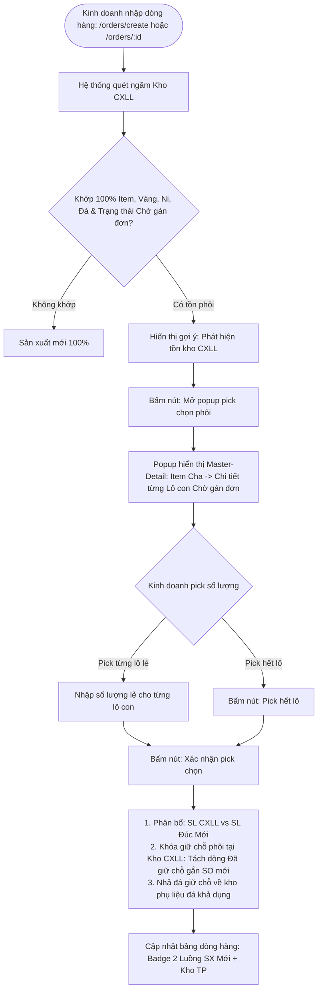

# US-ENH-01: Chọn Item Trong Kho Thành Phẩm Chờ Xử Lý Lại (CXLL) Vào Đơn Hàng

> **Mã Story:** `US-ENH-01` (Kế thừa / Alias: `US-DH-04`)  
> **Epic:** Epic 02: Quản Trị Đơn Hàng (SO) & CS5.Epic 3: Chờ Xử Lý Lại  
> **Module / Feature:** Quản Lý Đơn Hàng / Gán Phôi Kho Chờ Xử Lý Lại  
> **Actor chính:** Nhân viên Kinh doanh (Sales) / Cán bộ Quản lý đơn hàng (Sale Admin)  
> **Tài liệu tham chiếu:** [Prototype Chi Tiết Đơn Hàng: /orders/SO2608011](https://dungseva.vercel.app/orders/SO2608011)  
> **Trạng thái:** `Ready for Confluence Publish`  

---

## 1. USER STORY *

* **Là một (As a):** Nhân viên Kinh doanh (Sales) / Sale Admin
* **Tôi muốn (I want):** 
    1. Khi tạo đơn hàng mới (`/orders/create`) hoặc khi chỉnh sửa đơn hàng (`/orders/[id]`), hệ thống tự động nhận diện nếu có sản phẩm trùng khớp 100% trong Kho Thành Phẩm Chờ Xử Lý Lại (CXLL) ở trạng thái **`Chờ gán đơn`** và hiển thị banner chỉ báo gợi ý cho phép pick vào đơn.
    2. Popup gán phôi (`WarehouseSyncPopup`) hiển thị theo phân cấp rõ ràng: Item Cha ➔ Chi tiết từng Lô con (≤ 10 món/lô), chỉ hiển thị các dòng phôi ở trạng thái **`Chờ gán đơn`** (ẩn 100% các dòng đã giữ chỗ hoặc chờ chuyển bag để chống pick trùng).
    3. Hỗ trợ phân bổ linh hoạt (Split Allocation): Nếu khách đặt số lượng lớn hơn số lượng tồn phôi CXLL, phần lấy phôi CXLL được tách riêng, và phần còn lại tự động đưa sang luồng sản xuất mới hoàn toàn.
    4. Ngay khi xác nhận gán: Hệ thống tự động chuyển dòng phôi tại Kho CXLL sang trạng thái **`Đã giữ chỗ`** (gắn mã SO mới), đồng thời **nhả 100% lượng đá giữ chỗ tương ứng** về kho phụ liệu đá khả dụng.
    5. Toàn bộ trọng lượng kim loại, đá (Stamp) và tổng trọng lượng của phôi khi gán vào đơn hàng được bảo toàn chính xác theo chuẩn **4 số sau dấu thập phân** (ví dụ: `0.0012`, `0.0123`, `0.0004`...).
* **Để (So that):** Tận dụng tối đa thành phẩm có sẵn trong kho, rút ngắn thời gian giao hàng từ 10-15 ngày xuống còn 1-2 ngày, tiết kiệm chi phí đúc mới và tránh giam giữ đá ảo.

---

## 2. TIÊU CHÍ CHẤP NHẬN (ACCEPTANCE CRITERIA - AC) *

* **AC 1: Nhận diện tự động & Gợi ý khớp 100% thuộc tính**
  * **Given (Biết rằng):** Kinh doanh vừa nhập xong dòng hàng: Mã Item, Tuổi vàng, Ni tay/Size, Màu đá.
  * **When (Khi):** Hệ thống quét Kho CXLL và phát hiện có phôi khớp 100% thuộc tính đang ở trạng thái `Chờ gán đơn`.
  * **Then (Thì):** Dòng hàng hiển thị banner gợi ý màu xanh ngọc: *"💡 Phát hiện tồn kho CXLL: Có sẵn M món khớp 100% thuộc tính. [Mở popup pick chọn]"*.

* **AC 2: Tùy chọn số lượng từng Lô con trong Popup mở rộng**
  * **Given (Biết rằng):** Người dùng mở popup `WarehouseSyncPopup`.
  * **When (Khi):** Người dùng nhập số lượng lẻ cho từng lô con (≤ 10 món/lô) hoặc bấm nút `[⚡ Pick hết lô]`.
  * **Then (Thì):** Hệ thống tự động tính toán tức thì: Tổng SL pick kho CXLL và SL còn lại chuyển sang Sản xuất mới.

* **AC 3: Khóa giữ chỗ phôi & Tách dòng tại Kho CXLL**
  * **Given (Biết rằng):** Người dùng bấm `[Xác nhận pick chọn M món]`.
  * **Then (Thì):** Tại Kho CXLL:
    * Nếu pick toàn bộ số lượng dòng phôi (M = K): Dòng phôi đó chuyển trạng thái từ `Chờ gán đơn` sang `Đã giữ chỗ`, hiển thị link SO mới và khách hàng mới.
    * Nếu pick một phần số lượng dòng phôi (M < K): Dòng phôi tự động tách thành 2 dòng: 1 dòng `Đã giữ chỗ` với M pcs (gắn SO mới) và 1 dòng `Chờ gán đơn` với (K - M) pcs còn lại.
  * **And (Và):** Hệ thống lập tức phát lệnh nhả M suất đá giữ chỗ về lại Kho Đá khả dụng.

* **AC 4: Cho phép gán phôi cả khi Tạo mới và khi Chỉnh sửa đơn**
  * **Given (Biết rằng):** Đơn hàng đang ở màn hình Tạo mới (`/orders/create`) hoặc Chỉnh sửa (`/orders/[id]`).
  * **Then (Thì):** Tính năng quét và gán phôi CXLL hoạt động đồng nhất, hỗ trợ Bán hàng tối ưu tồn kho ở mọi khâu tiền sản xuất.

* **AC 5: Chuẩn hóa 4 số thập phân và bảo toàn mã Stamp**
  * **Given (Biết rằng):** Phôi CXLL được gán vào đơn hàng.
  * **Then (Thì):** Trọng lượng kim loại, trọng lượng đá và tổng trọng lượng trên chi tiết dòng hàng hiển thị chuẩn đúng 4 chữ số sau dấu thập phân (`#.####`, ví dụ: `0.0130 L`, `0.0004 L`, `0.0134 L`). Mã Stamp đi kèm được bảo toàn đúng theo quy cách: `Số Stamp = TL Đá × 1000`.

---

## 3. THIẾT KẾ (UX/UI) *

* **Link Prototype Chi Tiết Đơn Hàng:** [https://dungseva.vercel.app/orders/SO2608011](https://dungseva.vercel.app/orders/SO2608011)
* **Bố cục Popup Gán Phôi (`WarehouseSyncPopup`):**
  - Khung thông tin Item cha: Mã Item 30 ký tự, Tuổi vàng, Ni tay, Màu đá, Tổng tồn khả dụng CXLL.
  - Danh sách các Lô con (≤ 10 món/lô): Mã Lô, Mã SO cũ, Khách hàng cũ, Tồn khả dụng, Ô nhập SL pick (stepper), Mã Stamp, Trọng lượng chuẩn 4 số sau thập phân.
  - Thanh tổng kết dưới đáy: Tổng SL đặt, Tổng SL pick kho CXLL (badge xanh), SL còn lại chuyển Sản xuất mới (badge cam), Nút `[Hủy]` và Nút `[Xác nhận pick chọn phôi]`.

---

## 4. QUY TẮC NGHIỆP VỤ (BUSINESS RULES) *

* **BR-DH-01 (Exact Match 100%):** Bắt buộc khớp đồng thời 4 thuộc tính kỹ thuật: Mã Item, Tuổi vàng, Ni tay/Size, Quy cách đá. Tuyệt đối không nong/cắt ni hay cạy đá.
* **BR-DH-02 (Cấp Lô nhỏ ≤ 10 món):** Phản ánh đúng thực tế xưởng kim hoàn, mỗi lô trong kho thường ≤ 10 món. Popup phải hỗ trợ pick từ nhiều lô khác nhau.
* **BR-DH-03 (Chỉ hiển thị dòng Chờ gán đơn):** Popup gán phôi chỉ quét và hiển thị các dòng phôi đang ở trạng thái `Chờ gán đơn`. Tuyệt đối không hiển thị các dòng `Đã giữ chỗ` hoặc `Chờ chuyển bag` để triệt tiêu nguy cơ pick trùng.
* **BR-DH-04 (Split Allocation Mandatory):** Khi `SL Đặt > SL Tồn CXLL`, hệ thống bắt buộc phân bổ: Tối đa số lượng kho có sẵn và phần thiếu hụt tự động chuyển sang luồng sản xuất mới.
* **BR-DH-05 (Stone Delta Release):** Tự động nhả số lượng đá giữ chỗ tương ứng với số lượng phôi lấy từ kho CXLL về kho phụ liệu đá khả dụng ngay khi xác nhận gán đơn.
* **BR-DH-06 (Quy chuẩn Stamp và Trọng lượng 4 số thập phân):** 
  - `Số Stamp = TL Đá × 1000` (ví dụ: `TL Đá = 0.0004` ➔ `Stamp = 0.4`; `TL Đá = 0.0012` ➔ `Stamp = 1.2`).
  - Mọi thông số trọng lượng kim loại, đá và tổng trọng lượng lấy chuẩn 4 số sau dấu thập phân.

---

## 5. DANH MỤC DỮ LIỆU & RÀNG BUỘC

### 5.1 Popup Gán Phôi Kho CXLL (`WarehouseSyncPopup`)

| Fields (Tên trường) | Type (Kiểu dữ liệu) | Required (Bắt buộc) | Default value (Giá trị mặc định) | Rules (Quy tắc & Nghiệp vụ) |
| :--- | :--- | :---: | :--- | :--- |
| **Mã Item & Thuộc tính** | Text | Có | Kế thừa | Mã 30 ký tự, Tên sản phẩm, Ni tay, Đá. |
| **Mã Lô (Bag)** | Text / Font-mono | Có | Kế thừa | Định danh lô cũ trong kho (VD: `SO-260800063`). |
| **Mã Đơn Cũ** | Text / Font-mono | Có | Kế thừa | Mã đơn hàng cũ bị hủy (VD: `SO123456`). |
| **Mã Stamp** | Text | Có | Kế thừa | Mã Stamp: `Số Stamp = TL Đá × 1000` (VD: `0.4`, `1.2`, `15`...). |
| **SL Tồn Của Lô** | Integer | Có | Kế thừa | Số lượng phôi sẵn có trong lô ở trạng thái `Chờ gán đơn` (≤ 10 món). |
| **SL Pick Chọn** | Stepper / Integer | Có | `0` (hoặc FIFO) | Cho phép nhập lẻ (0 ≤ SL ≤ Tồn Lô) hoặc bấm tăng giảm stepper. |
| **Tổng SL Pick Kho** | Integer | Tự tính | Tổng các lô pick | Tự động cập nhật realtime khi thay đổi số lượng từng lô. |
| **SL Còn Lại SX Mới** | Integer | Tự tính | `SL Đặt - Pick Kho` | Tự động chuyển sang Luồng Sản Xuất Mới. |
| **TL Kim Loại (L)** | Decimal (4 số lẻ) | Có | Kế thừa / Tỷ lệ | Trọng lượng kim loại chuẩn 4 số sau thập phân. |
| **TL Đá (L)** | Decimal (4 số lẻ) | Có | Kế thừa / Tỷ lệ | Trọng lượng đá chuẩn 4 số sau thập phân. Nếu = 0 hiển thị `0.0000`. |
| **Tổng TL (L)** | Decimal (4 số lẻ) | Có | Kế thừa / Tỷ lệ | Tổng trọng lượng chuẩn 4 số sau thập phân (`TL Kim loại + TL Đá`). |

---

## 6. LUỒNG NGHIỆP VỤ (MERMAID FLOW)

