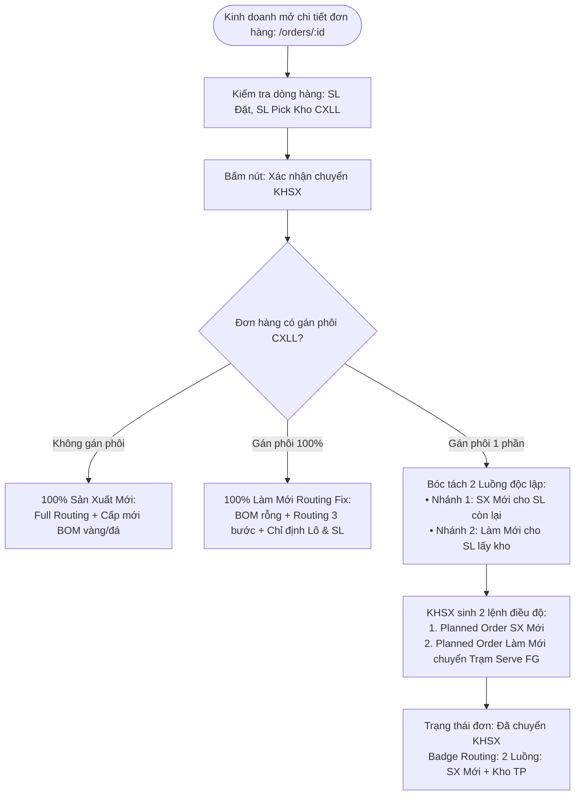

# US-DH-05: Xác Nhận Chuyển KHSX & Phân Tách 2 Luồng (SX Mới vs Làm Mới Routing Fix)

> **Mã Story:** `US-DH-05`  
> **Epic:** Epic 02: Quản Trị Đơn Hàng (SO) & Kế Hoạch Sản Xuất (PP)  
> **Module / Feature:** Quản Lý Đơn Hàng / Xác Nhận Chuyển KHSX & Điều Độ 2 Luồng  
> **Actor chính:** Cán bộ Quản lý đơn hàng (Sale Admin) / Cán bộ KHSX  
> **Tài liệu tham chiếu:** [Prototype Modal Kế Hoạch 2 Luồng: /orders/SO2608011](http://localhost:3000/orders/SO2608011)  
> **Trạng thái:** `Ready for Review`  

---

## 1. USER STORY *

*   **Là một (As a):** Cán bộ Quản lý Đơn hàng (Sale Admin) / Nhân viên Kinh doanh (Sales)
*   **Tôi muốn (I want):** 
    1. Tại màn hình **Chi tiết đơn hàng (`/orders/[id]`)**, sau khi đã hoàn tất việc gán phôi từ Kho Chờ Xử Lý Lại (CXLL) và kiểm tra các điều kiện thương mại, tôi có thể bấm nút **`[Xác nhận chuyển KHSX]`**.
    2. Hệ thống tự động phân tách dòng sản phẩm của đơn hàng thành **2 luồng công việc rõ ràng**:
       - **Luồng 1 (Sản xuất mới - New Production):** Cho phần số lượng còn thiếu chưa có phôi. Áp dụng Full Routing sản xuất tiêu chuẩn (22 công đoạn từ Sáp, Đúc, Nguội, Gắn đá, Đánh bóng, Xi mạ đến KCS), cấp mới vàng và đá theo BOM.
       - **Luồng 2 (Làm mới - Rework / Routing Fix):** Cho phần số lượng đã gán từ phôi CXLL. Ghi rõ đầy đủ 3 thông tin tác nghiệp:
         * **Routing Fix (3 bước):** `WC-0087: Serve FG` → `WC-0013: Stamping` → `WC-0023: Packing Out`.
         * **Lô nào:** Chỉ định chính xác Mã Lô / Mã Bag cũ từ Kho CXLL đã được pick.
         * **Số lượng bao nhiêu (Qty):** Chỉ định chính xác số lượng lấy từ từng lô cũ.
    3. Cung cấp **Modal Xem Kế Hoạch Sản Xuất 2 Luồng** để tôi và bộ phận KHSX có thể xem trực quan thông số phân bổ, tiến độ và danh sách các lô phôi được gán.
*   **Để (So that):** Minh bạch luồng lệnh sản xuất chuyển xuống nhà xưởng, tách bạch định mức vật tư giữa hàng đúc mới và hàng làm mới, tránh thất thoát vàng đá và rút ngắn chu kỳ sản xuất tối đa.

---

## 2. TIÊU CHÍ CHẤP NHẬN (ACCEPTANCE CRITERIA - AC) *

*   **AC 1: Bấm nút Xác nhận chuyển KHSX**
    *   **Given (Biết rằng):** Đơn hàng đang ở trạng thái tiền sản xuất (`Chờ Kỹ thuật` hoặc `Đủ thông tin KT`).
    *   **When (Khi):** Bán hàng bấm nút **`[Xác nhận chuyển KHSX]`**.
    *   **Then (Thì):** Trạng thái đơn hàng chuyển sang `Đã chuyển KHSX` và đẩy dữ liệu sang phân hệ KHSX.

*   **AC 2: Tự động phân tách 2 luồng công việc rõ ràng**
    *   **Biết rằng (Given):** Dòng sản phẩm có số lượng đặt là 10 món, đã gán 8 món phôi CXLL.
    *   **Then (Thì):** Hệ thống phân tách thành:
        - Luồng 1 (SX Mới): 2 món (Full Routing 22 bước, cấp mới vàng định mức và đá theo BOM).
        - Luồng 2 (Làm Mới): 8 món (Routing Fix 3 bước: `Serve FG` → `Stamping` → `Packing Out`).

*   **AC 3: Ghi rõ thông tin Lô nào và Số lượng bao nhiêu cho Luồng Làm Mới**
    *   **Given (Biết rằng):** Người dùng mở Modal Kế Hoạch Sản Xuất 2 Luồng.
    *   **Then (Thì):** Tại cột `Luồng Kho Thành Phẩm`, hệ thống hiển thị danh sách chi tiết:
        - Tên công đoạn Routing Fix 3 bước.
        - Khối danh sách các Lô hàng đã gán: Mã Lô (LotCode), Mã SO cũ và Số lượng món pick của từng lô.

*   **AC 4: Bàn giao lệnh sang Trạm Cấp Thành Phẩm (Serve FG)**
    *   **Given (Biết rằng):** Lệnh KHSX làm mới được phê duyệt.
    *   **Then (Thì):** Thông tin các lô làm mới tự động xuất hiện tại màn hình Trạm Cấp TP (`/inventory/reprocess/serve`) để Thủ kho chuẩn bị xuất phôi và in Thẻ Bag KHSX mới.

---

## 3. THIẾT KẾ (UX/UI) *

*   **Link Figma / Prototype:** [Modal Kế Hoạch Sản Xuất 2 Luồng: /orders/SO2608011](http://localhost:3000/orders/SO2608011)
*   **Ảnh đính kèm:**
    *   *Modal hiển thị phân bổ 2 Luồng: SX Mới vs Kho TP (Routing Fix 3 bước, chi tiết từng Lô và Số lượng):*

---

## 4. QUY TẮC NGHIỆP VỤ (BUSINESS RULES) *

*   **BR-KHSX-01 (Công thức phân bổ số lượng):** $\text{SL SX Mới} = \max(0, \text{SL Đặt} - \text{SL Pick Kho CXLL})$. $\text{SL Làm Mới} = \text{Tổng SL Pick từ các Lô CXLL}$.
*   **BR-KHSX-02 (Routing Fix 3 Bước):** Phôi CXLL bắt buộc áp dụng Routing Fix:
    1. `WC-0087: Serve FG` (Cấp thành phẩm tại Kho TP).
    2. `WC-0013: Stamping` (Khắc logo mới, tuổi vàng, khắc mã stamp theo TL đá, tẩy xi).
    3. `WC-0023: Packing Out` (Hoàn thiện đóng gói, dán tem vỉ SO mới, nhập kho giao hàng).
*   **BR-KHSX-03 (BOM Rỗng Luồng Làm Mới):** Tuyệt đối không sinh định mức cấp mới vàng đúc và đá cho phần hàng phôi CXLL.
*   **BR-KHSX-04 (Quyền chuyển KHSX):** Quyền bấm nút `[Xác nhận chuyển KHSX]` thuộc về bộ phận Bán hàng / QLĐH sau khi kiểm tra đầy đủ điều kiện thương mại và kỹ thuật.

---

## 5. DANH MỤC DỮ LIỆU & RÀNG BUỘC

### 5.1 Modal Kế Hoạch Sản Xuất 2 Luồng

| Fields (Tên trường) | Type (Kiểu dữ liệu) | Required (Bắt buộc) | Default value (Giá trị mặc định) | Rules (Quy tắc & Nghiệp vụ) |
| :--- | :--- | :---: | :--- | :--- |
| **Mã Đơn Hàng (SO)** | Text / Font-mono | Có | Kế thừa | Mã đơn hàng mới (VD: `SO2608011`). |
| **Mã Item** | Text / Font-mono | Có | Kế thừa | Mã 30 ký tự của dòng hàng. |
| **SL Đặt** | Integer | Có | Kế thừa | Tổng số lượng khách đặt (VD: `10 món`). |
| **SL SX Mới** | Integer | Tự tính | `0` | Số lượng chuyển sang đúc mới hoàn toàn. |
| **Routing SX Mới** | Text | Có | Kế thừa QLSP | Full Routing tiêu chuẩn (Đúc → Nguội → Đá → Đánh bóng → Xi → KCS). |
| **SL Làm Mới (Kho TP)** | Integer | Tự tính | `0` | Số lượng tận dụng từ phôi CXLL. |
| **Routing Làm Mới** | Text | Cố định | Routing Fix | Gồm đúng 3 bước: `Serve FG` → `Stamping` → `Packing Out`. |
| **Chi Tiết Lô Gán** | Array / List | Có | Danh sách lô | Gồm: `Mã Lô`, `Mã SO Cũ`, `SL Pick Của Lô` (hiển thị font-mono). |

---

## 6. LUỒNG NGHIỆP VỤ (MERMAID FLOW)

