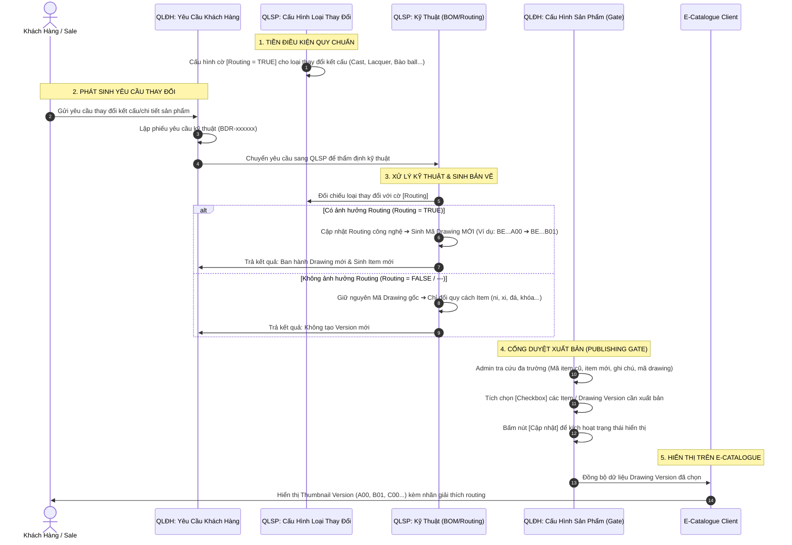

# US-EC-01: Cấu Hình và Xuất Bản Phiên Bản Bản Vẽ (Drawing Version) lên E-Catalogue qua Luồng Liên Phân Hệ (QLĐH ⟷ QLSP)

> **Mã Story:** `US-EC-01`  
> **Epic:** Quản lý Phiên bản Thiết kế & Xuất bản E-Catalogue Chào Hàng (E-Catalogue Design Version Management)  
> **Phân hệ áp dụng:** Quản lý sản phẩm (QLSP) ⟷ Quản lý đơn hàng (QLĐH) ⟷ E-Catalogue (EC)  
> **Đối tượng tác nghiệp:** Kỹ thuật trưởng (QLSP), Nhân viên Bán hàng / CS (QLĐH), Quản trị viên E-Catalogue (Admin EC), Khách hàng sỉ / Sale chào hàng (EC Client)  

---

## 1. Tóm tắt User Story (User Story Statements)

### Câu chuyện tổng quát (Epic-level User Story)
> **AS AN** Quản trị viên Hệ thống / Quản lý Đơn hàng,  
> **I WANT TO** kiểm soát chặt chẽ các loại thay đổi kỹ thuật có ảnh hưởng đến Routing tại QLSP và chủ động chọn lọc các Item / Drawing Version hợp lệ tại màn hình Cấu hình sản phẩm của QLĐH,  
> **SO THAT** E-Catalogue chỉ hiển thị đúng các phiên bản bản vẽ đã được duyệt thương mại, giúp khách hàng và nhân viên kinh doanh dễ dàng tham khảo, so sánh và nhận biết sự khác biệt giữa các version (như Cast, Đắp lacquer, Bào ball) mà không bị nhiễu bởi các biến thể quy cách thông thường (ni, màu xi, loại đá, loại khóa).

### Bộ chi tiết User Stories thành phần (Detailed User Stories)

| Mã Story | Vai trò (As a) | Hành động mong muốn (I want to) | Giá trị mang lại (So that) |
| :--- | :--- | :--- | :--- |
| **US-EC-01.1** | Kỹ thuật trưởng (QLSP) | Cấu hình cờ `Routing` cho từng Loại thay đổi tại màn hình `Cấu hình loại thay đổi` | Hệ thống tự động xác định các yêu cầu kỹ thuật nào làm thay đổi quy trình công nghệ để sinh Mã Drawing mới (11 ký tự), làm nguồn tạo Version cho E-Catalogue. |
| **US-EC-01.2** | Chuyên viên Bán hàng / CS (QLĐH) | Ghi nhận phiếu Yêu cầu kỹ thuật từ khách hàng (BDR-xxxxxx) và gửi sang QLSP cập nhật BOM/Routing | Đảm bảo mọi thay đổi sản phẩm từ khách hàng đều được phòng Kỹ thuật thẩm định và ban hành bản vẽ mới chuẩn xác. |
| **US-EC-01.3** | Quản trị viên EC / QLĐH | Tra cứu linh hoạt (theo item cũ, item mới, ghi chú, mã drawing) và tích chọn (checkbox) các Item / Version tại màn hình `Cấu hình sản phẩm` | Kiểm soát cổng xuất bản (Publishing Gate), chỉ đưa các phiên bản đạt chuẩn thương mại lên E-Catalogue chào hàng. |
| **US-EC-01.4** | Khách hàng / Sale chào hàng | Xem danh sách thumbnail Drawing Version kèm tooltip giải thích thay đổi routing trên trang chi tiết sản phẩm E-Catalogue | Nắm rõ lịch sử cải tiến thiết kế, so sánh trực quan và đặt hàng đúng phiên bản mong muốn. |

---

## 2. Luồng Nghiệp Vụ Liên Phân Hệ (End-to-End Business Flow)

---

## 3. Ma Trận Quy Tắc Nghiệp Vụ Cốt Lõi (First Principles Matrix)

| Nhóm Yêu Cầu Thay Đổi | Loại Thay Đổi Tiêu Biểu | Cờ Routing (QLSP) | Làm Đổi Mã Drawing? | Sinh Version Trên E-Catalogue? | Hành Xử Của Hệ Thống |
| :--- | :--- | :---: | :---: | :---: | :--- |
| **Thay đổi Kết Cấu & Công Nghệ** | `B` - Cast (thay khuôn đúc) `C` - Đắp lacquer - móc máy `F` - Thay Pearl sang Ball `I` - Thay kiểu bào ball | **BẬT (TRUE)** | **CÓ** (Đổi 3 ký tự đuôi của Mã Drawing: `A00` $\rightarrow$ `B01`) | **CÓ (ĐỦ ĐIỀU KIỆN)** | • QLSP sinh Mã Drawing mới. • Đưa vào danh sách chờ duyệt tại `QLĐH > Cấu hình sản phẩm`. • Hiển thị thành Version lựa chọn trên E-Catalogue khi Admin tích chọn. |
| **Thay đổi Quy Cách Thương Mại** | `D` - Thay Khóa dây/lắc `G` - Thay kích thước dây HTJ `H` - Thay kích thước ball `N` - Thay màu dây • Thay đổi Ni (Size nhẫn) • Thay đổi Màu xi (Vàng/Trắng/Hồng) • Khắc Laser tên riêng | **TẮT (FALSE / ---)** | **KHÔNG** (Giữ nguyên 11 ký tự Mã Drawing gốc) | **KHÔNG TẠO VERSION** | • Chỉ thay đổi các ký tự option của Mã Item (30 ký tự). • Hiển thị dưới dạng bộ chọn Size / Màu xi tại từng món thành phần trên E-Catalogue, không tạo thêm Drawing Version. |

---

### 3.2. Quy Tắc Liên Kết Giữa "Yêu Cầu Thay Đổi" và "Yêu Cầu Thay Đổi Khác" Trên E-Catalogue

| Trường hợp lựa chọn trên E-Catalogue | Cấu hình tại Quản lý sản phẩm (`otherChangeConfig`) | Hành vi nút Checkbox "Yêu cầu thay đổi khác" | Hành vi ô nhập mô tả (Textarea) |
| :--- | :--- | :--- | :--- |
| **Yêu cầu thay đổi = "Khác"** | Áp dụng trực tiếp cho option Khác | **ẨN nút checkbox** (tránh dư thừa vì bản thân lựa chọn đã là Khác) | **HIỂN THỊ TRỰC TIẾP** ô "Mô tả yêu cầu thay đổi *" (Bắt buộc nhập trước khi Thêm vào giỏ). |
| **Yêu cầu thay đổi = Loại thay đổi A** | Cấu hình = `Không được phép thay đổi` | **ẨN HOÀN TOÀN nút checkbox** | **ẨN** ô nhập mô tả. |
| **Yêu cầu thay đổi = Loại thay đổi B** | Cấu hình = `Được phép thay đổi` | **HIỂN THỊ nút checkbox** (Trạng thái tùy chọn / không bắt buộc) | Chỉ hiển thị khi người dùng tích chọn checkbox. |
| **Yêu cầu thay đổi = Loại thay đổi C** | Cấu hình = `Bắt buộc thay đổi` | **HIỂN THỊ nút checkbox** (Trạng thái BẮT BUỘC: tự động tích, có dấu `*` và badge `Bắt buộc`) | **LUÔN HIỂN THỊ** và BẮT BUỘC nhập mô tả trước khi Thêm vào giỏ. |
| **Yêu cầu thay đổi = "Không thay đổi"** | Mặc định hệ thống | **HIỂN THỊ nút checkbox** (Không bắt buộc) | Hiển thị khi người dùng tích chọn checkbox. |

---

### 3.3. Ma Trận Cấu Hình Thuộc Tính Thay Đổi (Chuẩn Excel Quản Trị Hệ Thống)

Dựa trên cấu hình phân loại thuộc tính thay đổi:
1. **Tùy chọn:** Yêu cầu thay đổi ở cột thuộc tính thể hiện ở dạng **dropdown**.
2. **Mô tả (Ghi chú):** Yêu cầu thay đổi ở cột thuộc tính thể hiện ở dạng **ghi chú** (chỉ có quyền tác nghiệp ở Admin).
3. **Cả tùy chọn và mô tả:** Vừa chọn dropdown vừa nhập text ghi chú (có checkbox để tích chọn yêu cầu thay đổi khác). **Nếu có nhập mô tả thì Giá công: "Tính giá sau"**.
4. **Quy tắc hiển thị trên E-Catalogue (E-C):**
   - Trên E-C **chỉ hiển thị các thuộc tính có tích chọn trong bảng (`showEC = true`) + Loại `'Khác'`**.
   - Khi chọn loại `'Khác'`: Hiển thị ô nhập mô tả thay đổi $\rightarrow$ Giá công chuyển thành: **"Tính giá sau"**.

| STT | Thuộc tính | Tùy chọn | Mô tả (Ghi chú) | Hiển thị E_C | Admin | Điều kiện / Ghi chú |
| :---: | :--- | :---: | :---: | :---: | :---: | :--- |
| **1** | **Màu xi** | **X** | | **X** | **X** | Thuộc tính cơ bản (Vàng, Trắng, Hồng, Hai màu) |
| **2** | **Màu đá chính** | **X** | | **X** | **X** | Thuộc tính cơ bản (Trắng, Đỏ, Xanh, Tím, Vàng, Hồng, Đen...) |
| **3** | **Kích thước** | **X** | | **X** | **X** | Thuộc tính cơ bản (Size Ni 14, 15, 16, 17, 18...) |
| **4** | **Khóa (khóa càng cua/mỏ vịt)** | **X** | | **X** | **X** | Chị Vy đưa lại cái tên khóa |
| **5** | **Tăng đơ (đổi/bỏ)** | **X** | | **X** | **X** | Đổi tăng đơ chữ nhật, tim, hoặc bỏ tăng đơ |
| **6** | **Kiểu bào ball** | **X** | | **X** | **X** | • Nhiều loại ball khác kích thước nhau thì không cho thay đổi kiểu bào • Chị Vy đưa lại tên kiểu bào + hình ảnh |
| **7** | **Thay kích thước dây HTJ (Tăng/giảm size)** | **X** | | **X** | **X** | Tăng/giảm size cỡ dây |
| **8** | **Màu dây (phụ liệu - vải,da)** | **X** | | | **X** | CNS đánh giá chỉ lấy cùng loại dây, cùng kích thước |
| **9** | **Đắp lacquer-móc máy** | **X** *(Móc máy / Lácquer / Móc máy + Lácquer)* | **X** | | **X** | Cả tùy chọn và mô tả: vừa chọn vừa nhập, có checkbox yêu cầu thay đổi khác $\rightarrow$ Nếu có nhập mô tả thì **Giá tính sau** |
| **10** | **Thay cast** | | **X** | | **X** | Khuôn đúc, ổ chấu (Chỉ Admin) |
| **11** | **Thay pearl sang ball** | | **X** | | **X** | Thay cấu trúc pearl sang ball kim loại (Chỉ Admin) |
| **12** | **Đá phụ** | | **X** | | **X** | Thay đổi đá phụ (loại đá, cách kết) (Chỉ Admin) |

---

### 3.4. Quy Tắc Tự Động Tách Đơn Hàng (Automatic Order Splitting) & Thẩm Định Kỹ Thuật Admin

Khi khách hàng / sale đặt hàng qua Giỏ hàng E-Catalogue hoặc Tạo đơn hàng:
- **Điều kiện kích hoạt tách đơn tự động:**
  Đơn hàng có sản phẩm có **Yêu cầu thay đổi là "Khác"** HOẶC **có nhập mô tả thay đổi khác**.
- **Hành vi tách đơn tự động của hệ thống:**
  Hệ thống tự động phân tách thành **2 mã đơn hàng SO độc lập**:
  1. **Đơn Hàng Tiêu Chuẩn (Mã: `SOxxxxxxx-STD`):**
     - Chứa các sản phẩm tiêu chuẩn (không có thay đổi khác).
     - Trạng thái: **`Chờ xác nhận`** (hoặc Đang xử lý).
     - Giá công: Đã tính theo đơn giá định mức tiêu chuẩn.
  2. **Đơn Hàng Gia Công Đặc Biệt (Mã: `SOxxxxxxx-CUSTOM`):**
     - Chứa các sản phẩm có Yêu cầu thay đổi khác hoặc chọn 'Khác'.
     - Trạng thái: **`Chờ xử lý`** (Pending Review).
     - Giá công: **`Tính giá sau`**.
- **Quyền hạn & Nghiệp vụ Quản trị viên (Admin) trên Đơn Chờ Xử Lý:**
  - Tại màn hình Chi tiết đơn hàng `/orders/[id]`:
  - Xuất hiện Alert Banner thông báo trạng thái Chờ xử lý kèm nút tác vụ: **`Tùy chọn thuộc tính kỹ thuật (Admin)`**.
  - Admin mở form/modal thẩm định và tùy chọn lại **5 thuộc tính kỹ thuật nội bộ đã được cấu hình trong bảng mà chưa có trên E-C**:
    1. `Màu dây (phụ liệu - vải,da)`: Chọn từ danh sách phụ liệu chuẩn.
    2. `Đắp lacquer-móc máy`: Chọn phương pháp (Móc máy / Lacquer / Cả hai) + Nhóm kỹ thuật (Nhóm 1, 2, 3) + Ghi chú chi tiết.
    3. `Thay cast`: Ghi chú kỹ thuật khuôn đúc, ổ chấu.
    4. `Thay pearl sang ball`: Ghi chú kỹ thuật bi kim loại.
    5. `Đá phụ`: Ghi chú kỹ thuật loại đá, số lượng, giác cắt, cách kết đá.
    6. **Định giá công chính thức (VNĐ):** Admin nhập số tiền công cụ thể (Ví dụ: `250,000đ`).
  - Sau khi Admin bấm **Lưu cấu hình**:
    * Đơn hàng tự động chuyển từ trạng thái `Chờ xử lý` sang **`Đủ thông tin KT`** (hoặc `Chờ xác nhận`).
    * Giá công chuyển từ nhãn `Tính giá sau` thành số tiền chính thức và tự động tính tổng tiền cho đơn hàng.

---

## 4. Đặc Tả Giao Diện & Dữ Liệu (Field Specifications)

### 4.1. Màn hình 1: Quản lý sản phẩm > Cấu hình loại thay đổi
*URL tham chiếu: `/product-management/change-types`*

| STT | Tên trường / Cột | Kiểu dữ liệu | Bắt buộc | Mô tả & Quy tắc hiển thị |
| :---: | :--- | :--- | :---: | :--- |
| 1 | **STT** | Số nguyên | Có | Đánh số thứ tự tăng dần. |
| 2 | **Mã loại** | Chuỗi (1 ký tự) | Có | Mã định danh phân loại: `B`, `C`, `D`, `F`, `G`, `H`, `I`, `N`... |
| 3 | **Tên loại thay đổi** | Chuỗi | Có | Tên mô tả: `Cast`, `Đắp lacquer - móc máy`, `Thay Khóa`, `Thay kiểu bào ball`... |
| 4 | **Loại sản phẩm** | Chuỗi | Có | Phạm vi chủng loại áp dụng (Vòng tay, Lắc tay, Nhẫn, Dây chuyền...). |
| 5 | **Nhập chi tiết thay đổi** | Boolean (Checkbox) | Tùy chọn | Bật trường nhập tự do "Mô tả thay đổi *" cho loại thay đổi. |
| 6 | **Chọn chi tiết thay đổi** | Boolean (Checkbox) | Tùy chọn | Bật dropdown chọn tùy biến (Nhóm kỹ thuật, Hiệu ứng bào, Phụ kiện...). |
| 7 | **Cấu hình thay đổi khác (EC)** *(Mới)* | Radio (3 tùy chọn) | Có | **Quy định hành vi checkbox trên E-Catalogue:** • `Không được phép thay đổi` $\rightarrow$ Ẩn nút checkbox trên EC. • `Được phép thay đổi` $\rightarrow$ Hiện nút checkbox (không bắt buộc). • `Bắt buộc thay đổi` $\rightarrow$ Hiện nút checkbox (bắt buộc tích & nhập mô tả). |
| 8 | **Thiết kế** | Boolean (Icon) | Có | Đánh dấu yêu cầu có cần phòng Thiết kế can thiệp hay không. |
| 9 | **BOM** | Boolean (Icon) | Có | Đánh dấu yêu cầu có làm thay đổi định mức nguyên vật liệu BOM. |
| 10 | **Routing (Trọng yếu)** | Boolean (Icon/Cờ) | Có | **Cờ quyết định cốt lõi:** • `Tích xanh (TRUE)`: Thay đổi ảnh hưởng quy trình công nghệ ➔ BẮT BUỘC đổi mã Drawing và làm nguồn sinh Version trên EC. • `--- (FALSE)`: Không ảnh hưởng Routing ➔ Không đổi mã Drawing. |
| 11 | **Hiện Admin / Hiện Client** | Boolean | Có | Quy định quyền xem trên giao diện nội bộ và khách hàng. |
| 12 | **Phạm vi mở rộng** | Chuỗi | Không | Ghi chú số nhóm kỹ thuật hoặc số Item phụ kiện liên quan. |
| 13 | **Thao tác** | Hành động | Có | Icon Sửa ✏️ (Mở Modal Cập nhật loại thay đổi), Xóa 🗑️. |

---

### 4.2. Màn hình 2: Quản lý đơn hàng > Danh sách Yêu cầu khách hàng
*URL tham chiếu: `/orders/customer-requests` (Khớp chuẩn dữ liệu thực tế từ video quản trị)*

| STT | Tên trường / Cột | Kiểu dữ liệu | Bắt buộc | Mô tả & Giá trị nghiệp vụ |
| :---: | :--- | :--- | :---: | :--- |
| 1 | **STT** | Số nguyên | Có | Đánh số thứ tự tăng dần. |
| 2 | **Mã yêu cầu kỹ thuật** | Chuỗi (Code) | Có | Mã định danh phiếu yêu cầu dạng `BDR-xxxxxx` (ví dụ: `BDR-000291`, `BDR-000287`). |
| 3 | **Mã đơn hàng** *(Mới)* | Chuỗi (Code) | Không | Mã đơn hàng phát sinh yêu cầu (ví dụ: `SO2610023`, `SO2610019`). Giúp BA & Sale biết yêu cầu thuộc đơn hàng nào. |
| 4 | **Tên khách hàng** *(Mới)* | Chuỗi | Có | Tên/Mã khách hàng sỉ đặt hàng (ví dụ: `200121 - SEVATECH`, `200105 - LUXURY GEMS`). |
| 5 | **Mã Drawing gốc** | Chuỗi (11 ký tự) | Có | Mã bản vẽ ban đầu của sản phẩm (ví dụ: `BE000148A00`, `BT000153A00`). |
| 6 | **Mã Item gốc** | Chuỗi (30 ký tự) | Có | Mã item 30 ký tự đầy đủ đang đặt (ví dụ: `GY0BE000148A00A00C00000CZWW1048`). |
| 7 | **Loại thay đổi** | Chuỗi / Enum | Có | Loại thay đổi kỹ thuật áp dụng (ví dụ: `A00`, `B - Cast`, `C - Đắp lacquer`, `D - Thay Khóa`). |
| 8 | **Người yêu cầu** | Chuỗi | Có | Tên nhân viên kinh doanh / CS tạo yêu cầu kèm Avatar. |
| 9 | **Ngày tạo** | Ngày & Giờ | Có | Format `DD/MM/YYYY HH:mm` (ví dụ: `14/10/2026 14:15`). |
| 10 | **Trạng thái** | Phân loại (Enum) | Có | • `Chờ xử lý` (Badge xám) • `Chờ thiết kế` (Badge cam) • `Đang xử lý` (Badge xanh dương) • `Hoàn thành` (Badge xanh lá) |
| 11 | **Mã Drawing mới** | Chuỗi (11 ký tự) | Không | • Hiển thị `---` nếu đang xử lý hoặc thay đổi không đổi Routing. • Hiển thị mã Drawing mới (ví dụ: `BE000148B01`, `BT000153B01`) khi kỹ thuật duyệt hoàn tất. |
| 12 | **Mã Item mới** *(Mới)* | Chuỗi (30 ký tự) | Không | Mã định danh Item 30 ký tự mới sinh ra sau khi áp dụng Drawing mới (ví dụ: `GW0BE000148B01A00C00000CZWW1048`). |

---

### 4.3. Màn hình 3: Quản lý đơn hàng > Cấu hình > Cấu hình sản phẩm (Publishing Gate)
*URL tham chiếu: `/orders/config-product` (Khớp chuẩn 18 cột dữ liệu thực tế và 2 Popup Modal từ video)*

| STT | Tên trường / Cột | Kiểu dữ liệu | Bắt buộc | Mô tả & Quy tắc hiển thị / Validation |
| :---: | :--- | :--- | :---: | :--- |
| 1 | **Checkbox Chọn** | Boolean | Có | Checkbox ở từng dòng và Checkbox Chọn tất cả ở header: Dùng để tích chọn item/version được xuất bản lên E-Catalogue. |
| 2 | **STT** | Số nguyên | Có | Thứ tự dòng trong bảng. |
| 3 | **Mã item** | Chuỗi (30 ký tự) | Có | Font mono, hiển thị mã item 30 ký tự chuẩn ERP (ví dụ: `PW0NE000172A00...`, `GY0NE000189B01...`). |
| 4 | **Mã drawing** | Chuỗi (11 ký tự) | Có | Font mono, hiển thị mã bản vẽ đại diện (ví dụ: `NE000172A00`, `NE000189B01`). |
| 5 | **Hình render** | Ảnh Thumbnail | Có | Ảnh render 3D sản phẩm. Click vào mở popup xem chi tiết sản phẩm. |
| 6 | **Hình 4view** | Ảnh Thumbnail | Có | Ảnh kỹ thuật 4 góc nhìn có huy hiệu `4V`. Click mở **Modal Hình ảnh 4 góc nhìn**. |
| 7 | **Loại sản phẩm** | Chuỗi | Có | Dây chuyền nữ, Nhẫn nữ, Lắc tay nữ, Bộ trang sức... |
| 8 | **Trọng lượng vàng** | Số thực (gam) | Có | Hiển thị chính xác đến 4 chữ số thập phân (ví dụ: `0.0783g`, `0.1025g`). |
| 9 | **Loại phụ liệu chính** | Chuỗi | Không | Loại đá/phụ liệu chính đính kèm (ví dụ: `CZ`, `Ngọc trai`). |
| 10 | **Loại phụ liệu phụ** | Chuỗi | Không | Loại phụ liệu phụ đính kèm (ví dụ: `CZ tấm`, `---`). |
| 11 | **Màu phụ liệu chính** *(Mới)* | Chuỗi | Không | Màu sắc của phụ liệu chính (ví dụ: `Trắng`, `Đỏ`, `Xanh dương`...). |
| 12 | **Màu phụ liệu phụ** *(Mới)* | Chuỗi | Không | Màu sắc của phụ liệu phụ (ví dụ: `Trắng`, `Vàng`...). |
| 13 | **Cấp đá** *(Mới)* | Chuỗi / Số | Không | Phân cấp chất lượng đá (ví dụ: `1`, `2`, `AAA`). |
| 14 | **Cột E-Catalogue** | Boolean (Icon) | Có | Checkbox xanh lá hiển thị trực tiếp trạng thái hiển thị trên E-Catalogue chào hàng. |
| 15 | **Ngày tạo** *(Mới)* | Ngày | Có | Format `DD/MM/YYYY` (ví dụ: `14/10/2026`). |
| 16 | **Người tạo** *(Mới)* | Chuỗi | Có | Họ tên nhân sự tạo bản ghi (ví dụ: `Lê Thân Diệu Yến`) kèm avatar. |
| 17 | **Trạng thái** *(Mới)* | Enum | Có | Trạng thái phát triển kỹ thuật (`Pending Approval`, `Making Sample`, `Unknown`, `Approved`). |
| 18 | **Actions (Chi tiết)** | Nút hành động | Có | Icon 4 ô vuông: Bấm mở **Modal Chi tiết sản phẩm** toàn diện. |

#### Bổ sung: Đặc tả 2 Modal tương tác chuẩn Video Admin thực tế

1. **Modal Hình ảnh 4 góc nhìn (4-View Modal - Kích hoạt khi bấm vào ô Hình 4view):**
   - Tiêu đề: `HÌNH ẢNH` (kèm mã Item và nút đóng `X`).
   - Bố cục 2x2 gồm đúng 4 góc nhìn kỹ thuật:
     * `1. Mặt trước` (Front View)
     * `2. Góc nghiêng` (Perspective View)
     * `3. Mặt sau` (Back View)
     * `4. Mặt bên` (Side View)
   - Từng ảnh có khung bo góc, zoom hover mượt mà và nhãn chú thích rõ ràng.

2. **Modal Chi tiết sản phẩm (Product Detail Modal - Kích hoạt khi bấm icon Actions hoặc click ảnh Render):**
   - Tiêu đề: `CHI TIẾT SẢN PHẨM` kèm nút đóng `X`.
   - Bố cục chia 2 phần:
     * **Cột hình ảnh:** 2 khung ảnh Render 3D & Bản vẽ 4view kỹ thuật.
     * **Bảng thông số kỹ thuật:** Trình bày dạng danh sách nhãn & giá trị tinh gọn gồm: `Mã item`, `Mã Drawing`, `Mã bộ`, `Loại sản phẩm`, `Bộ sưu tập`, `Nguyên liệu`, `Màu xi`, `Trọng lượng vàng`, `Loại phụ liệu chính / phụ`, `Màu phụ liệu chính / phụ`, `Cấp đá`, `Trạng thái`, `Ngày tạo`, `Người tạo`.

---

## 5. Tiêu Chí Chấp Nhận (Acceptance Criteria - Gherkin Format)

### AC 1: Phân loại tự động yêu cầu kỹ thuật theo cờ Routing (Happy Path - QLSP)
*   **Given:** Quản trị viên QLSP đã cấu hình loại thay đổi `C - Đắp lacquer - móc máy` có `Routing = TRUE`.
*   **When:** Phòng Kỹ thuật hoàn tất xử lý phiếu yêu cầu `BDR-000291` áp dụng loại thay đổi `C`.
*   **Then:** Hệ thống QLSP tự động sinh Mã Drawing mới (thay đổi 3 ký tự đuôi từ `A00` sang `B01`).
*   **And:** Bản ghi Item và Drawing mới được đồng bộ sang cơ sở dữ liệu của Quản lý đơn hàng ở trạng thái sẵn sàng cấu hình.

---

### AC 2: Không sinh Drawing mới khi loại thay đổi không ảnh hưởng Routing (Edge Path - QLSP)
*   **Given:** Loại thay đổi `D - Thay Khóa` có cấu hình `Routing = --- (FALSE)`.
*   **When:** Phiếu yêu cầu `BDR-000287` hoàn tất xử lý.
*   **Then:** Hệ thống giữ nguyên Mã Drawing gốc `BT000153A00`, cột "Mã Drawing mới" hiển thị `---`.
*   **And:** Hệ thống không tạo Drawing Version mới trên E-Catalogue mà chỉ cập nhật thông số quy cách phụ liệu của Item.

---

### AC 3: Tra cứu đa trường tại Cấu hình sản phẩm QLĐH (Search Flexibility - QLĐH)
*   **Given:** Admin đang ở màn hình `Quản lý đơn hàng > Cấu hình > Cấu hình sản phẩm`.
*   **When:** Admin nhập từ khóa vào ô tìm kiếm theo một trong các tiêu chí:
    *   Mã item cũ: `PW0NE000172...`
    *   Mã item mới: `GY0NE000189...`
    *   Mã drawing: `NE000172A00`
    *   Ghi chú / tên công nghệ: `Đắp lacquer`, `Thay Cast`
*   **Then:** Bảng dữ liệu lọc ngay lập tức (thời gian phản hồi $\le 300\text{ms}$) trả về đúng các dòng sản phẩm thỏa mãn điều kiện.

---

### AC 4: Tích chọn và Cập nhật xuất bản Item/Version lên E-Catalogue (Publishing Gate - QLĐH)
*   **Given:** Danh sách sản phẩm hiển thị các Drawing Version mới được đồng bộ từ QLSP.
*   **When:** Admin tích chọn các checkbox tương ứng của các Version cần mở bán và bấm nút `Cập nhật`.
*   **Then:** Hệ thống lưu trạng thái xuất bản (`isPublishedToEC = true`) cho các item/version đã chọn.
*   **And:** Hiển thị thông báo Toast thành công: *"Đã cập nhật danh sách hiển thị trên E-Catalogue thành công!"*.
*   **And:** Nút "Cập nhật" chuyển từ trạng thái nổi bật sang disable hoặc hoàn tất.

---

### AC 5: Khách hàng & Sale trải nghiệm Drawing Version trên E-Catalogue (End-user Experience - EC)
*   **Given:** Khách hàng hoặc Sale truy cập trang chi tiết Bộ trang sức `/catalogue/product/set-1`.
*   **When:** Sản phẩm có các Drawing Version đã được kích hoạt hiển thị từ QLĐH (ví dụ: `A00 - Tiêu chuẩn`, `A01 - Lacquer`, `B00 - Thay Cast`, `C00 - Bào Ball`).
*   **Then:** Hệ thống hiển thị các thumbnail phiên bản dưới ảnh đại diện kèm viền xanh active khi được chọn.
*   **And:** Khi hover chuột vào từng thumbnail version, xuất hiện Tooltip giải thích chi tiết lý do thay đổi routing công nghệ (ví dụ: *"Thay kết cấu khuôn ổ đá - Thay đổi Drawing"*).
*   **And:** Từng món con trong bộ (Nhẫn, Dây chuyền, Bông tai, Lắc tay) tự động cập nhật đúng Mã Drawing font-mono tương ứng với Version đã chọn.

---

### AC 6: Ngoại lệ - Bỏ chọn toàn bộ version của sản phẩm (Edge Case & Validation)
*   **Given:** Một sản phẩm đang có ít nhất 1 Drawing Version được hiển thị trên E-Catalogue.
*   **When:** Admin bỏ tích toàn bộ các checkbox của tất cả version thuộc sản phẩm đó và bấm `Cập nhật`.
*   **Then:** Hệ thống hiển thị modal cảnh báo xác nhận: *"Cảnh báo: Sản phẩm này sẽ bị ẩn hoàn toàn khỏi E-Catalogue chào hàng. Bạn có chắc chắn muốn tiếp tục?"*.
*   **And:** Chỉ khi Admin bấm "Xác nhận ẩn", sản phẩm mới ngừng hiển thị trên E-Catalogue.

---

### AC 7: Cấu hình "Nhập chi tiết thay đổi" và hiển thị ô mô tả trên Client (Text Input Mode)
*   **Given:** Admin mở Modal "Cập nhật loại thay đổi" cho loại thay đổi `B - Cast` tại màn hình `/product-management/change-types`.
*   **When:** Admin tích chọn trường **"Nhập chi tiết thay đổi"** (`hasTextInput = true`) và lưu cấu hình.
*   **Then:** Trên giao diện E-Catalogue / Đặt hàng (`/catalogue/product/[id]`), khi khách hàng hoặc Sale chọn "Yêu cầu thay đổi" là `Cast`:
    *   Hệ thống hiển thị trường bắt buộc **"Mô tả thay đổi *"** với ô văn bản (Textarea) có placeholder *"Nhập mô tả thay đổi..."*.
    *   Khách hàng có thể nhập yêu cầu chi tiết tự do (ví dụ: *"Hạ chấu nhẫn 0.8mm"*).
    *   Thông tin mô tả này được lưu trữ và đính kèm vào Item đơn hàng khi thêm vào danh sách / giỏ hàng.

---

### AC 8: Cấu hình "Chọn chi tiết thay đổi" và hiển thị dropdown danh mục tùy biến trên Client (Custom Selection Mode)
*   **Given:** Admin mở Modal "Cập nhật loại thay đổi" cho loại thay đổi `C - Đắp lacquer - móc máy` tại `/product-management/change-types`.
*   **When:** Admin tích chọn trường **"Chọn chi tiết thay đổi"** (`hasCustomSelection = true`) và gắn danh mục (ví dụ: Nhóm kỹ thuật).
*   **Then:** Trên giao diện E-Catalogue / Đặt hàng (`/catalogue/product/[id]`), khi chọn "Yêu cầu thay đổi" là `Đắp lacquer - móc máy`:
    *   Hệ thống hiển thị trường chọn dạng Dropdown với nhãn tương ứng (ví dụ: **"Nhóm kỹ thuật"**).
    *   Dropdown hiển thị đúng danh mục tùy biến đã cấu hình trong phạm vi áp dụng (ví dụ: *"Nhóm 1 - Men sứ đơn sắc nano"*, *"Nhóm 2 - Men sứ đa sắc viền kim"*, *"Nhóm 3 - Móc máy hoa văn nổi 3D"*).
    *   Khi khách hàng chọn một giá trị tùy biến, giá trị này được ghi nhận trực tiếp vào chi tiết yêu cầu kỹ thuật của Item đơn hàng.

---

## 6. Ma Trận Phân Quyền (RBAC Matrix)

| Vai trò người dùng (Role) | QLSP: Cấu hình loại thay đổi | QLĐH: Yêu cầu khách hàng | QLĐH: Cấu hình sản phẩm | E-Catalogue Client |
| :--- | :---: | :---: | :---: | :---: |
| **Kỹ thuật trưởng / Admin QLSP** | Toàn quyền (CRUD) | Xem (Read-only) | Xem (Read-only) | Xem & Trải nghiệm |
| **Nhân viên Kỹ thuật BOM/Routing** | Xem & Cập nhật BOM | Cập nhật kết quả BDR | Không truy cập | Không truy cập |
| **Nhân viên Kinh doanh / CS (Sale)** | Không truy cập | Tạo & Xem phiếu BDR | Xem (Read-only) | Xem & Tạo giỏ hàng |
| **Quản trị viên E-Catalogue (Admin EC)**| Xem (Read-only) | Xem (Read-only) | Toàn quyền (Tích chọn & Cập nhật) | Xem & Quản trị |
| **Khách hàng sỉ / Đại lý (End-user)** | Không truy cập | Không truy cập | Không truy cập | Xem sản phẩm & Đặt hàng |

---

## 7. Definition of Done (DoD)

- [x] **Tài liệu đặc tả:** Đầy đủ User Story statements (INVEST), Mermaid BPMN, Field Specs cho 3 màn hình và Acceptance Criteria dạng Gherkin.
- [x] **Logic liên phân hệ:** Phản ánh chính xác điều kiện tiên quyết: Cờ `Routing` tại QLSP là nguồn kích hoạt đổi Drawing, QLĐH là cổng duyệt xuất bản lên E-Catalogue.
- [x] **Tích hợp Prototype:** Đã xây dựng và bổ sung cả 3 giao diện tương tác thực tế trong prototype (`/orders/config-product`, `/orders/customer-requests`, `/product-management/change-types`).
- [x] **Tìm kiếm đa trường:** Prototype hỗ trợ search trực tiếp theo `Mã item cũ`, `Mã item mới`, `Ghi chú`, `Mã drawing`.
- [x] **Kiểm thử AC:** Đã test các kịch bản tương tác chọn item, bấm Cập nhật, hiển thị Toast và link sang E-Catalogue.
- [x] **Deploy Production:** Build production bundle sạch lỗi và đồng bộ git lên cả 2 remote (`origin/main`, `dungseva/main`).
