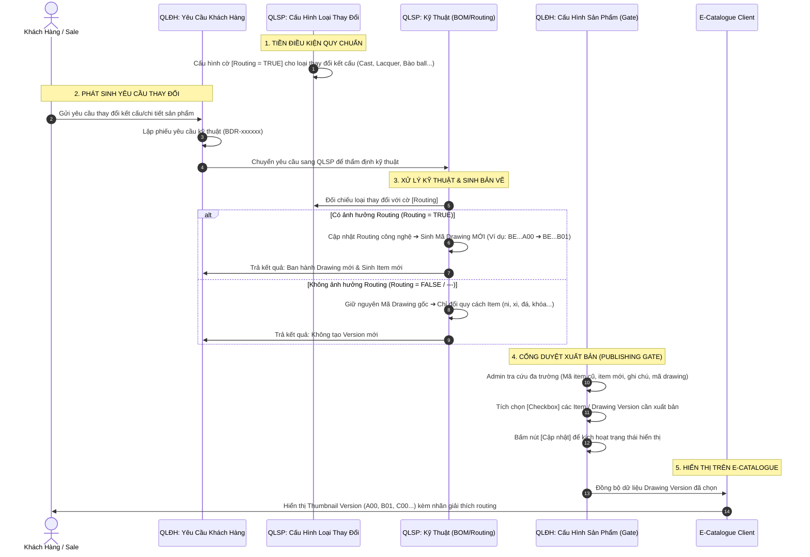

# US-EC-01: Cấu Hình và Xuất Bản Phiên Bản Bản Vẽ (Drawing Version) lên E-Catalogue qua Luồng Liên Phân Hệ (QLĐH ⟷ QLSP)

> **Mã Story:** `US-EC-01`  
> **Epic:** Quản lý Phiên bản Thiết kế & Xuất bản E-Catalogue Chào Hàng (E-Catalogue Design Version Management)  
> **Phân hệ áp dụng:** Quản lý sản phẩm (QLSP) ⟷ Quản lý đơn hàng (QLĐH) ⟷ E-Catalogue (EC)  
> **Đối tượng tác nghiệp:** Kỹ thuật trưởng (QLSP), Nhân viên Bán hàng / CS (QLĐH), Quản trị viên E-Catalogue (Admin EC), Khách hàng sỉ / Sale chào hàng (EC Client)  

---

## 1. Tóm tắt User Story (User Story Statements)

### Câu chuyện tổng quát (Epic-level User Story)
> **AS AN** Quản trị viên Hệ thống / Quản lý Đơn hàng,  
> **I WANT TO** kiểm soát chặt chẽ các loại thay đổi kỹ thuật có ảnh hưởng đến Routing tại QLSP và chủ động chọn lọc các Item / Drawing Version hợp lệ tại màn hình Cấu hình sản phẩm của QLĐH,  
> **SO THAT** E-Catalogue chỉ hiển thị đúng các phiên bản bản vẽ đã được duyệt thương mại, giúp khách hàng và nhân viên kinh doanh dễ dàng tham khảo, so sánh và nhận biết sự khác biệt giữa các version (như Cast, Đắp lacquer, Bào ball) mà không bị nhiễu bởi các biến thể quy cách thông thường (ni, màu xi, loại đá, loại khóa).

### Bộ chi tiết User Stories thành phần (Detailed User Stories)

| Mã Story | Vai trò (As a) | Hành động mong muốn (I want to) | Giá trị mang lại (So that) |
| :--- | :--- | :--- | :--- |
| **US-EC-01.1** | Kỹ thuật trưởng (QLSP) | Cấu hình cờ `Routing` cho từng Loại thay đổi tại màn hình `Cấu hình loại thay đổi` | Hệ thống tự động xác định các yêu cầu kỹ thuật nào làm thay đổi quy trình công nghệ để sinh Mã Drawing mới (11 ký tự), làm nguồn tạo Version cho E-Catalogue. |
| **US-EC-01.2** | Chuyên viên Bán hàng / CS (QLĐH) | Ghi nhận phiếu Yêu cầu kỹ thuật từ khách hàng (BDR-xxxxxx) và gửi sang QLSP cập nhật BOM/Routing | Đảm bảo mọi thay đổi sản phẩm từ khách hàng đều được phòng Kỹ thuật thẩm định và ban hành bản vẽ mới chuẩn xác. |
| **US-EC-01.3** | Quản trị viên EC / QLĐH | Tra cứu linh hoạt (theo item cũ, item mới, ghi chú, mã drawing) và tích chọn (checkbox) các Item / Version tại màn hình `Cấu hình sản phẩm` | Kiểm soát cổng xuất bản (Publishing Gate), chỉ đưa các phiên bản đạt chuẩn thương mại lên E-Catalogue chào hàng. |
| **US-EC-01.4** | Khách hàng / Sale chào hàng | Xem danh sách thumbnail Drawing Version kèm tooltip giải thích thay đổi routing trên trang chi tiết sản phẩm E-Catalogue | Nắm rõ lịch sử cải tiến thiết kế, so sánh trực quan và đặt hàng đúng phiên bản mong muốn. |

---

## 2. Luồng Nghiệp Vụ Liên Phân Hệ (End-to-End Business Flow)

---

## 3. Ma Trận Quy Tắc Nghiệp Vụ Cốt Lõi (First Principles Matrix)

| Nhóm Yêu Cầu Thay Đổi | Loại Thay Đổi Tiêu Biểu | Cờ Routing (QLSP) | Làm Đổi Mã Drawing? | Sinh Version Trên E-Catalogue? | Hành Xử Của Hệ Thống |
| :--- | :--- | :---: | :---: | :---: | :--- |
| **Thay đổi Kết Cấu & Công Nghệ** | `B` - Cast (thay khuôn đúc) `C` - Đắp lacquer - móc máy `F` - Thay Pearl sang Ball `I` - Thay kiểu bào ball | **BẬT (TRUE)** | **CÓ** (Đổi 3 ký tự đuôi của Mã Drawing: `A00` $\rightarrow$ `B01`) | **CÓ (ĐỦ ĐIỀU KIỆN)** | • QLSP sinh Mã Drawing mới. • Đưa vào danh sách chờ duyệt tại `QLĐH > Cấu hình sản phẩm`. • Hiển thị thành Version lựa chọn trên E-Catalogue khi Admin tích chọn. |
| **Thay đổi Quy Cách Thương Mại** | `D` - Thay Khóa dây/lắc `G` - Thay kích thước dây HTJ `H` - Thay kích thước ball `N` - Thay màu dây • Thay đổi Ni (Size nhẫn) • Thay đổi Màu xi (Vàng/Trắng/Hồng) • Khắc Laser tên riêng | **TẮT (FALSE / ---)** | **KHÔNG** (Giữ nguyên 11 ký tự Mã Drawing gốc) | **KHÔNG TẠO VERSION** | • Chỉ thay đổi các ký tự option của Mã Item (30 ký tự). • Hiển thị dưới dạng bộ chọn Size / Màu xi tại từng món thành phần trên E-Catalogue, không tạo thêm Drawing Version. |

---

## 4. Đặc Tả Giao Diện & Dữ Liệu (Field Specifications)

### 4.1. Màn hình 1: Quản lý sản phẩm > Cấu hình loại thay đổi
*URL tham chiếu: `/product-management/change-types`*

| STT | Tên trường / Cột | Kiểu dữ liệu | Bắt buộc | Mô tả & Quy tắc hiển thị |
| :---: | :--- | :--- | :---: | :--- |
| 1 | **STT** | Số nguyên | Có | Đánh số thứ tự tăng dần. |
| 2 | **Mã loại** | Chuỗi (1 ký tự) | Có | Mã định danh phân loại: `B`, `C`, `D`, `F`, `G`, `H`, `I`, `N`... |
| 3 | **Tên loại thay đổi** | Chuỗi | Có | Tên mô tả: `Cast`, `Đắp lacquer - móc máy`, `Thay Khóa`, `Thay kiểu bào ball`... |
| 4 | **Loại sản phẩm** | Chuỗi | Có | Phạm vi chủng loại áp dụng (Vòng tay, Lắc tay, Nhẫn, Dây chuyền...). |
| 5 | **Thiết kế** | Boolean (Icon) | Có | Đánh dấu yêu cầu có cần phòng Thiết kế can thiệp hay không. |
| 6 | **BOM** | Boolean (Icon) | Có | Đánh dấu yêu cầu có làm thay đổi định mức nguyên vật liệu BOM. |
| 7 | **Routing (Trọng yếu)** | Boolean (Icon/Cờ) | Có | **Cờ quyết định cốt lõi:** • `Tích xanh (TRUE)`: Thay đổi ảnh hưởng quy trình công nghệ ➔ BẮT BUỘC đổi mã Drawing và làm nguồn sinh Version trên EC. • `--- (FALSE)`: Không ảnh hưởng Routing ➔ Không đổi mã Drawing. |
| 8 | **Hiện Admin / Hiện Client** | Boolean | Có | Quy định quyền xem trên giao diện nội bộ và khách hàng. |
| 9 | **Phạm vi mở rộng** | Chuỗi | Không | Ghi chú số nhóm kỹ thuật hoặc số Item phụ kiện liên quan. |
| 10 | **Thao tác** | Hành động | Có | Icon Sửa ✏️, Xóa 🗑️. |

---

### 4.2. Màn hình 2: Quản lý đơn hàng > Danh sách Yêu cầu khách hàng
*URL tham chiếu: `/orders/customer-requests`*

| STT | Tên trường / Cột | Kiểu dữ liệu | Bắt buộc | Mô tả & Quy tắc hiển thị |
| :---: | :--- | :--- | :---: | :--- |
| 1 | **STT** | Số nguyên | Có | Đánh số thứ tự tăng dần. |
| 2 | **Mã yêu cầu kỹ thuật** | Chuỗi (Code) | Có | Định dạng `BDR-xxxxxx` (ví dụ: `BDR-000291`, `BDR-000287`). |
| 3 | **Mã Drawing gốc** | Chuỗi (11 ký tự) | Có | Mã bản vẽ hiện tại của sản phẩm (ví dụ: `BE000148A00`, `BT000153A00`). |
| 4 | **Mã Item gốc** | Chuỗi (30 ký tự) | Có | Mã item đầy đủ đang đặt (ví dụ: `GY0BE000148A00A00C00000CZWW1048`). |
| 5 | **Loại thay đổi** | Chuỗi / Enum | Có | Lấy từ Master Data Loại thay đổi (ví dụ: `A00`, `D - Thay Khóa`, `C - Đắp lacquer`). |
| 6 | **Người yêu cầu** | Chuỗi | Có | Tên nhân viên kinh doanh / CS tạo yêu cầu (kèm avatar). |
| 7 | **Ngày tạo** | Ngày & Giờ | Có | Format `DD/MM/YYYY HH:mm`. |
| 8 | **Trạng thái** | Phân loại (Enum) | Có | • `Chờ xử lý` (Badge xám) • `Chờ thiết kế` (Badge cam) • `Đang xử lý` (Badge xanh dương) • `Hoàn thành` (Badge xanh lá) |
| 9 | **Mã Drawing mới** | Chuỗi | Không | • Hiển thị `---` nếu đang xử lý hoặc thay đổi không đổi Routing. • Hiển thị mã Drawing mới (ví dụ: `GW...`, `GY...`, `BE000148B01`) khi kỹ thuật hoàn tất và loại thay đổi có `Routing = TRUE`. |

---

### 4.3. Màn hình 3: Quản lý đơn hàng > Cấu hình > Cấu hình sản phẩm (Publishing Gate)
*URL tham chiếu: `/orders/config-product`*

| STT | Tên trường / Cột | Kiểu dữ liệu | Bắt buộc | Mô tả & Quy tắc hiển thị / Validation |
| :---: | :--- | :--- | :---: | :--- |
| 1 | **Ô Tìm Kiếm Đa Trường** | Chuỗi tìm kiếm | Không | **Hỗ trợ tìm kiếm thông minh:** • Tìm theo Mã Item cũ (bắt đầu bằng `PW...`) • Tìm theo Mã Item mới (bắt đầu bằng `GY...`) • Tìm theo Mã Drawing (11 ký tự) • Tìm theo Ghi chú / Loại thay đổi ("Đắp lacquer", "Thay cast", "Bào ball") |
| 2 | **Checkbox Chọn** | Boolean | Có | Checkbox ở từng dòng và Checkbox Chọn tất cả ở header: Dùng để tích chọn item/version được hiển thị trên E-Catalogue. |
| 3 | **STT** | Số nguyên | Có | Thứ tự dòng trong bảng. |
| 4 | **Mã item** | Chuỗi (30 ký tự) | Có | Font mono, hiển thị mã item 30 ký tự chuẩn ERP. |
| 5 | **Mã drawing** | Chuỗi (11 ký tự) | Có | Font mono, hiển thị mã drawing đại diện. |
| 6 | **Hình render** | Ảnh Thumbnail | Có | Ảnh render 3D chất lượng cao của sản phẩm/version. |
| 7 | **Hình 4view** | Ảnh Thumbnail | Có | Ảnh kỹ thuật 4 góc nhìn phục vụ kiểm tra kết cấu. |
| 8 | **Loại sản phẩm** | Chuỗi | Có | Dây chuyền nữ, Nhẫn nữ, Lắc tay nữ, Bộ trang sức... |
| 9 | **Trọng lượng vàng** | Số thực (gam) | Có | Hiển thị chính xác đến 4 chữ số thập phân (ví dụ: `0.0783g`). |
| 10 | **Loại phụ liệu chính / phụ** | Chuỗi | Không | Loại đá hoặc phụ kiện đính kèm (Đá CZ, Ngọc trai...). |
| 11 | **Trạng thái Xuất bản EC** | Phân loại (Enum) | Có | • `Đã bật trên EC` (Badge xanh lục): Đang hiển thị cho Sale/Khách xem. • `Chưa bật` (Badge xám): Ẩn khỏi E-Catalogue. |
| 12 | **Nút "Cập nhật"** | Hành động | Có | Nút bấm góc trên bên phải: Nhận diện danh sách item được tích chọn và lưu trạng thái xuất bản lên E-Catalogue; hiển thị Toast xác nhận. |

---

## 5. Tiêu Chí Chấp Nhận (Acceptance Criteria - Gherkin Format)

### AC 1: Phân loại tự động yêu cầu kỹ thuật theo cờ Routing (Happy Path - QLSP)
*   **Given:** Quản trị viên QLSP đã cấu hình loại thay đổi `C - Đắp lacquer - móc máy` có `Routing = TRUE`.
*   **When:** Phòng Kỹ thuật hoàn tất xử lý phiếu yêu cầu `BDR-000291` áp dụng loại thay đổi `C`.
*   **Then:** Hệ thống QLSP tự động sinh Mã Drawing mới (thay đổi 3 ký tự đuôi từ `A00` sang `B01`).
*   **And:** Bản ghi Item và Drawing mới được đồng bộ sang cơ sở dữ liệu của Quản lý đơn hàng ở trạng thái sẵn sàng cấu hình.

---

### AC 2: Không sinh Drawing mới khi loại thay đổi không ảnh hưởng Routing (Edge Path - QLSP)
*   **Given:** Loại thay đổi `D - Thay Khóa` có cấu hình `Routing = --- (FALSE)`.
*   **When:** Phiếu yêu cầu `BDR-000287` hoàn tất xử lý.
*   **Then:** Hệ thống giữ nguyên Mã Drawing gốc `BT000153A00`, cột "Mã Drawing mới" hiển thị `---`.
*   **And:** Hệ thống không tạo Drawing Version mới trên E-Catalogue mà chỉ cập nhật thông số quy cách phụ liệu của Item.

---

### AC 3: Tra cứu đa trường tại Cấu hình sản phẩm QLĐH (Search Flexibility - QLĐH)
*   **Given:** Admin đang ở màn hình `Quản lý đơn hàng > Cấu hình > Cấu hình sản phẩm`.
*   **When:** Admin nhập từ khóa vào ô tìm kiếm theo một trong các tiêu chí:
    *   Mã item cũ: `PW0NE000172...`
    *   Mã item mới: `GY0NE000189...`
    *   Mã drawing: `NE000172A00`
    *   Ghi chú / tên công nghệ: `Đắp lacquer`, `Thay Cast`
*   **Then:** Bảng dữ liệu lọc ngay lập tức (thời gian phản hồi $\le 300\text{ms}$) trả về đúng các dòng sản phẩm thỏa mãn điều kiện.

---

### AC 4: Tích chọn và Cập nhật xuất bản Item/Version lên E-Catalogue (Publishing Gate - QLĐH)
*   **Given:** Danh sách sản phẩm hiển thị các Drawing Version mới được đồng bộ từ QLSP.
*   **When:** Admin tích chọn các checkbox tương ứng của các Version cần mở bán và bấm nút `Cập nhật`.
*   **Then:** Hệ thống lưu trạng thái xuất bản (`isPublishedToEC = true`) cho các item/version đã chọn.
*   **And:** Hiển thị thông báo Toast thành công: *"Đã cập nhật danh sách hiển thị trên E-Catalogue thành công!"*.
*   **And:** Nút "Cập nhật" chuyển từ trạng thái nổi bật sang disable hoặc hoàn tất.

---

### AC 5: Khách hàng & Sale trải nghiệm Drawing Version trên E-Catalogue (End-user Experience - EC)
*   **Given:** Khách hàng hoặc Sale truy cập trang chi tiết Bộ trang sức `/catalogue/product/set-1`.
*   **When:** Sản phẩm có các Drawing Version đã được kích hoạt hiển thị từ QLĐH (ví dụ: `A00 - Tiêu chuẩn`, `A01 - Lacquer`, `B00 - Thay Cast`, `C00 - Bào Ball`).
*   **Then:** Hệ thống hiển thị các thumbnail phiên bản dưới ảnh đại diện kèm viền xanh active khi được chọn.
*   **And:** Khi hover chuột vào từng thumbnail version, xuất hiện Tooltip giải thích chi tiết lý do thay đổi routing công nghệ (ví dụ: *"Thay kết cấu khuôn ổ đá - Thay đổi Drawing"*).
*   **And:** Từng món con trong bộ (Nhẫn, Dây chuyền, Bông tai, Lắc tay) tự động cập nhật đúng Mã Drawing font-mono tương ứng với Version đã chọn.

---

### AC 6: Ngoại lệ - Bỏ chọn toàn bộ version của sản phẩm (Edge Case & Validation)
*   **Given:** Một sản phẩm đang có ít nhất 1 Drawing Version được hiển thị trên E-Catalogue.
*   **When:** Admin bỏ tích toàn bộ các checkbox của tất cả version thuộc sản phẩm đó và bấm `Cập nhật`.
*   **Then:** Hệ thống hiển thị modal cảnh báo xác nhận: *"Cảnh báo: Sản phẩm này sẽ bị ẩn hoàn toàn khỏi E-Catalogue chào hàng. Bạn có chắc chắn muốn tiếp tục?"*.
*   **And:** Chỉ khi Admin bấm "Xác nhận ẩn", sản phẩm mới ngừng hiển thị trên E-Catalogue.

---

## 6. Ma Trận Phân Quyền (RBAC Matrix)

| Vai trò người dùng (Role) | QLSP: Cấu hình loại thay đổi | QLĐH: Yêu cầu khách hàng | QLĐH: Cấu hình sản phẩm | E-Catalogue Client |
| :--- | :---: | :---: | :---: | :---: |
| **Kỹ thuật trưởng / Admin QLSP** | Toàn quyền (CRUD) | Xem (Read-only) | Xem (Read-only) | Xem & Trải nghiệm |
| **Nhân viên Kỹ thuật BOM/Routing** | Xem & Cập nhật BOM | Cập nhật kết quả BDR | Không truy cập | Không truy cập |
| **Nhân viên Kinh doanh / CS (Sale)** | Không truy cập | Tạo & Xem phiếu BDR | Xem (Read-only) | Xem & Tạo giỏ hàng |
| **Quản trị viên E-Catalogue (Admin EC)**| Xem (Read-only) | Xem (Read-only) | Toàn quyền (Tích chọn & Cập nhật) | Xem & Quản trị |
| **Khách hàng sỉ / Đại lý (End-user)** | Không truy cập | Không truy cập | Không truy cập | Xem sản phẩm & Đặt hàng |

---

## 7. Definition of Done (DoD)

- [x] **Tài liệu đặc tả:** Đầy đủ User Story statements (INVEST), Mermaid BPMN, Field Specs cho 3 màn hình và Acceptance Criteria dạng Gherkin.
- [x] **Logic liên phân hệ:** Phản ánh chính xác điều kiện tiên quyết: Cờ `Routing` tại QLSP là nguồn kích hoạt đổi Drawing, QLĐH là cổng duyệt xuất bản lên E-Catalogue.
- [x] **Tích hợp Prototype:** Đã xây dựng và bổ sung cả 3 giao diện tương tác thực tế trong prototype (`/orders/config-product`, `/orders/customer-requests`, `/product-management/change-types`).
- [x] **Tìm kiếm đa trường:** Prototype hỗ trợ search trực tiếp theo `Mã item cũ`, `Mã item mới`, `Ghi chú`, `Mã drawing`.
- [x] **Kiểm thử AC:** Đã test các kịch bản tương tác chọn item, bấm Cập nhật, hiển thị Toast và link sang E-Catalogue.
- [x] **Deploy Production:** Build production bundle sạch lỗi và đồng bộ git lên cả 2 remote (`origin/main`, `dungseva/main`).
