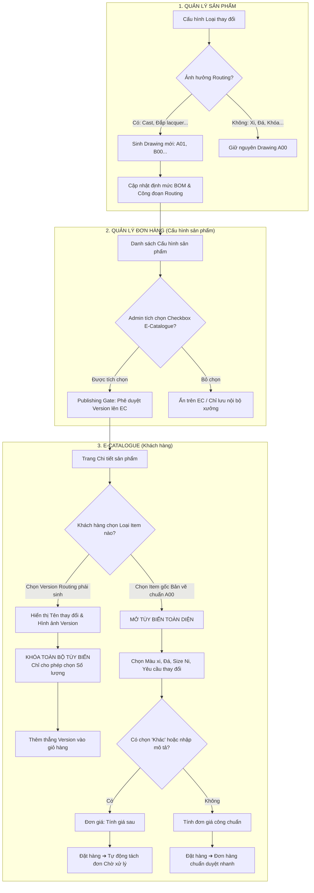

# US-EC-02: QUẢN LÝ YÊU CẦU THAY ĐỔI & PHIÊN BẢN (VERSION) ROUTING TRÊN E-CATALOGUE VÀ ADMIN

> **Mã Story:** `US-EC-02`  
> **Module liên phân hệ:** Quản lý sản phẩm (QLSP) ➔ Quản lý đơn hàng (QLĐH) ➔ E-Catalogue (EC)  
> **Feature:** Cơ chế Yêu cầu thay đổi linh hoạt & Đưa Version thành phẩm phát sinh từ Routing lên E-Catalogue làm sản phẩm bán tiếp  
> **Tác giả:** AI Airlearn (Business Analyst)  
> **Trạng thái:** Sẵn sàng kiểm thử (Ready for Review & Testing)  

---

## 1. BẢNG SO SÁNH HIỆN TRẠNG (AS-IS) VS ĐỀ XUẤT MỚI (TO-BE)

### 1.1. Trên giao diện E-Catalogue (Khách hàng B2B / B2C)

| Tiêu chí so sánh | Hiện trạng (As-Is) | Đề xuất mới (To-Be) | Giá trị nghiệp vụ mang lại |
| :--- | :--- | :--- | :--- |
| **Cơ chế danh mục thuộc tính thay đổi** | Danh sách cố định (Hardcoded) gồm 4-5 loại, không liên kết với cơ sở dữ liệu cấu hình loại thay đổi từ QLSP. | Chỉ hiển thị các thuộc tính có cờ cấu hình `showEC = true` từ Master Data QLSP + Tùy chọn `Khác`. | Khách hàng chỉ nhìn thấy các tùy chọn khả thi về mặt kỹ thuật, loại bỏ việc đặt hàng sai quy chuẩn sản xuất. |
| **Checkbox "Yêu cầu thay đổi khác"** | Luôn hiển thị cố định hoặc bị ẩn ngẫu nhiên, không theo quy tắc kỹ thuật. | **Cascade thông minh theo cấu hình QLSP:** • Chọn *Không thay đổi* hoặc cấu hình `not_allowed` $\rightarrow$ **Ẩn checkbox**. • Cấu hình `allowed` $\rightarrow$ **Hiển thị checkbox (Không bắt buộc)**. • Cấu hình `required` $\rightarrow$ **Hiển thị checkbox (Bắt buộc chọn & nhập mô tả)**. • Chọn loại *Khác* $\rightarrow$ **Ẩn checkbox, hiển thị trực tiếp ô nhập mô tả**. | Tránh sót thông tin khi khách chọn các loại thay đổi phức tạp bắt buộc phải có mô tả kỹ thuật kèm theo. |
| **Cơ chế tính giá công** | Bắt buộc hiển thị giá cố định, nếu có yêu cầu gia công đặc biệt khách không biết giá chính xác hoặc báo sai giá. | Khi chọn loại *Khác* **HOẶC** *có nhập mô tả thay đổi khác* $\rightarrow$ Đơn giá công chuyển sang hiển thị **"Tính giá sau"**. | Minh bạch với khách hàng, xưởng kỹ thuật có thời gian bóc tách công đoạn trước khi chốt giá chính xác. |
| **Luồng xử lý đơn hàng khi đặt mua** | Toàn bộ các dòng hàng gộp chung vào 1 đơn hàng duy nhất, gây tắc nghẽn toàn bộ đơn nếu có 1 món cần báo giá lại. | **Tự động tách làm 2 đơn hàng riêng biệt:** 1. *Đơn hàng tiêu chuẩn:* Xử lý sản xuất bình thường. 2. *Đơn hàng thay đổi khác:* Trạng thái **Chờ xử lý (Pending)** để Admin/Kỹ thuật duyệt lại. | Không làm trễ tiến độ giao hàng của các sản phẩm tiêu chuẩn có sẵn trong giỏ. |
| **Bán các phiên bản phát sinh từ Routing kỹ thuật** | Không hỗ trợ. Khách muốn đặt lại mẫu mã đã từng đắp lacquer hoặc đổi khuôn Cast thì phải chọn mẫu gốc và gõ lại mô tả từ đầu. | **Đưa các Version từ Routing lên E-C làm sản phẩm bán tiếp:** • Hiển thị danh sách Version trực quan ở cột trái kèm hình ảnh riêng. • Tên version hiển thị đúng loại thay đổi (ví dụ: *Đắp lacquer - móc máy*, *Thay Cast ổ chấu*). • **Khóa toàn bộ tùy biến** (chỉ chọn số lượng để thêm vào giỏ). • Muốn tùy biến khác version $\rightarrow$ Bấm nút quay lại **Bản vẽ gốc A00**. | Chuẩn hóa các mẫu mã cải tiến thành SKU độc lập để tái khai thác doanh thu thương mại mà không gây lỗi sản xuất. |

---

### 1.2. Trên giao diện Admin (Quản trị Đơn hàng & Cấu hình sản phẩm)

| Tiêu chí so sánh | Hiện trạng (As-Is) | Đề xuất mới (To-Be) | Giá trị nghiệp vụ mang lại |
| :--- | :--- | :--- | :--- |
| **Giao diện Modal cấu hình item (Order Item Modal)** | Xuất hiện nhiều badge, text giải thích thừa thãi gây rối mắt như `(Tùy vào cấu hình thay đổi)`, `(Mặc định)`. | **First Principles & Strict Minimalism:** Dọn sạch toàn bộ text thừa, badge dư thừa. Giao diện trực diện, đúng & đủ cho tác nghiệp. | Tối ưu tốc độ thao tác của nhân viên nhập liệu/xử lý đơn hàng, giảm thiểu nhầm lẫn. |
| **Hình thức nhập liệu thuộc tính thay đổi** | Cố định ô text hoặc dropdown chung chung, không tương thích với bảng 12 thuộc tính kỹ thuật QLSP. | **Cascade linh hoạt theo 3 hình thức cấu hình QLSP:** 1. *Tùy chọn:* Hiển thị Dropdown. 2. *Mô tả:* Hiển thị ô Ghi chú nội bộ (chỉ Admin thấy). 3. *Cả tùy chọn & mô tả:* Vừa chọn dropdown vừa nhập text ghi chú. | Đảm bảo tính nhất quán dữ liệu giữa phân hệ Kỹ thuật (QLSP) và Kinh doanh (QLĐH). |
| **Phê duyệt Version lên E-Catalogue (Cấu hình sản phẩm)** | Bảng danh sách hiển thị lẫn lộn không phân biệt được mã Drawing gốc và mã Drawing phái sinh từ Routing. | **Phân cấp rõ ràng & Publishing Gate trực quan:** • Badge tím nổi bật nhận diện: `🔄 Version: [Tên loại thay đổi]` (ví dụ: `A01 • Đắp lacquer`, `B00 • Thay Cast`). • Badge xám cho `Bản vẽ gốc A00`. • Tab lọc nhanh: *Tất cả*, *Bản vẽ chuẩn A00*, *Version từ Routing*. • Cột checkbox E-Catalogue: Admin tích chọn để duyệt hiển thị lên EC. | Quản trị viên chủ động kiểm soát chính xác từng Version thành phẩm được phép kinh doanh trên E-Catalogue. |

---

## 2. KIẾN TRÚC LUỒNG LIÊN PHÂN HỆ (END-TO-END FLOW)

---

## 3. ĐẶC TẢ CHI TIẾT USER STORIES

### US-01: Lựa chọn Yêu cầu thay đổi & Cơ chế Cascade trên E-Catalogue
*   **AS A:** Khách hàng đặt mua trang sức trên E-Catalogue.
*   **I WANT TO:** Lựa chọn các yêu cầu thay đổi đã được xưởng chuẩn hóa kỹ thuật hoặc gửi yêu cầu gia công riêng kèm mô tả chi tiết.
*   **SO THAT:** Tôi truyền đạt chính xác mong muốn chế tác mà không bị sai sót thông tin, đồng thời biết rõ món hàng nào có giá ngay và món nào cần báo giá sau.

#### Tiêu chí Chấp nhận (Acceptance Criteria - Gherkin):
*   **AC 1.1: Cascade hiển thị checkbox theo cấu hình Master Data QLSP**
    *   **Given:** Khách hàng đang ở màn hình Chi tiết sản phẩm gốc (Bản vẽ chuẩn A00).
    *   **When:** Khách hàng chọn dropdown `Yêu cầu thay đổi`:
        *   Nếu chọn `Không thay đổi` $\rightarrow$ **Then:** Ẩn hoàn toàn checkbox `Yêu cầu thay đổi khác` và ô nhập mô tả.
        *   Nếu chọn loại có cấu hình `otherChangeConfig = "not_allowed"` $\rightarrow$ **Then:** Ẩn checkbox `Yêu cầu thay đổi khác`.
        *   Nếu chọn loại có cấu hình `otherChangeConfig = "optional"` $\rightarrow$ **Then:** Hiển thị checkbox `Yêu cầu thay đổi khác` ở dạng tùy chọn (không bắt buộc).
        *   Nếu chọn loại có cấu hình `otherChangeConfig = "required"` $\rightarrow$ **Then:** Tự động tick chọn checkbox `Yêu cầu thay đổi khác` và bắt buộc nhập ô mô tả.
        *   Nếu chọn `Khác` $\rightarrow$ **Then:** Ẩn checkbox, hiển thị trực tiếp ô textarea `Mô tả yêu cầu thay đổi (*)`.
*   **AC 1.2: Hiển thị "Tính giá sau" khi có yêu cầu thay đổi ngoài danh mục**
    *   **Given:** Khách hàng đang cấu hình sản phẩm.
    *   **When:** Khách hàng chọn loại `Khác` **HOẶC** (có tick chọn thay đổi khác và nhập mô tả văn bản).
    *   **Then:** Cột Đơn giá công và Tổng tiền tự động hiển thị nhãn `Tính giá sau` (màu hổ phách), chặn hiển thị đơn giá cố định.
*   **AC 1.3: Tự động tách đơn hàng khi hoàn tất đặt hàng**
    *   **Given:** Giỏ hàng của khách hàng có chứa cả sản phẩm tiêu chuẩn và sản phẩm có yêu cầu thay đổi `Khác`.
    *   **When:** Khách hàng nhấn nút `Gửi đơn hàng`.
    *   **Then:** Hệ thống tự động tách thành 2 mã đơn riêng biệt:
        *   Đơn hàng A: Chứa các sản phẩm tiêu chuẩn (Trạng thái: *Mới tạo / Đã tiếp nhận*).
        *   Đơn hàng B: Chứa sản phẩm có yêu cầu thay đổi riêng (Trạng thái: *Chờ xử lý* để nhân viên kỹ thuật liên hệ báo giá).

---

### US-02: Cấu hình Yêu cầu thay đổi trên Quản trị Đơn hàng (Admin Modal)
*   **AS A:** Nhân viên Quản lý Đơn hàng (Admin / Sales Support).
*   **I WANT TO:** Xem và điều chỉnh cấu hình chi tiết của từng item trong đơn hàng với giao diện tinh gọn, không rườm rà.
*   **SO THAT:** Tôi xử lý nhanh các đơn hàng "Chờ xử lý", bổ sung chính xác các thuộc tính kỹ thuật nội bộ mà E-Catalogue không hiển thị.

#### Tiêu chí Chấp nhận (Acceptance Criteria - Gherkin):
*   **AC 2.1: Triệt tiêu thông tin thừa (Strict Minimalism)**
    *   **Given:** Quản trị viên mở Modal cấu hình item đơn hàng (`OrderItemConfigModal`).
    *   **When:** Form hiển thị lên màn hình.
    *   **Then:** Tuyệt đối không hiển thị các badge phụ gây rối như `(Mặc định)`, `(Tùy vào cấu hình thay đổi)`. Mỗi trường dữ liệu chỉ gồm: Tên trường nhãn xám rõ ràng + Control nhập liệu tương ứng.
*   **AC 2.2: Tương thích 3 hình thức cấu hình thuộc tính của QLSP**
    *   **Given:** Đơn hàng ở trạng thái *Chờ xử lý* cần điều chỉnh thuộc tính.
    *   **When:** Quản trị viên chọn từng thuộc tính trong 12 thuộc tính:
        *   Nếu thuộc tính loại `Tùy chọn` (Màu xi, Màu đá, Size, Khóa, Ball...): Hiển thị Dropdown danh mục chuẩn.
        *   Nếu thuộc tính loại `Mô tả`: Hiển thị ô Ghi chú nghiệp vụ (chỉ lưu nội bộ, không đưa lên EC).
        *   Nếu thuộc tính loại `Cả tùy chọn và mô tả`: Hiển thị đồng thời Dropdown lựa chọn và ô nhập mô tả chi tiết.

---

### US-03: Đưa Version từ Routing lên E-Catalogue làm sản phẩm bán tiếp
*   **AS A:** Quản lý Sản phẩm / Quản lý Đơn hàng.
*   **I WANT TO:** Phê duyệt các Version thành phẩm sinh ra từ quá trình điều chỉnh Routing (Cast, Đắp lacquer...) để mở bán tiếp trên E-Catalogue.
*   **SO THAT:** Doanh nghiệp mở rộng danh mục sản phẩm từ các mẫu mã đã sản xuất thực tế thành công, tối ưu chi phí thiết kế mới.

#### Tiêu chí Chấp nhận (Acceptance Criteria - Gherkin):
*   **AC 3.1: Hiển thị nhận diện Version Routing tại Cấu hình sản phẩm (QLĐH)**
    *   **Given:** Quản trị viên truy cập màn hình `/orders/config-product`.
    *   **When:** Bảng danh sách sản phẩm hiển thị:
        *   Cột `Mã drawing` hiển thị rõ mã drawing (A00, A01, B00...).
        *   Nếu là sản phẩm phát sinh từ Routing (`affectsRouting = true`): Hiển thị badge tím nổi bật `🔄 Version: [Tên loại thay đổi]` (Ví dụ: `A01 • Đắp lacquer - móc máy`, `B00 • Thay Cast ổ chấu`).
        *   Nếu là bản vẽ gốc: Hiển thị badge xám `Bản vẽ gốc A00`.
    *   **And:** Tab bar cho phép lọc nhanh: `Tất cả`, `Bản vẽ chuẩn A00 (Gốc)`, `Version từ Routing (Bán tiếp)`.
*   **AC 3.2: Cơ chế Publishing Gate qua checkbox E-Catalogue**
    *   **Given:** Quản trị viên muốn cho phép hoặc ngừng bán một Version trên E-C.
    *   **When:** Quản trị viên tick chọn hoặc bỏ chọn checkbox tại cột `E-Catalogue` và nhấn nút `Cập nhật`.
    *   **Then:** Trạng thái được lưu vào hệ thống (`localStorage` / Database); E-Catalogue lập tức đồng bộ danh sách Version được phép hiển thị tương ứng.
*   **AC 3.3: Khóa tùy biến trên Version phái sinh tại E-Catalogue**
    *   **Given:** Khách hàng bấm chọn một Version Routing (ví dụ: *Đắp lacquer - móc máy* hoặc *Thay Cast ổ chấu*).
    *   **When:** Giao diện chi tiết sản phẩm cập nhật theo Version:
        *   Hình ảnh sản phẩm chuyển sang hình ảnh riêng của Version.
        *   Hiển thị Banner cảnh báo màu tím: *"Phiên bản thành phẩm cố định quy trình kỹ thuật ([Tên Version]). Không áp dụng tùy biến khác. Quý khách chỉ cần chọn số lượng để đặt hàng."*
        *   Khóa (Disabled) hoặc ẩn toàn bộ các khối chọn: Màu xi, Đá chính, Kích thước, Yêu cầu thay đổi.
        *   Khách hàng chỉ có thể nhập số lượng và nhấn `Thêm vào giỏ hàng`.
*   **AC 3.4: Cho phép quay về Bản vẽ gốc để tùy biến tự do**
    *   **Given:** Khách hàng đang ở một Version phái sinh nhưng muốn đổi màu xi, đổi đá hoặc yêu cầu gia công khác.
    *   **When:** Khách hàng nhấn nút `Chọn lại Bản vẽ gốc để tùy biến` trên Banner hoặc click vào thumbnail `Bản vẽ chuẩn A00`.
    *   **Then:** Hệ thống chuyển về Item gốc A00, mở lại toàn bộ quyền tùy biến tự do như một sản phẩm tiêu chuẩn bình thường.

---

## 4. MA TRẬN DỮ LIỆU THUỘC TÍNH (MAPPING MATRIX)

| STT | Tên thuộc tính | Cấu hình QLSP | Hiển thị E-Catalogue | Hiển thị Admin | Checkbox 'Khác' trên E-C | Ghi chú nghiệp vụ |
| :---: | :--- | :--- | :---: | :---: | :---: | :--- |
| 1 | Màu xi | Tùy chọn | Có | Có | Ẩn | Thuộc tính cơ bản (Vàng, Trắng, Hồng, Hai màu) |
| 2 | Màu đá chính | Tùy chọn | Có | Có | Ẩn | Thuộc tính cơ bản (Trắng, Đỏ, Xanh, Tím...) |
| 3 | Kích thước / Size | Tùy chọn | Có | Có | Ẩn | Ni tay trang sức (14, 15, 16, 17, 18...) |
| 4 | Khóa (Càng cua / Mỏ vịt) | Tùy chọn | Có | Có | Optional | Phụ kiện khóa trang sức |
| 5 | Tăng đơ (Đổi / Bỏ) | Tùy chọn | Có | Có | Optional | Phụ kiện tăng đơ đuôi |
| 6 | Kiểu bào ball | Tùy chọn | Có | Có | Optional | Chữ S, Moon, Slash 45, Trơn... |
| 7 | Kích thước dây HTJ | Tùy chọn | Có | Có | Optional | Tăng/giảm size dây chuyền |
| 8 | **Đắp lacquer - móc máy** | **Ảnh hưởng Routing** | **Thành Version** | Có | **Khóa tùy biến** | **Sinh Drawing A01 $\rightarrow$ Đưa lên EC bán tiếp** |
| 9 | **Thay Cast ổ chấu** | **Ảnh hưởng Routing** | **Thành Version** | Có | **Khóa tùy biến** | **Sinh Drawing B00 $\rightarrow$ Đưa lên EC bán tiếp** |
| 10 | Yêu cầu kỹ thuật khác | Mô tả | Có (Loại Khác) | Có | Required | Nhập mô tả $\rightarrow$ Tính giá sau $\rightarrow$ Tách đơn |

---

## 5. DEFINITION OF DONE (DOD)
- [x] Đã hoàn thành bảng so sánh chi tiết Hiện trạng (As-Is) vs Đề xuất mới (To-Be) cho cả E-Catalogue và Admin.
- [x] Đã chuẩn hóa quy tắc cascade hiển thị checkbox "Yêu cầu thay đổi khác" theo cấu hình QLSP.
- [x] Đã hiện thực hóa cơ chế khóa tùy biến cho các Version thành phẩm sinh ra từ Routing trên E-Catalogue.
- [x] Đã bổ sung cơ chế Publishing Gate (Checkbox E-Catalogue) và Badge nhận diện Version Routing trên màn hình Cấu hình sản phẩm (QLĐH).
- [x] Next.js Turbopack build thành công 17/17 routes, không phát sinh lỗi biên dịch.
- [x] Đã đồng bộ mã nguồn lên toàn bộ các kho lưu trữ Git (`origin` và `dungseva`).
