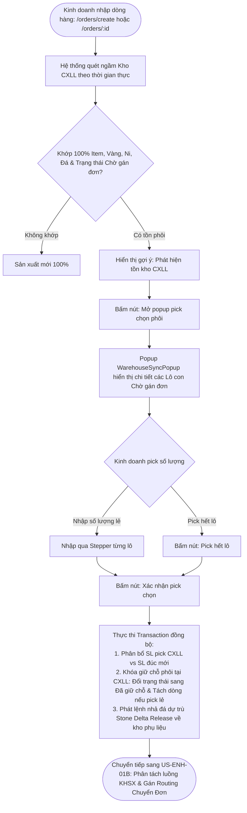

# US-ENH-01A: Đồng Bộ Dữ Liệu Kho Thành Phẩm (CXLL) Với Đơn Hàng Khi Tạo Mới Hoặc Chỉnh Sửa

> **Mã Story:** `US-ENH-01A` (Tách từ `US-ENH-01` - Phần 1)  
> **Epic:** Epic 02: Quản Trị Đơn Hàng (SO) & CS5.Epic 3: Chờ Xử Lý Lại  
> **Module / Feature:** Quản Lý Đơn Hàng / Đồng Bộ Tồn Kho CXLL & Đối Soát Pick Phôi  
> **Actor chính:** Nhân viên Kinh doanh (Sales) / Cán bộ Quản lý đơn hàng (Sale Admin)  
> **Tài liệu tham chiếu:** [Prototype Chi Tiết Đơn Hàng: /orders/SO2608011](https://dungseva.vercel.app/orders/SO2608011)  
> **Trạng thái:** `Ready for Confluence Publish`  

---

## 1. USER STORY *

* **Là một (As a):** Nhân viên Kinh doanh (Sales) / Cán bộ Quản lý đơn hàng (Sale Admin)
* **Tôi muốn (I want):** 
    1. Khi nhập dòng hàng lúc tạo mới đơn hàng (`/orders/create`) hoặc khi chỉnh sửa đơn hàng (`/orders/[id]`), hệ thống tự động quét ngầm Kho Chờ Xử Lý Lại (CXLL) và phát hiện nếu có sản phẩm trùng khớp 100% thuộc tính kỹ thuật đang ở trạng thái **`Chờ gán đơn`**.
    2. Hiển thị banner chỉ báo gợi ý trực quan ngay trên dòng hàng: *"💡 Phát hiện tồn kho CXLL: Có sẵn M món khớp 100% thuộc tính. [Mở popup pick chọn]"*.
    3. Nhấp mở Popup gán phôi (`WarehouseSyncPopup`) để xem chi tiết theo cấp: Item Cha ➔ Chi tiết từng Lô con (≤ 10 món/lô). Popup **chỉ hiển thị các dòng phôi ở trạng thái `Chờ gán đơn`** (ẩn 100% các dòng đã giữ chỗ hoặc chờ chuyển bag để triệt tiêu nguy cơ pick trùng).
    4. Cho phép nhập số lượng lẻ cần pick cho từng lô (dùng ô stepper) hoặc bấm nút `[⚡ Pick hết lô]`. Hệ thống tự động tính toán: Tổng SL pick kho CXLL và SL còn lại chuyển sang sản xuất mới.
    5. Ngay khi bấm `[Xác nhận pick chọn]`: Hệ thống tự động khóa giữ chỗ dòng phôi tại Kho CXLL (chuyển sang trạng thái **`Đã giữ chỗ`**, gắn mã SO mới; nếu pick lẻ thì tự động tách thành 2 dòng độc lập tại Kho CXLL), đồng thời **nhả 100% lượng đá giữ chỗ tương ứng** về kho phụ liệu đá khả dụng (`Stone Delta Release`).
    6. Nếu đơn hàng bị hủy bỏ trước khi bấm Chuyển KHSX: Hệ thống tự động hoàn nhập dòng phôi về trạng thái `Chờ gán đơn` tại Kho CXLL.
* **Để (So that):** Nhận biết tức thì nguồn phôi sẵn có trong kho, chủ động pick phôi tái sử dụng cho khách, rút ngắn lead time giao hàng từ 10-15 ngày xuống còn 1-2 ngày và không giam giữ đá ảo.

---

## 2. MỤC TIÊU NGHIỆP VỤ

1. **Tận dụng phôi có sẵn:** Giảm áp lực đúc mới cho xưởng bằng cách tái sử dụng nhanh các sản phẩm bị hủy đơn còn lưu tại Kho CXLL.
2. **Đối soát chính xác 100% thuộc tính kỹ thuật:** Chỉ gợi ý phôi khi khớp toàn diện 4 yếu tố: Mã Item, Tuổi vàng, Ni tay/Size, Quy cách đá. Tuyệt đối không can thiệp cơ học (cắt/nong ni hay cạy đá).
3. **Bảo toàn số liệu & Chống pick trùng:** Khóa giữ chỗ ngay lập tức tại kho vật lý và hiển thị thông số trọng lượng chuẩn đúng 4 số sau dấu thập phân (`#.####`) kèm mã Stamp (`Số Stamp = TL Đá × 1000`).

---

## 3. TIÊU CHÍ CHẤP NHẬN (ACCEPTANCE CRITERIA - AC) *

* **AC 1: Tự động quét & Hiển thị banner gợi ý khớp 100% thuộc tính**
  * **Given (Biết rằng):** Kinh doanh nhập xong dòng hàng: Mã Item, Tuổi vàng, Ni tay/Size, Màu đá.
  * **When (Khi):** Hệ thống quét Kho CXLL và phát hiện có ít nhất 1 dòng phôi khớp 100% cả 4 thuộc tính trên và đang ở trạng thái `Chờ gán đơn`.
  * **Then (Thì):** Dòng hàng lập tức hiển thị banner gợi ý màu xanh ngọc: *"💡 Phát hiện tồn kho CXLL: Có sẵn M món khớp 100% thuộc tính. [Mở popup pick chọn]"*.

* **AC 2: Popup đối soát danh sách Lô con Chờ gán đơn (`WarehouseSyncPopup`)**
  * **Given (Biết rằng):** Người dùng bấm nút `[Mở popup pick chọn]` trên banner gợi ý.
  * **Then (Thì):** Popup hiển thị 2 phần rõ rệt:
    * Khung thông tin Item cha: Mã Item 30 ký tự, Tuổi vàng, Ni tay, Màu đá, Tổng tồn khả dụng CXLL.
    * Danh sách các Lô con (≤ 10 món/lô): Mã Lô, Mã SO cũ, Khách hàng cũ, Tồn khả dụng, Ô nhập SL pick (stepper 0 ≤ SL ≤ Tồn), Mã Stamp (`Số Stamp = TL Đá × 1000`), Trọng lượng chuẩn 4 số sau thập phân (TL Kim loại, TL Đá, Tổng TL).
  * **And (Và):** Chỉ hiển thị các dòng mang trạng thái `Chờ gán đơn`. Tuyệt đối không hiển thị các dòng `Đã giữ chỗ` hoặc `Chờ chuyển bag`.

* **AC 3: Thao tác nhập số lượng pick & Tính toán phân bổ tức thì**
  * **When (Khi):** Người dùng thay đổi số lượng pick tại từng lô (nhập số hoặc bấm nút +/- stepper) hoặc bấm nút `[⚡ Pick hết lô]`.
  * **Then (Thì):** Hệ thống cập nhật realtime ở thanh tổng kết đáy popup:
    * `Tổng SL đặt của đơn`: K pcs.
    * `Tổng SL pick kho CXLL`: M pcs (Badge xanh).
    * `SL còn lại SX mới`: (K - M) pcs (Badge cam).

* **AC 4: Khóa giữ chỗ & Cơ chế tách dòng tại Kho CXLL**
  * **Given (Biết rằng):** Người dùng bấm `[Xác nhận pick chọn M món]`.
  * **Then (Thì):** Hệ thống cập nhật dữ liệu tại Kho CXLL:
    * Nếu pick toàn bộ số lượng dòng phôi (M = Tồn dòng): Dòng này đổi trạng thái sang `Đã giữ chỗ`, gán mã SO mới và tên khách hàng mới.
    * Nếu pick một phần số lượng dòng phôi (M < Tồn dòng): Dòng phôi tự động tách thành 2 dòng riêng biệt: 1 dòng `Đã giữ chỗ` với M pcs (gắn SO mới) và 1 dòng `Chờ gán đơn` với số lượng còn lại.
  * **And (Và):** Dòng hàng trên đơn hàng ghi nhận liên kết phôi thành công.

* **AC 5: Tự động nhả đá giữ chỗ (`Stone Delta Release`)**
  * **Given (Biết rằng):** Đơn hàng mới đã được hệ thống tính toán dự trù đá phụ liệu ban đầu.
  * **When (Khi):** Xác nhận gán M pcs phôi từ Kho CXLL vào đơn.
  * **Then (Thì):** Do phôi CXLL đã có sẵn đá gắn trên sản phẩm, hệ thống tự động phát lệnh **nhả 100% lượng đá dự trù tương ứng với M món về lại Kho Phụ Liệu Đá khả dụng**, không giam giữ đá ảo.

* **AC 6: Hoàn nhập phôi khi Đơn hàng mới bị hủy bỏ**
  * **Given (Biết rằng):** Dòng phôi đang ở trạng thái `Đã giữ chỗ` cho đơn hàng SO mới.
  * **When (Khi):** Đơn hàng SO mới bị hủy hoặc dòng hàng bị xóa trước khi bấm Chuyển KHSX.
  * **Then (Thì):** Dòng phôi tại Kho CXLL tự động hoàn nhập về trạng thái `Chờ gán đơn`, xóa liên kết SO mới để các đơn hàng khác có thể tiếp tục pick.

---

## 4. QUY TẮC NGHIỆP VỤ (BUSINESS RULES) *

* **BR-SYNC-01 (Exact Match 100%):** Bắt buộc khớp đồng thời 4 thuộc tính kỹ thuật: Mã Item, Tuổi vàng, Ni tay/Size, Quy cách đá. Tuyệt đối không gán ép sản phẩm lệch quy cách.
* **BR-SYNC-02 (Cấp Lô nhỏ ≤ 10 món):** Phản ánh đúng thực tế xưởng kim hoàn, mỗi lô trong kho thường ≤ 10 món. Popup hỗ trợ pick linh hoạt từ nhiều lô con khác nhau.
* **BR-SYNC-03 (Chỉ quét dòng Chờ gán đơn):** Hệ thống chỉ quét và cho phép pick các dòng phôi có trạng thái `Chờ gán đơn` tại Kho CXLL. Triệt tiêu 100% nguy cơ tranh chấp hoặc pick trùng phôi.
* **BR-SYNC-04 (Stone Delta Release Mandatory):** Tự động phát lệnh nhả đá dự trù về kho phụ liệu đá ngay tại thời điểm xác nhận gán phôi.
* **BR-SYNC-05 (Quy chuẩn Stamp & 4 số sau thập phân):** 
  * `Số Stamp = TL Đá (Lượng) × 1000` (Ví dụ: `TL Đá = 0.0004 L` → `Stamp = 0.4`; `TL Đá = 0.0012 L` → `Stamp = 1.2`).
  * Toàn bộ trọng lượng kim loại, đá và tổng trọng lượng lấy chuẩn đúng 4 số sau dấu thập phân (`#.####`).
* **BR-SYNC-06 (Hoàn nhập phôi):** Chỉ hoàn nhập phôi về `Chờ gán đơn` nếu đơn mới bị hủy khi chưa duyệt chuyển KHSX. Một khi đã duyệt KHSX (chuyển sang `Chờ chuyển bag`), quy trình hủy phải thông qua nghiệp vụ xử lý phôi trạm cấp TP.

---

## 5. DANH MỤC DỮ LIỆU & RÀNG BUỘC (DATA DICTIONARY)

### 5.1 Popup Đối Soát & Gán Phôi Kho CXLL (`WarehouseSyncPopup`)

| Fields (Tên trường) | Type (Kiểu dữ liệu) | Required | Default value | Rules (Quy tắc & Nghiệp vụ) |
| :--- | :--- | :---: | :--- | :--- |
| **Mã Item & Thuộc tính** | Text | Có | Kế thừa từ dòng đơn | Mã 30 ký tự, Tên sản phẩm, Tuổi vàng, Ni tay, Màu đá. |
| **Mã Lô (Bag phôi)** | Text / Mono | Có | Kế thừa từ CXLL | Định danh lô cũ trong kho (VD: `SO-260800063`). Có icon copy 1-click. |
| **Mã SO Cũ** | Text / Mono | Có | Kế thừa từ CXLL | Mã đơn hàng cũ bị hủy (VD: `SO123456`). |
| **Khách Hàng Cũ** | Text | Có | Kế thừa từ CXLL | Tên khách hàng cũ của lô phôi. |
| **Mã Stamp** | Text | Có | Kế thừa từ CXLL | Mã Stamp: `Số Stamp = TL Đá × 1000` (VD: `0.4`, `1.2`, `15`...). |
| **SL Tồn Của Lô** | Integer | Có | Kế thừa từ CXLL | Số lượng phôi sẵn có trong lô ở trạng thái `Chờ gán đơn` (≤ 10 món). |
| **SL Pick Chọn** | Stepper / Integer | Có | `0` (hoặc gợi ý FIFO) | Nhập số lẻ (0 ≤ SL ≤ Tồn Lô) hoặc bấm tăng/giảm stepper. |
| **Tổng SL Pick Kho** | Integer | Tự tính | Tổng các lô pick | Tự động cập nhật realtime khi thay đổi số lượng từng lô. |
| **SL Còn Lại SX Mới** | Integer | Tự tính | `SL Đặt - Pick Kho` | Tự động tính phần số lượng phải đúc mới. |
| **TL Kim Loại (L)** | Decimal (4 số lẻ) | Có | Kế thừa / Tỷ lệ | Trọng lượng kim loại chuẩn 4 số sau thập phân. |
| **TL Đá (L)** | Decimal (4 số lẻ) | Có | Kế thừa / Tỷ lệ | Trọng lượng đá chuẩn 4 số sau thập phân. Nếu = 0 hiển thị `0.0000`. |
| **Tổng TL (L)** | Decimal (4 số lẻ) | Có | Kế thừa / Tỷ lệ | Tổng trọng lượng chuẩn 4 số sau thập phân (`TL Kim loại + TL Đá`). |

---

## 6. LUỒNG NGHIỆP VỤ (MERMAID FLOW)

