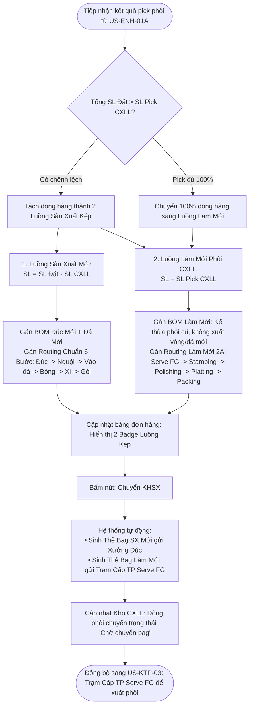

# US-ENH-01B: Gán Item CXLL Vào Đơn Hàng & Phân Tách 2 Luồng KHSX (SX Mới vs Làm Mới Cấu Hình Routing/BOM)

> **Mã Story:** `US-ENH-01B` (Tách từ `US-ENH-01` - Phần 2)  
> **Epic:** Epic 02: Quản Trị Đơn Hàng (SO) & Quản Trị Kế Hoạch Sản Xuất (KHSX)  
> **Module / Feature:** Quản Lý Đơn Hàng & KHSX / Phân Tách Luồng & Gán BOM/Routing Cho Phôi CXLL  
> **Actor chính:** Cán bộ Quản lý đơn hàng (Sale Admin) / Kỹ sư KHSX (Production Planner)  
> **Tài liệu tham chiếu:** [Prototype Chi Tiết Đơn Hàng: /orders/SO2608011](https://dungseva.vercel.app/orders/SO2608011) | [Trạm Cấp TP Serve FG: /inventory/reprocess/serve](https://dungseva.vercel.app/inventory/reprocess/serve)  
> **Trạng thái:** `Ready for Confluence Publish`  

---

## 1. USER STORY *

* **Là một (As a):** Cán bộ Quản lý đơn hàng (Sale Admin) / Kỹ sư KHSX (Production Planner)
* **Tôi muốn (I want):** 
    1. Khi một dòng hàng trên đơn (SO) được xác nhận gán phôi từ Kho CXLL, hệ thống tự động **phân tách dòng hàng thành 2 luồng sản xuất độc lập (Split Production Workflow)**:
       * **Luồng 1 (Sản xuất mới):** Áp dụng cho phần số lượng thiếu hụt khách đặt vượt quá tồn kho CXLL (`SL SX Mới = SL Đặt - SL Pick CXLL`).
       * **Luồng 2 (Làm mới phôi CXLL):** Áp dụng cho phần số lượng đã pick từ kho CXLL (`SL Làm Mới = SL Pick CXLL`).
    2. Tự động áp cấu hình **BOM & Routing** chuẩn xác cho từng luồng:
       * **Với Luồng Sản Xuất Mới:** Gán **BOM thành phẩm đầy đủ** (vàng đúc mới, đá phụ liệu, khuôn, chấu) và **Routing gia công đầy đủ** (Đúc ➔ Làm nguội ➔ Vào đá ➔ Đánh bóng ➔ Xi mạ ➔ Đóng gói).
       * **Với Luồng Làm Mới:** Gán **BOM làm mới** (kế thừa nguyên trạng phôi kim loại + đá niêm phong từ kho CXLL, không cấp vàng đúc và đá mới) và **Routing Làm Mới cấu hình (Routing 2A - 5 bước tinh giản)**:
         - Bước 1: `WC-0111: Serve FG` (Trạm cấp thành phẩm - chuyển phôi từ Bag cũ sang Bag mới).
         - Bước 2: `WC-0013: Stamping` (Khắc logo/ký hiệu đơn mới, kiểm tra stamp đá, tẩy xi cũ).
         - Bước 3: `WC-0020: Polishing` (Đánh bóng làm mới).
         - Bước 4: `WC-0153: Platting` (Xi mạ theo màu yêu cầu của đơn mới).
         - Bước 5: `WC-0147: Packing in` (Kiểm tra chất lượng FQC và đóng gói Thẻ Bag mới).
    3. Hiển thị trực quan 2 badge luồng kèm thông số BOM/Routing trực tiếp trên bảng dòng hàng của đơn hàng: `[SX Mới: X pcs - Routing Chuẩn]` và `[Làm Mới Phôi TP: Y pcs - Routing 2A]`.
    4. Khi bấm `[Chuyển KHSX]`: Hệ thống tự động sinh 2 lệnh sản xuất (hoặc 2 Thẻ Bag KHSX riêng biệt) chuyển xuống các xưởng tương ứng, đồng thời kích hoạt trạng thái phôi tại Kho CXLL chuyển từ `Đã giữ chỗ` sang **`Chờ chuyển bag`** để đồng bộ sang Trạm Cấp Thành Phẩm (`/inventory/reprocess/serve`).
* **Để (So that):** Đảm bảo lệnh sản xuất xuống xưởng chính xác 100%, không bị xuất trùng nguyên vật liệu vàng/đá, tận dụng tối đa phôi sẵn có và điều phối dây chuyền xưởng tinh gọn, không qua các khâu đúc/gắn đá thừa thãi.

---

## 2. MỤC TIÊU NGHIỆP VỤ

1. **Chuẩn hóa công nghệ sản xuất làm mới:** Tách biệt triệt để quy trình làm mới phôi có sẵn với quy trình đúc mới truyền thống, tối ưu chi phí gia công và thời gian giao hàng.
2. **Minh bạch định mức vật tư (BOM):** Luồng làm mới tuyệt đối không tạo yêu cầu xuất vàng nguyên liệu đúc hay xuất đá mới từ kho vật tư, ngăn chặn thất thoát và sai lệch giá thành đơn hàng.
3. **Liên thông dữ liệu khép kín:** Nối liền khâu Quản lý đơn hàng (SO) với khâu Kế hoạch sản xuất (KHSX) và Trạm Cấp Thành Phẩm (Serve FG).

---

## 3. TIÊU CHÍ CHẤP NHẬN (ACCEPTANCE CRITERIA - AC) *

* **AC 1: Tự động phân tách 2 luồng sản xuất trên dòng hàng**
  * **Given (Biết rằng):** Khách đặt dòng hàng với số lượng K pcs (ví dụ: 10 pcs).
  * **When (Khi):** Người dùng xác nhận pick M pcs từ Kho CXLL (với 0 < M < K, ví dụ pick 3 pcs CXLL).
  * **Then (Thì):** Hệ thống tự động phân tách dòng hàng thành 2 phân luồng:
    * `Luồng 1 (Sản xuất mới)`: (K - M) pcs (ví dụ: 7 pcs).
    * `Luồng 2 (Làm mới phôi CXLL)`: M pcs (ví dụ: 3 pcs).
  * **And (Và):** Nếu M = K (pick đủ 100% số lượng từ kho CXLL): Dòng hàng chuyển 100% sang Luồng Làm Mới (0 pcs Sản xuất mới).

* **AC 2: Gán BOM & Routing chuẩn cho Luồng Sản Xuất Mới**
  * **Given (Biết rằng):** Phân luồng Sản xuất mới có số lượng (K - M) > 0.
  * **Then (Thì):** Hệ thống tự động gán cấu hình tiêu chuẩn xưởng kim hoàn:
    * **BOM:** Định mức vàng đúc mới theo tuổi vàng đơn hàng + Đá phụ liệu theo quy cách + Chấu đúc khuôn.
    * **Routing quy trình công nghệ:** Áp Routing chuẩn 6 bước: Đúc (Casting) ➔ Làm nguội (Filing) ➔ Vào đá (Stone Setting) ➔ Đánh bóng (Polishing) ➔ Xi mạ (Plating) ➔ Kiểm tra & Đóng gói (Packing in).

* **AC 3: Gán BOM & Routing Làm Mới cấu hình cho Luồng Làm Mới Phôi CXLL**
  * **Given (Biết rằng):** Phân luồng Làm mới có số lượng M pcs lấy từ Kho CXLL.
  * **Then (Thì):** Hệ thống tự động áp cấu hình làm mới:
    * **BOM Làm Mới:** Kế thừa phôi từ Bag cũ (không phát sinh vàng hạt đúc và đá mới); chỉ tính định mức phụ liệu tiêu hao làm mới (dung dịch tẩy xi, hóa chất xi mạ, hao hụt đánh bóng).
    * **Routing Làm Mới (Routing 2A):** Tự động gán quy trình 5 bước tinh giản:
      1. `WC-0111: Serve FG` (Trạm cấp thành phẩm)
      2. `WC-0013: Stamping` (Khắc ký hiệu, kiểm tra Stamp đá: `Số Stamp = TL Đá × 1000`, tẩy xi cũ)
      3. `WC-0020: Polishing` (Đánh bóng làm mới)
      4. `WC-0153: Platting` (Xi mạ màu theo đơn hàng mới)
      5. `WC-0147: Packing in` (Đóng gói hoàn thiện Thẻ Bag mới)

* **AC 4: Hiển thị minh bạch trên giao diện Quản lý Đơn hàng**
  * **Given (Biết rằng):** Dòng hàng đã được gán phôi và phân luồng.
  * **Then (Thì):** Bảng chi tiết đơn hàng hiển thị:
    * Cột Số lượng: Hiển thị tổng số lượng kèm 2 badge con rõ ràng (Ví dụ: `10 pcs` kèm badge `SX Mới: 7 pcs` và `Kho TP: 3 pcs`).
    * Cột Quy trình / Routing: Hiển thị liên kết xem cấu hình Routing của từng luồng (`Routing Chuẩn` / `Routing 2A - Làm Mới`).
    * Thông số trọng lượng chuẩn 4 số sau thập phân.

* **AC 5: Tự động phát sinh Lệnh KHSX & Đồng bộ Trạm Cấp Thành Phẩm khi Duyệt đơn**
  * **Given (Biết rằng):** Đơn hàng có dòng hàng phân luồng kép được bấm **`[Chuyển KHSX]`**.
  * **Then (Thì):** Hệ thống tự động:
    * Sinh 2 Lệnh KHSX (hoặc 2 Thẻ Bag KHSX) độc lập cho xưởng: Thẻ Bag SX Mới gửi sang Xưởng Đúc; Thẻ Bag Làm Mới gửi sang Trạm Cấp TP.
    * Cập nhật trạng thái dòng phôi tương ứng tại Kho CXLL từ `Đã giữ chỗ` sang **`Chờ chuyển bag`**.
    * Hiển thị dòng chờ cấp phôi tại màn hình **Trạm Cấp Thành Phẩm (`/inventory/reprocess/serve`)** để Thủ kho thực hiện chuyển phôi theo đúng quy chuẩn `US-KTP-03`.

---

## 4. QUY TẮC NGHIỆP VỤ (BUSINESS RULES) *

* **BR-ALLOC-01 (Quy tắc phân luồng KHSX):**
  * Khi `SL Đặt > SL Pick CXLL`: Bắt buộc tách làm 2 luồng độc lập (`Sản xuất mới` và `Làm mới`).
  * Khi `SL Đặt = SL Pick CXLL`: 100% dòng hàng chuyển sang Luồng Làm Mới.
* **BR-ALLOC-02 (Quy tắc định mức BOM Làm Mới):**
  * Tuyệt đối không xuất vàng nguyên liệu đúc và đá mới cho phần số lượng thuộc Luồng Làm Mới.
  * Trọng lượng kim loại và trọng lượng đá của phôi được bảo toàn nguyên trạng từ Kho CXLL sang đơn hàng mới.
* **BR-ALLOC-03 (Quy tắc Routing Làm Mới 2A):**
  * Bắt buộc bỏ qua các công đoạn: Cắt sáp, Đúc, Nhặt ba via, Gắn đá.
  * Bắt đầu bắt buộc tại trạm `WC-0111: Serve FG` và bước `WC-0013: Stamping` để đối soát Stamp đá (`Số Stamp = TL Đá × 1000`) trước khi đánh bóng và xi mạ lại.
* **BR-ALLOC-04 (Chuyển trạng thái Kho CXLL sang Chờ chuyển bag):** Khi đơn hàng bấm Duyệt Chuyển KHSX, phôi tại Kho CXLL chuyển ngay sang `Chờ chuyển bag`, khóa cứng không cho phép hoàn nhập tự do nếu không có biên bản hủy lệnh KHSX.

---

## 5. DANH MỤC DỮ LIỆU & RÀNG BUỘC (DATA DICTIONARY)

### 5.1 Cấu Trúc Phân Luồng Trên Dòng Hàng Đơn (SO Line Item)

| Fields (Tên trường) | Type (Kiểu dữ liệu) | Required | Default value | Rules (Quy tắc & Nghiệp vụ) |
| :--- | :--- | :---: | :--- | :--- |
| **Mã Dòng Hàng** | Text / Mono | Có | Tự động sinh | Định danh duy nhất dòng hàng (VD: `LINE-001`). |
| **Tổng SL Đặt** | Integer | Có | Người dùng nhập | Tổng số lượng khách đặt (VD: `10`). |
| **SL Sản Xuất Mới** | Integer | Có | Tự tính | `Tổng SL Đặt - SL Pick CXLL`. Nếu = 0 hiển thị `0`. |
| **SL Làm Mới CXLL** | Integer | Có | Kế thừa từ Popup | Số lượng phôi lấy từ Kho CXLL. Nếu = 0 hiển thị `0`. |
| **BOM Luồng SX Mới** | Object / JSON | Điều kiện | BOM Chuẩn | Kích hoạt khi SL SX Mới > 0 (vàng đúc, đá, khuôn). |
| **BOM Luồng Làm Mới** | Object / JSON | Điều kiện | BOM Refurbish | Kích hoạt khi SL Làm Mới > 0 (phôi cũ + tiêu hao xi mạ). |
| **Routing Luồng SX Mới** | Text / Enum | Điều kiện | `ROUTING-STD-01` | Quy trình đúc mới chuẩn (6 bước). |
| **Routing Luồng Làm Mới** | Text / Enum | Điều kiện | `ROUTING-2A-REPROCESS` | Quy trình làm mới phôi tinh giản (5 bước). |
| **Mã Bag Phôi Nguồn** | Text / Mono | Điều kiện | Kế thừa từ CXLL | Mã Bag phôi cũ gán cho luồng làm mới (VD: `SO-260800063`). |
| **Trạng Thái KHSX** | Enum / Badge | Có | `Chờ duyệt KHSX` | `Chờ duyệt KHSX` ➔ `Đã chuyển KHSX` (sinh 2 Thẻ Bag). |

---

## 6. LUỒNG NGHIỆP VỤ (MERMAID FLOW)

