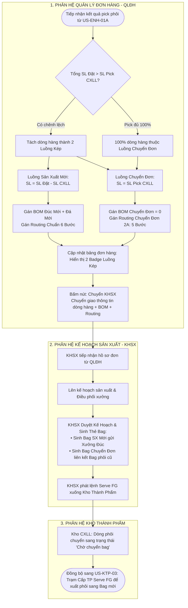

# US-ENH-01B: Gán Item CXLL Vào Đơn Hàng & Phân Tách 2 Luồng (SX Mới vs Chuyển Đơn Cấu Hình Routing/BOM)

> **Mã Story:** `US-ENH-01B` (Tách từ `US-ENH-01` - Phần 2)  
> **Epic:** Epic 02: Quản Trị Đơn Hàng (SO) & Quản Trị Kế Hoạch Sản Xuất (KHSX)  
> **Module / Feature:** Quản Lý Đơn Hàng & KHSX / Phân Tách Luồng & Chuyển Thông Tin BOM/Routing Sang KHSX  
> **Actor chính:**  
> • Cán bộ Quản lý đơn hàng (Sale Admin) — Gán phôi và chuyển thông tin BOM/Routing sang KHSX  
> • Kỹ sư Kế hoạch sản xuất (Production Planner) — Lên kế hoạch, sinh Thẻ Bag và đẩy lệnh Serve FG xuống Kho TP  
> **Tài liệu tham chiếu:** [Prototype Chi Tiết Đơn Hàng: /orders/SO2608011](https://dungseva.vercel.app/orders/SO2608011) | [Trạm Cấp TP Serve FG: /inventory/reprocess/serve](https://dungseva.vercel.app/inventory/reprocess/serve)  
> **Trạng thái:** `Ready for Confluence Publish`  

---

## 1. USER STORY *

* **Là một:** Cán bộ Quản lý đơn hàng (Sale Admin) / Kỹ sư Kế hoạch sản xuất (Production Planner)
* **Tôi muốn (I want):** 
    1. Khi một dòng hàng trên đơn (SO) được xác nhận gán phôi từ Kho CXLL, hệ thống tự động **phân tách dòng hàng thành 2 luồng độc lập (Split Workflow)**:
       * **Luồng 1 (Sản xuất mới):** Áp dụng cho phần số lượng thiếu hụt khách đặt vượt quá tồn kho CXLL (`SL SX Mới = SL Đặt - SL Pick CXLL`).
       * **Luồng 2 (Chuyển đơn phôi CXLL):** Áp dụng cho phần số lượng đã pick từ kho CXLL (`SL Chuyển Đơn = SL Pick CXLL`).
    2. Tự động áp cấu hình **BOM & Routing** chuẩn xác cho từng luồng:
       * **Với Luồng Sản Xuất Mới:** Gán **BOM thành phẩm đầy đủ** (vàng đúc mới, đá phụ liệu, khuôn, chấu) và **Routing gia công chuẩn** (Đúc ➔ Làm nguội ➔ Vào đá ➔ Đánh bóng ➔ Xi mạ ➔ Đóng gói).
       * **Với Luồng Chuyển Đơn:** Gán **BOM Chuyển Đơn = 0** (tuyệt đối không xuất vàng hạt đúc mới, không xuất đá mới, định mức tiêu hao = 0 vì kế thừa 100% phôi cũ) và **Routing Chuyển Đơn (Routing 2A - 5 bước tinh giản)**:
         - Bước 1: `WC-0111: Serve FG` (Trạm cấp thành phẩm - chuyển phôi từ Bag cũ sang Bag mới).
         - Bước 2: `WC-0013: Stamping` (Khắc logo/ký hiệu đơn mới, kiểm tra stamp đá: `Số Stamp = TL Đá × 1000`, tẩy xi cũ).
         - Bước 3: `WC-0020: Polishing` (Đánh bóng làm mới).
         - Bước 4: `WC-0153: Platting` (Xi mạ theo màu yêu cầu của đơn mới).
         - Bước 5: `WC-0147: Packing in` (Kiểm tra chất lượng FQC và đóng gói Thẻ Bag mới).
    3. Hiển thị trực quan 2 badge luồng kèm thông số BOM/Routing trực tiếp trên bảng dòng hàng của đơn hàng: `[SX Mới: X pcs - Routing Chuẩn]` và `[Chuyển Đơn: Y pcs - Routing Chuyển Đơn 2A]`.
    4. **Phân định rõ ràng trách nhiệm giữa QLĐH và KHSX:**
       * **Quản lý đơn hàng (QLĐH):** Chỉ thực hiện chốt đơn và bấm **`[Chuyển KHSX]`** để chuyển giao toàn bộ thông tin dòng hàng, số lượng phân luồng, BOM và Routing xuống phân hệ KHSX. QLĐH **không tự sinh Bag** và **không đẩy lệnh trực tiếp xuống Kho TP**.
       * **Kế hoạch sản xuất (KHSX):** Tiếp nhận thông tin từ QLĐH, tiến hành lên lịch sản xuất, **chính thức sinh các Thẻ Bag (Work Order / Bag KHSX)** độc lập cho từng luồng, và **đẩy lệnh Serve FG xuống Kho Thành Phẩm**. Khi đó, dòng phôi tại Kho CXLL mới chính thức chuyển trạng thái từ `Đã giữ chỗ` sang **`Chờ chuyển bag`** để sẵn sàng cho Trạm Cấp Thành Phẩm (`/inventory/reprocess/serve`).
* **Để (So that):** Đảm bảo tính phân quyền chặt chẽ theo quy trình nhà máy kim hoàn, không gây thất thoát vật tư do BOM chuyển đơn = 0, và KHSX chủ động hoàn toàn việc điều phối dây chuyền xưởng và cấp phôi tại kho.

---

## 2. MỤC TIÊU NGHIỆP VỤ

1. **Chuẩn hóa thuật ngữ & Định mức BOM chuyển đơn = 0:** Sử dụng thống nhất thuật ngữ **Item Chuyển Đơn**, **Routing Chuyển Đơn** và khẳng định **BOM Chuyển Đơn = 0**, ngăn chặn tuyệt đối việc hệ thống tự động xuất trùng vàng đúc hoặc đá mới.
2. **Tách bạch ranh giới trách nhiệm (Separation of Concerns):** 
   * QLĐH làm chủ dữ liệu thương mại và bàn giao thông tin BOM/Routing.
   * KHSX làm chủ kế hoạch thực thi xưởng, phát hành Thẻ Bag và phát lệnh xuất phôi Serve FG.
3. **Liên thông dòng chảy sản xuất:** Đảm bảo dữ liệu từ Đơn hàng (SO) ➔ KHSX ➔ Kho Thành Phẩm (Serve FG) ➔ Xưởng Stamping ăn khớp 100%.

---

## 3. TIÊU CHÍ CHẤP NHẬN (ACCEPTANCE CRITERIA - AC) *

* **AC 1: Tự động phân tách 2 luồng trên dòng hàng đơn (QLĐH)**
  * **Given (Biết rằng):** Khách đặt dòng hàng với số lượng K pcs (ví dụ: 10 pcs).
  * **When (Khi):** Người dùng xác nhận pick M pcs phôi CXLL từ popup đồng bộ kho (với 0 < M < K, ví dụ pick 3 pcs CXLL).
  * **Then (Thì):** Hệ thống tự động phân tách dòng hàng thành 2 phân luồng:
    * `Luồng 1 (Sản xuất mới)`: (K - M) pcs (ví dụ: 7 pcs).
    * `Luồng 2 (Chuyển đơn phôi CXLL)`: M pcs (ví dụ: 3 pcs).
  * **And (Và):** Nếu M = K (pick đủ 100% số lượng từ kho CXLL): Dòng hàng chuyển 100% sang Luồng Chuyển Đơn (0 pcs Sản xuất mới).

* **AC 2: Gán BOM & Routing chuẩn cho Luồng Sản Xuất Mới**
  * **Given (Biết rằng):** Phân luồng Sản xuất mới có số lượng (K - M) > 0.
  * **Then (Thì):** Hệ thống tự động gán cấu hình tiêu chuẩn xưởng kim hoàn:
    * **BOM:** Định mức vàng đúc mới theo tuổi vàng đơn hàng + Đá phụ liệu theo quy cách + Chấu đúc khuôn.
    * **Routing quy trình công nghệ:** Áp Routing chuẩn 6 bước: Đúc (Casting) ➔ Làm nguội (Filing) ➔ Vào đá (Stone Setting) ➔ Đánh bóng (Polishing) ➔ Xi mạ (Plating) ➔ Kiểm tra & Đóng gói (Packing in).

* **AC 3: Gán BOM Chuyển Đơn = 0 & Routing Chuyển Đơn 2A**
  * **Given (Biết rằng):** Phân luồng Chuyển đơn có số lượng M pcs lấy từ Kho CXLL.
  * **Then (Thì):** Hệ thống tự động áp cấu hình:
    * **BOM Chuyển Đơn = 0:** Định mức vật tư xuất mới bằng 0 (không xuất vàng đúc mới, không xuất đá mới vì kế thừa 100% phôi cũ).
    * **Routing Chuyển Đơn (Routing 2A):** Tự động gán quy trình 5 bước tinh giản:
      1. `WC-0111: Serve FG` (Trạm cấp thành phẩm)
      2. `WC-0013: Stamping` (Khắc logo/ký hiệu đơn mới, kiểm tra Stamp đá: `Số Stamp = TL Đá × 1000`, tẩy xi cũ)
      3. `WC-0020: Polishing` (Đánh bóng làm mới)
      4. `WC-0153: Platting` (Xi mạ màu theo đơn hàng mới)
      5. `WC-0147: Packing in` (Đóng gói hoàn thiện Thẻ Bag mới)

* **AC 4: QLĐH chuyển thông tin BOM/Routing xuống KHSX**
  * **Given (Biết rằng):** Dòng hàng đã được gán phôi và phân luồng trên màn hình chi tiết đơn hàng (`/orders/[id]`).
  * **When (Khi):** Cán bộ QLĐH bấm nút **`[Chuyển KHSX]`**.
  * **Then (Thì):** Hệ thống chuyển toàn bộ hồ sơ kỹ thuật (Thông tin dòng hàng, số lượng phân tách từng luồng, cấu hình BOM và Routing tương ứng) sang phân hệ KHSX.
  * **And (Và):** QLĐH không sinh Bag và không gửi lệnh trực tiếp xuống Kho TP. Trạng thái dòng đơn chuyển sang `Đã chuyển KHSX`.

* **AC 5: KHSX lên kế hoạch, sinh Bag và đẩy lệnh Serve FG xuống Kho TP**
  * **Given (Biết rằng):** Kế hoạch sản xuất (KHSX) tiếp nhận thông tin đơn hàng từ QLĐH.
  * **When (Khi):** Kỹ sư KHSX kiểm tra năng lực xưởng và bấm duyệt kế hoạch:
  * **Then (Thì):** KHSX là bộ phận chính thức:
    * **Sinh Thẻ Bag KHSX:**
      - Thẻ Bag SX Mới: Gửi lệnh xuống Xưởng Đúc.
      - Thẻ Bag Chuyển Đơn: Gán mã Bag mới, liên kết với Bag phôi cũ tại Kho CXLL.
    * **Đẩy lệnh Serve FG xuống Kho Thành Phẩm:**
      - Cập nhật trạng thái dòng phôi tại Kho CXLL từ `Đã giữ chỗ` sang **`Chờ chuyển bag`**.
      - Đẩy dòng chờ cấp phôi xuất hiện tại màn hình **Trạm Cấp Thành Phẩm (`/inventory/reprocess/serve`)** để Thủ kho thực hiện chuyển phôi sang Bag mới theo đúng quy chuẩn `US-KTP-03`.

---

## 4. QUY TẮC NGHIỆP VỤ (BUSINESS RULES) *

* **BR-ALLOC-01 (Quy tắc phân luồng dòng hàng):**
  * Khi `SL Đặt > SL Pick CXLL`: Bắt buộc tách làm 2 luồng độc lập (`Sản xuất mới` và `Chuyển đơn`).
  * Khi `SL Đặt = SL Pick CXLL`: 100% dòng hàng thuộc Luồng Chuyển Đơn.
* **BR-ALLOC-02 (Quy tắc BOM Chuyển Đơn = 0):**
  * Giá trị và định mức của **BOM Chuyển Đơn bắt buộc bằng 0** đối với kim loại đúc và đá phụ liệu.
  * Toàn bộ trọng lượng kim loại và đá của phôi được kế thừa nguyên trạng từ Kho CXLL, không cấp phát thêm vật tư từ kho nguyên liệu.
* **BR-ALLOC-03 (Quy tắc Routing Chuyển Đơn 2A):**
  * Bắt buộc bỏ qua các công đoạn: Cắt sáp, Đúc, Nhặt ba via, Gắn đá.
  * Bắt đầu bắt buộc tại trạm `WC-0111: Serve FG` và bước `WC-0013: Stamping` để đối soát Stamp đá (`Số Stamp = TL Đá × 1000`) trước khi đánh bóng và xi mạ lại.
* **BR-ALLOC-04 (Ranh giới trách nhiệm QLĐH vs KHSX):**
  * QLĐH chỉ có thẩm quyền chuyển thông tin cấu hình dòng hàng (BOM/Routing) sang KHSX.
  * Chỉ KHSX mới có thẩm quyền sinh mã Thẻ Bag và phát lệnh điều phối phôi `Serve FG` xuống Kho Thành Phẩm.
* **BR-ALLOC-05 (Chuyển trạng thái Kho CXLL sang Chờ chuyển bag):** Dòng phôi tại Kho CXLL chỉ chuyển từ `Đã giữ chỗ` sang `Chờ chuyển bag` khi KHSX chính thức phê duyệt kế hoạch và sinh Thẻ Bag (không chuyển ngay khi QLĐH mới bấm chuyển KHSX).

---

## 5. DANH MỤC DỮ LIỆU & RÀNG BUỘC (DATA DICTIONARY)

### 5.1 Cấu Trúc Phân Luồng Trên Dòng Hàng Đơn (SO Line Item)

| Fields (Tên trường) | Type (Kiểu dữ liệu) | Required | Default value | Rules (Quy tắc & Nghiệp vụ) |
| :--- | :--- | :---: | :--- | :--- |
| **Mã Dòng Hàng** | Text / Mono | Có | Tự động sinh | Định danh duy nhất dòng hàng (VD: `LINE-001`). |
| **Tổng SL Đặt** | Integer | Có | Người dùng nhập | Tổng số lượng khách đặt (VD: `10`). |
| **SL Sản Xuất Mới** | Integer | Có | Tự tính | `Tổng SL Đặt - SL Pick CXLL`. Nếu = 0 hiển thị `0`. |
| **SL Chuyển Đơn CXLL** | Integer | Có | Kế thừa từ Popup | Số lượng phôi lấy từ Kho CXLL. Nếu = 0 hiển thị `0`. |
| **BOM Luồng SX Mới** | Object / JSON | Điều kiện | BOM Chuẩn | Kích hoạt khi SL SX Mới > 0 (vàng đúc, đá, khuôn). |
| **BOM Luồng Chuyển Đơn**| Decimal / Zero | Điều kiện | `0` | **BOM Chuyển Đơn = 0** (không xuất vàng đúc, không xuất đá). |
| **Routing Luồng SX Mới** | Text / Enum | Điều kiện | `ROUTING-STD-01` | Quy trình đúc mới chuẩn (6 bước). |
| **Routing Chuyển Đơn** | Text / Enum | Điều kiện | `ROUTING-2A-REPROCESS` | Quy trình chuyển đơn tinh giản (5 bước). |
| **Mã Bag Phôi Nguồn** | Text / Mono | Điều kiện | Kế thừa từ CXLL | Mã Bag phôi cũ gán cho luồng chuyển đơn (VD: `SO-260800063`). |
| **Trạng Thái Dòng SO** | Enum / Badge | Có | `Chờ duyệt KHSX` | `Chờ duyệt KHSX` ➔ `Đã chuyển thông tin sang KHSX`. |
| **Trạng Thái KHSX (Bên KHSX)** | Enum / Badge | Có | `Chờ lập kế hoạch` | `Chờ lập kế hoạch` ➔ `Đã duyệt & Sinh Bag` ➔ `Đã phát lệnh Serve FG`. |

---

## 6. LUỒNG NGHIỆP VỤ LIÊN THÔNG (MERMAID FLOW)

