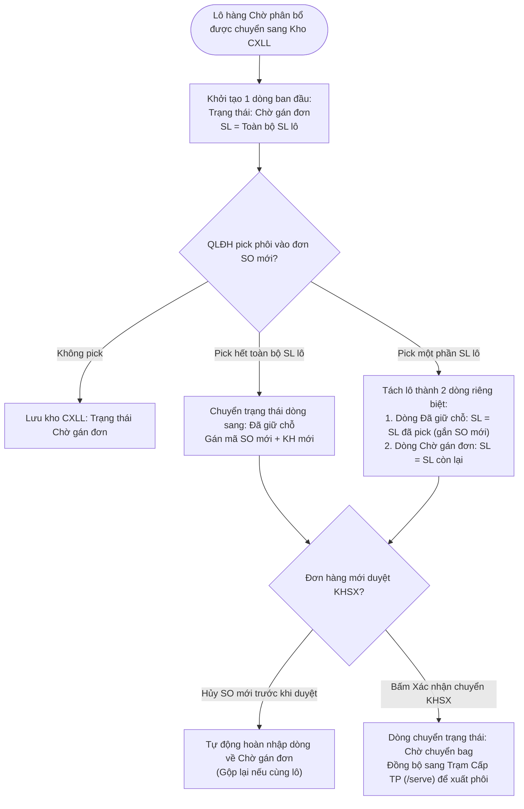

# CS5.E3.US-02: Quản lý danh sách lô chờ xử lý lại

> **Mã Story:** `CS5.E3.US-02` (hay `US-KTP-02`)  
> **Epic:** CS5.Epic 3: Chờ xử lý lại  
> **Module / Feature:** Kho Thành Phẩm / Danh Sách Lô Chờ Xử Lý Lại  
> **Actor chính:** Quản lý Kho thành phẩm (Thủ kho)  
> **Tài liệu tham chiếu:** [Prototype Kho CXLL: /inventory/reprocess](http://localhost:3000/inventory/reprocess)  
> **Trạng thái:** `Ready for Confluence Publish`  

---

## 1. USER STORY *

* **Là một (As a):** Quản lý Kho thành phẩm
* **Tôi muốn (I want):**
    1. Quản lý toàn bộ danh sách các lô có nguồn gốc từ các đơn hàng đã bị hủy tại màn hình **Danh Sách Lô Chờ Xử Lý Lại**.
    2. Theo dõi số lượng thông qua **1 cột `SL` duy nhất**, phản ánh chính xác số lượng cho trạng thái của lô trên từng dòng.
    3. Trường hợp 1 lô có nhiều trạng thái (ví dụ tổng 10 pcs gồm: 3 pcs chờ gán đơn, 3 pcs đã giữ chỗ, 4 pcs chờ chuyển bag), hệ thống tự động **tách làm 3 dòng riêng biệt** với 3 trạng thái tương ứng.
    4. Trực tiếp theo dõi đơn hàng mới được gán (Mã SO mới, Khách hàng mới, Mã Bag mới) trên từng dòng đã giữ chỗ hoặc chờ chuyển bag.
* **Để (So that):** Ngăn chặn tuyệt đối việc pick trùng một lô cho nhiều đơn hàng khác nhau, loại bỏ hoàn toàn ô dữ liệu phức tạp/popover, giữ giao diện bảng luôn phẳng, tinh gọn và đối soát số lượng tức thì.

---

## 2. TIÊU CHÍ CHẤP NHẬN (ACCEPTANCE CRITERIA - AC) *

* **AC 1: Hiển thị danh sách với 1 cột SL duy nhất và cơ chế tách dòng theo trạng thái**
  * **Given (Biết rằng):** Thủ kho truy cập màn hình `DS Chờ xử lý lại` (`/inventory/reprocess`).
  * **Then (Thì):** Hệ thống hiển thị 4 Tabs trạng thái trên thanh công cụ: `Tất cả`, `Chờ gán đơn`, `Đã giữ chỗ`, `Chờ chuyển bag`.
  * **And (Và):** Bảng dữ liệu chỉ có **1 cột `SL` duy nhất**, hiển thị số lượng pcs của trạng thái trên dòng đó.
  * **And (Và):** Nếu 1 lô phôi có các pcs ở nhiều trạng thái khác nhau (ví dụ: một phần còn chờ gán đơn, một phần đã giữ chỗ cho đơn mới, một phần đã duyệt KHSX chờ chuyển bag), hệ thống tự động tách thành các dòng độc lập tương ứng với từng trạng thái.

* **AC 2: Chuẩn hóa 3 trạng thái kho và màu sắc trực quan**
  * **Given (Biết rằng):** Mỗi dòng hiển thị một trạng thái kho cụ thể:
    * **`Chờ gán đơn`** (Badge xanh lá `bg-emerald-50 text-emerald-700 border-emerald-200`): Pcs phôi còn tự do trong két kho, sẵn sàng để QLĐH pick vào đơn hàng mới.
    * **`Đã giữ chỗ`** (Badge tím `bg-purple-50 text-purple-700 border-purple-200`): Pcs phôi đã được pick vào đơn hàng mới và đang khóa giữ chỗ (chờ duyệt KHSX).
    * **`Chờ chuyển bag`** (Badge xanh dương `bg-blue-50 text-blue-700 border-blue-200`): Pcs phôi đã được duyệt KHSX, sẵn sàng xuất phôi tại Trạm Cấp TP để làm mới.
  * **Then (Thì):** Thủ kho nhận biết ngay tiến độ xử lý của từng phần phôi mà không cần bấm mở chi tiết.

* **AC 3: Hiển thị trực tiếp tại cột Mã Đơn Hàng Mới**
  * **Given (Biết rằng):** Mỗi dòng đã gắn liền với 1 trạng thái và 1 đơn hàng mới (nếu có):
    * Dòng ở trạng thái **`Chờ gán đơn`**: Cột `MÃ ĐƠN HÀNG MỚI` hiển thị dấu gạch ngang mờ `—`.
    * Dòng ở trạng thái **`Đã giữ chỗ`** hoặc **`Chờ chuyển bag`**: Cột `MÃ ĐƠN HÀNG MỚI` hiển thị trực tiếp link `SO...` (click mở chi tiết đơn trong QLĐH) kèm tên khách hàng mới và mã bag mới.
  * **Then (Thì):** Bảng dữ liệu phẳng 100%, không bị vỡ dòng, không cần popover đa đơn hàng.

* **AC 4: Tự động khóa giữ chỗ khi QLĐH pick phôi**
  * **Given (Biết rằng):** Dòng phôi đang ở trạng thái `Chờ gán đơn` với số lượng K pcs.
  * **When (Khi):** Nhân viên kinh doanh / QLĐH chọn pick M pcs (với M ≤ K) vào đơn hàng mới (tại `/orders/create` hoặc `/orders/[id]`).
  * **Then (Thì):** 
    * Nếu M = K (pick hết cả dòng): Dòng này chuyển trạng thái từ `Chờ gán đơn` sang `Đã giữ chỗ`, hiển thị link SO mới và khách hàng mới.
    * Nếu M < K (pick một phần): Dòng này tự động tách thành 2 dòng: 1 dòng `Đã giữ chỗ` với M pcs (gắn SO mới) và 1 dòng `Chờ gán đơn` với (K - M) pcs còn lại.

* **AC 5: Chống pick trùng tuyệt đối**
  * **Given (Biết rằng):** Các dòng phôi ở trạng thái `Đã giữ chỗ` hoặc `Chờ chuyển bag`.
  * **When (Khi):** QLĐH đồng bộ danh sách tồn khả dụng CXLL để gán vào đơn hàng khác.
  * **Then (Thì):** Hệ thống chỉ đồng bộ các dòng ở trạng thái `Chờ gán đơn`. Các dòng đã giữ chỗ hoặc chờ chuyển bag tuyệt đối không hiển thị, ngăn chặn triệt để việc gán trùng.

* **AC 6: Tự động hoàn nhập khi đơn hàng mới bị hủy (trước khi chuyển KHSX)**
  * **Given (Biết rằng):** Dòng phôi đang ở trạng thái `Đã giữ chỗ` cho đơn hàng mới.
  * **When (Khi):** Đơn hàng mới bị hủy bỏ hoặc xóa dòng hàng trước khi bấm Chuyển KHSX.
  * **Then (Thì):** Dòng phôi tự động chuyển trạng thái hoàn nhập về `Chờ gán đơn`, xóa liên kết với đơn hàng mới, giải phóng phôi để các đơn hàng khác có thể pick lại. Nếu lô gốc đã có dòng `Chờ gán đơn`, hệ thống tự động gộp số lượng lại thành 1 dòng.

* **AC 7: Chốt chặn điều chuyển từ Kho Tồn Thành Phẩm sang CXLL**
  * **Given (Biết rằng):** Thủ kho thao tác tại màn hình Tồn kho thành phẩm (`/inventory`).
  * **When (Khi):** Thủ kho chọn một hoặc nhiều lô để Chuyển CXLL.
  * **Then (Thì):** Chỉ cho phép bấm `[Chuyển CXLL]` đối với các lô đang ở trạng thái **`Chờ phân bổ`**. Các lô ở trạng thái khác (`Chờ lập HĐ`, `Chờ giao`, `Đã phân bổ`) bị khóa nút và checkbox, ngăn chặn việc chuyển nhầm hàng đang trong quy trình xuất bán.

---

## 3. THIẾT KẾ (UX/UI) *

* **Link Prototype:** [Màn hình Danh Sách Chờ Xử Lý Lại: /inventory/reprocess](http://localhost:3000/inventory/reprocess)
* **Quy chuẩn bố cục bảng (12 cột chuẩn hóa):**
  1. `MÃ LÔ`: Mã phôi gốc (Font-mono, copy 1-click).
  2. `MÃ ITEM`: Mã 30 ký tự định danh mẫu sản phẩm (Font-mono, copy 1-click).
  3. `CHỦNG LOẠI`: Nhẫn, Bông tai, Vòng tay, Dây chuyền...
  4. `MÃ SO CŨ`: Mã đơn hàng cũ bị hủy (Font-mono).
  5. `KHÁCH HÀNG CŨ`: Tên khách hàng của đơn cũ (giữ nguyên vết truy xuất).
  6. `TUỔI VÀNG`: Hàm lượng tuổi vàng (VD: `AU 61.00 Y`, `AU 75.00 Y`).
  7. `SL`: Chỉ 1 cột duy nhất, hiển thị số lượng pcs của trạng thái trên dòng đó.
  8. `TRẠNG THÁI KHO`: 3 trạng thái chuẩn hóa (`Chờ gán đơn`, `Đã giữ chỗ`, `Chờ chuyển bag`).
  9. `MÃ ĐƠN HÀNG MỚI`: Hiển thị SO + KH mới + Bag mới nếu có, hoặc `—` nếu Chờ gán đơn.
  10. `TL VÀNG (L)`: Trọng lượng vàng phân bổ cho dòng (4 số thập phân, đơn vị: Lượng L).
  11. `TL ĐÁ`: Trọng lượng đá phân bổ cho dòng (4 số thập phân, nếu không có đá hiển thị `—`).
  12. `TỔNG TL`: Tổng trọng lượng của dòng (= TL Vàng + TL Đá).

---

## 4. QUY TẮC NGHIỆP VỤ (BUSINESS RULES) *

* **BR-CXLL-01 (Cơ chế 1 cột SL và tách dòng theo trạng thái):**
  * Bảng danh sách sử dụng duy nhất 1 cột `SL` để phản ánh số lượng cho trạng thái của lô trên dòng đó.
  * Trường hợp 1 lô gồm các pcs ở nhiều trạng thái khác nhau (ví dụ tổng 10 pcs: 3 pcs chờ gán đơn, 3 pcs đã giữ chỗ, 4 pcs chờ chuyển bag), hệ thống tự động tách làm các dòng độc lập với trạng thái tương ứng.
  * Trọng lượng kim loại và trọng lượng đá của từng dòng tách được phân bổ theo tỷ lệ: `SL_dong ÷ Tong_SL_lo`, đảm bảo tổng trọng lượng các dòng luôn bằng chính xác trọng lượng lô gốc.
* **BR-CXLL-02 (Chuẩn hóa 3 trạng thái kho):**
  * `Chờ gán đơn`: Phôi tự do trong két kho, sẵn sàng gán cho đơn hàng mới (`SL` > 0).
  * `Đã giữ chỗ`: Đã được QLĐH pick vào đơn mới và đang khóa chờ duyệt KHSX.
  * `Chờ chuyển bag`: Đơn mới đã duyệt KHSX, sẵn sàng chuyển Bag mới tại Trạm Cấp TP.
* **BR-CXLL-03 (Quy chuẩn hiển thị đơn hàng mới):**
  * Dòng ở trạng thái `Chờ gán đơn`: Hiển thị dấu gạch ngang mờ `—`.
  * Dòng ở trạng thái `Đã giữ chỗ` hoặc `Chờ chuyển bag`: Hiển thị trực tiếp mã SO mới (link click chuyển trang) kèm tên khách hàng mới và mã bag mới.
* **BR-CXLL-04 (Quy chuẩn hiển thị số liệu):**
  * Bỏ toàn bộ chữ "pcs" trong các ô số lượng, chỉ hiển thị số nguyên thuần túy (VD: `3`, `4`, `1`).
  * Trường hợp giá trị bằng 0 luôn hiển thị dấu gạch ngang mờ `—` (triệt tiêu rác thị giác).
* **BR-CXLL-05 (Chốt chặn điều chuyển sang CXLL):** Chỉ các lô đang ở trạng thái `Chờ phân bổ` tại Kho Tồn Thành Phẩm mới được phép Chuyển CXLL. Các lô đang ở trạng thái `Chờ lập HĐ`, `Chờ giao`, `Đã phân bổ` bị chặn tuyệt đối.
* **BR-CXLL-06 (Bảo toàn định danh và lịch sử gốc):** Toàn bộ thông số gốc của lô (Mã Item, Chủng loại, Mã SO cũ, Khách hàng cũ, Tuổi vàng) được bảo toàn lưu vết 100% trên mọi dòng tách của lô đó.

---

## 5. DANH MỤC DỮ LIỆU & RÀNG BUỘC

### 5.1 Màn hình Danh sách chờ xử lý lại (`/inventory/reprocess`)

| Fields (Tên trường) | Type (Kiểu dữ liệu) | Required (Bắt buộc) | Default value (Giá trị mặc định) | Rules (Quy tắc & Nghiệp vụ) |
| :--- | :--- | :---: | :--- | :--- |
| **Mã Lô** | Text / Font-mono | Có | Kế thừa từ Kho TP | Mã định danh duy nhất của lô/bag phôi (VD: `SO-260800065`). Có icon copy 1-click. |
| **Mã Item** | Text / Font-mono | Có | Kế thừa từ Kho TP | Mã 30 ký tự định danh mẫu sản phẩm. Có icon copy 1-click. |
| **Chủng Loại** | Text | Có | Kế thừa từ Kho TP | Nhẫn, Bông tai, Vòng tay, Mặt dây... |
| **Mã SO Cũ** | Text / Font-mono | Có | Kế thừa từ Kho TP | Mã đơn hàng cũ đã bị hủy (VD: `SO123456`). |
| **Khách Hàng Cũ** | Text | Có | Kế thừa từ Kho TP | Tên khách hàng của đơn cũ đã hủy. |
| **Tuổi Vàng** | Text | Có | Kế thừa từ Kho TP | Hàm lượng tuổi vàng (VD: `AU 61.00 Y`, `AU 75.00 Y`). |
| **SL** | Integer | Có | Kế thừa | Số lượng pcs cho trạng thái của lô trên dòng đó. Chỉ hiển thị số nguyên. |
| **Trạng Thái Kho** | Enum / Badge | Có | `Chờ gán đơn` | 1 trong 3 trạng thái: `Chờ gán đơn` (xanh lá) / `Đã giữ chỗ` (tím) / `Chờ chuyển bag` (xanh dương). |
| **Mã Đơn Hàng Mới** | Text / Link | Không | `—` | Hiển thị link SO mới + KH mới + Bag mới nếu trạng thái là `Đã giữ chỗ` hoặc `Chờ chuyển bag`. Hiển thị `—` nếu `Chờ gán đơn`. |
| **TL Vàng (L)** | Decimal | Có | Kế thừa (tính theo tỷ lệ SL dòng) | Trọng lượng vàng của dòng (làm tròn đến 4 số thập phân, đơn vị: Lượng L). |
| **TL Đá** | Decimal | Có | Kế thừa (tính theo tỷ lệ SL dòng) | Trọng lượng đá của dòng (làm tròn đến 4 số thập phân). Nếu không có đá hiển thị dấu gạch ngang mờ `—`. |
| **Tổng TL** | Decimal | Có | Kế thừa (tính theo tỷ lệ SL dòng) | Tổng trọng lượng toàn bộ sản phẩm của dòng (làm tròn đến 4 số thập phân). Công thức: `Tổng TL = TL Vàng + TL Đá`. |

---

## 6. LUỒNG NGHIỆP VỤ (MERMAID FLOW)



---

## 7. GHI CHÚ KỸ THUẬT & VALIDATION (TECH NOTES)

1. **Thuật toán Tách Dòng theo Trạng thái (Row Splitting Algorithm):**
   ```text
   Mỗi lô phôi (lot) có tổng số lượng totalQty và 3 chỉ tiêu:
     - availableQty: Số pcs chờ gán đơn
     - holdQty: Số pcs đã giữ chỗ
     - servedQty: Số pcs chờ chuyển bag
   
   Quy tắc tạo dòng hiển thị:
     1. Nếu servedQty > 0: Tạo 1 dòng với status = "Chờ chuyển bag", qty = servedQty, tỷ lệ TL = servedQty / totalQty.
     2. Nếu holdQty > 0: Tạo 1 dòng với status = "Đã giữ chỗ", qty = holdQty, tỷ lệ TL = holdQty / totalQty.
     3. Nếu availableQty > 0: Tạo 1 dòng với status = "Chờ gán đơn", qty = availableQty, tỷ lệ TL = availableQty / totalQty.
   ```
2. **Quy chuẩn Định dạng Hiển thị Số liệu & Màu sắc:**
   - **Số lượng (SL):** Chỉ hiển thị số nguyên thuần túy (VD: `3`, `4`, `1`). Tuyệt đối không hiển thị chữ "pcs" trong ô bảng.
   - **Bảng màu Badge Trạng Thái Kho:**
     - Xanh lá (`bg-emerald-50 text-emerald-700 border-emerald-200`): Chờ gán đơn
     - Tím (`bg-purple-50 text-purple-700 border-purple-200`): Đã giữ chỗ
     - Xanh dương (`bg-blue-50 text-blue-700 border-blue-200`): Chờ chuyển bag
   - **Định dạng công thức:** Sử dụng Plain text và ký hiệu Unicode (`=`, `+`, `-`, `—`, `≤`, `≥`, `÷`), tuyệt đối không dùng mã LaTeX.
