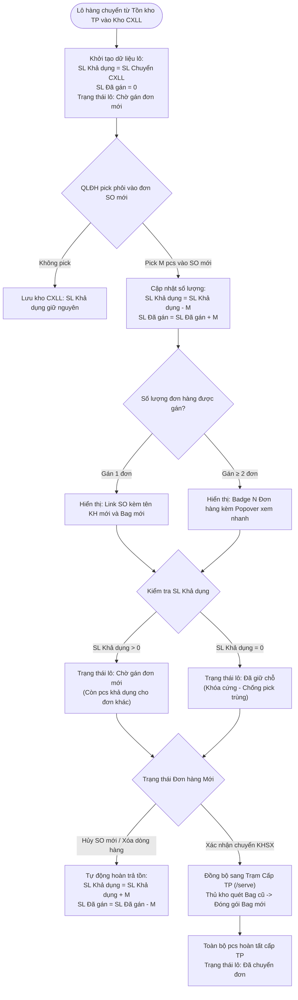

# CS5.E3.US-02: Quản lý danh sách lô chờ xử lý lại

> **Mã Story:** `CS5.E3.US-02` (hay `US-KTP-02`)  
> **Epic:** CS5.Epic 3: Chờ xử lý lại  
> **Module / Feature:** Kho Thành Phẩm / Danh Sách Lô Chờ Xử Lý Lại  
> **Actor chính:** Quản lý Kho thành phẩm (Thủ kho)  
> **Tài liệu tham chiếu:** [Prototype Kho CXLL: /inventory/reprocess](http://localhost:3000/inventory/reprocess)  
> **Trạng thái:** `Ready for Confluence Publish`  

---

## 1. USER STORY *

* **Là một (As a):** Quản lý Kho thành phẩm
* **Tôi muốn (I want):**
    1. Quản lý toàn bộ danh sách các lô có nguồn gốc từ các đơn hàng đã bị hủy tại màn hình **Danh Sách Lô Chờ Xử Lý Lại**.
    2. Theo dõi 2 chỉ tiêu số lượng của từng lô:
       * `SL khả dụng`: Số lượng pcs còn tự do trong két kho, sẵn sàng để gán cho đơn hàng khác.
       * `SL đã gán`: Tổng số lượng pcs đã có chủ (bao gồm cả đang giữ chỗ chờ duyệt và đã chuyển sang Bag mới làm mới).
       * *Công thức bảo toàn:* `Tổng SL = SL khả dụng + SL đã gán`.
    3. Trạng thái kho của lô tự động xác định theo **trạng thái thấp nhất của các pcs trong lô**:
       * `Chờ gán đơn mới`: Lô còn ít nhất 1 pcs khả dụng để gán tiếp (`SL khả dụng > 0`).
       * `Đã giữ chỗ`: Toàn bộ pcs của lô đã được gán hết vào đơn mới và đang giữ chỗ (`SL khả dụng = 0` và có pcs giữ chỗ).
       * `Đã chuyển đơn`: Toàn bộ pcs trong lô đã hoàn tất Cấp thành phẩm sang Bag mới.
    4. Quản lý thông tin đơn hàng mới một cách rõ ràng: Hiển thị trực tiếp mã đơn hàng mới nếu gán 1 đơn, hoặc hiển thị Badge tổng hợp khi 1 lô gán cho từ 2 đơn hàng trở lên.
* **Để (So that):** Ngăn chặn tuyệt đối việc gán trùng một lô cho nhiều đơn hàng khác nhau, tối ưu hóa việc tái sử dụng phôi theo từng pcs lẻ và giữ giao diện bảng luôn tinh gọn, chuẩn xác.

---

## 2. TIÊU CHÍ CHẤP NHẬN (ACCEPTANCE CRITERIA - AC) *

* **AC 1: Hiển thị danh sách và 2 cột số lượng tinh gọn**
  * **Given (Biết rằng):** Thủ kho truy cập màn hình `DS Chờ xử lý lại` (`/inventory/reprocess`).
  * **Then (Thì):** Bảng dữ liệu hiển thị rõ ràng 2 cột số lượng:
    * `SL KHẢ DỤNG`: Số pcs còn có thể gán cho đơn khác (nếu = 0 hiển thị dấu `—`).
    * `SL ĐÃ GÁN`: Tổng số pcs đã có chủ (gồm đang giữ chỗ + đã chuyển, nếu = 0 hiển thị dấu `—`).
  * **And (Và):** Ô dữ liệu chỉ hiển thị số nguyên thuần túy (không đính kèm chữ "pcs"). Dấu gạch ngang `—` mờ khi giá trị = 0.

* **AC 2: Trạng thái lô bắt theo trạng thái thấp nhất của pcs trong lô**
  * **Biết rằng (Given):** Lô phôi có tổng cộng N pcs nằm tại Kho CXLL.
  * **Khi (When):** Các pcs trong lô có trạng thái khác nhau:
    * Nếu trong lô còn ít nhất 1 pcs khả dụng (`SL khả dụng > 0`): Trạng thái của lô hiển thị là **`Chờ gán đơn mới`** (badge xanh lá tươi).
    * Nếu lô hết pcs khả dụng (`SL khả dụng = 0`) nhưng có pcs đang giữ chỗ: Trạng thái của lô hiển thị là **`Đã giữ chỗ`** (badge tím hoàng gia).
    * Nếu toàn bộ pcs trong lô đã được duyệt KHSX và chuyển bag: Trạng thái của lô hiển thị là **`Đã chuyển đơn`** (badge xanh dương đậm).
  * **Thì (Then):** Người dùng luôn nhận diện chính xác lô nào còn có thể khai thác tiếp chỉ bằng việc nhìn vào màu sắc và trạng thái.

* **AC 3: Xử lý hiển thị tại cột Mã Đơn Hàng Mới**
  * **Biết rằng (Given):** Lô phôi đã có pcs được gán vào đơn hàng mới (`SL đã gán > 0`).
  * **Khi (When):** 
    * Nếu lô được gán cho **1 đơn hàng duy nhất**: Cột `MÃ ĐƠN HÀNG MỚI` hiển thị link `SO...` kèm tên khách hàng mới và mã bag mới.
    * Nếu lô được gán cho **≥ 2 đơn hàng khác nhau**: Cột `MÃ ĐƠN HÀNG MỚI` hiển thị Badge **`N Đơn hàng ↗`** (màu tím).
  * **Thì (Then):** 
    * Khi rê chuột (hover) vào Badge: Hiển thị Popover tóm tắt danh sách các đơn hàng kèm số lượng pcs từng đơn.
    * Khi click vào dòng: Mở Drawer chi tiết hiển thị đầy đủ thông tin chi tiết từng đơn hàng. Ô dữ liệu không bị vỡ dòng hoặc đội chiều cao.

* **AC 4: Tự động khóa giữ chỗ khi QLĐH gán đơn mới**
  * **Biết rằng (Given):** Lô đang có `SL khả dụng = K` tại Kho CXLL.
  * **Khi (When):** QLĐH chọn pick M pcs (với M ≤ K) từ lô này vào đơn hàng mới (tại `/orders/create` hoặc `/orders/[id]`).
  * **Thì (Then):** Hệ thống tự động trừ M pcs khỏi `SL khả dụng` và cộng M pcs vào `SL đã gán`.
  * **And (Và):** Trạng thái của lô tự động cập nhật lại theo quy tắc pcs thấp nhất.

* **AC 5: Chống pick trùng tuyệt đối**
  * **Biết rằng (Given):** Lô phôi có `SL khả dụng = 0` (đã gán hết).
  * **When (Khi):** QLĐH mở popup đồng bộ DS tồn khả dụng CXLL để gán vào đơn mới.
  * **Then (Thì):** Hệ thống không hiển thị lô này trong danh sách gợi ý khả dụng, ngăn chặn hoàn toàn việc gán vượt quá số lượng tồn.

* **AC 6: Hoàn lại SL khả dụng nếu Đơn hàng mới bị hủy (trước khi chuyển KHSX)**
  * **Biết rằng (Given):** Lô phôi đang có M pcs đã gán (đang giữ chỗ) cho đơn hàng mới.
  * **Khi (When):** Đơn hàng mới bị hủy bỏ hoặc xóa dòng hàng trước khi bấm Chuyển KHSX.
  * **Thì (Then):** Hệ thống tự động trừ M pcs khỏi `SL đã gán` và hoàn nhập M pcs về `SL khả dụng`. Trạng thái của lô tự động cập nhật lại theo quy tắc pcs thấp nhất.

* **AC 7: Điều chuyển sang Trạm Cấp TP khi duyệt KHSX**
  * **Biết rằng (Given):** Lô phôi có pcs đang giữ chỗ cho đơn hàng mới.
  * **Khi (When):** Đơn hàng mới được bấm `[Xác nhận chuyển KHSX]`.
  * **Thì (Then):** Các pcs đã gán được tự động chuyển sang trạm **Cấp TP (Serve FG)** (`/inventory/reprocess/serve`) để thực hiện chuyển Bag cũ sang Bag mới.

---

## 3. THIẾT KẾ (UX/UI) *

* **Link Figma / Prototype:** [Màn hình Danh Sách Chờ Xử Lý Lại: /inventory/reprocess](http://localhost:3000/inventory/reprocess)
* **Ảnh đính kèm:**
  * *Giao diện bảng danh sách lô phôi chuẩn hóa 13 cột với 2 cột SL khả dụng & SL đã gán, xử lý đa đơn hàng dạng Badge Popover và 3 gam màu trạng thái tương phản cao:*

    

---

## 4. QUY TẮC NGHIỆP VỤ (BUSINESS RULES) *

* **BR-CXLL-01 (Cơ cấu số lượng lô):** Bảng danh sách chính thể hiện 2 chỉ tiêu số lượng cốt lõi:
  * `SL khả dụng`: Số lượng pcs phôi còn tự do trong két kho, có thể gán cho đơn khác.
  * `SL đã gán`: Tổng số lượng pcs phôi đã có chủ (gồm cả đang giữ chỗ chờ duyệt và đã chuyển bag làm mới).
  * *Công thức bảo toàn:* `Tổng SL = SL khả dụng + SL đã gán`.
  * *Bóc tách chi tiết:* Chi tiết số lượng đang giữ chỗ và số lượng đã chuyển sang Bag mới được hiển thị tại Drawer chi tiết khi click dòng.
* **BR-CXLL-02 (Quy tắc xác định trạng thái theo pcs thấp nhất):** Trạng thái hiển thị của lô được xác định theo trạng thái thấp nhất của các pcs bên trong (Thứ bậc từ thấp đến cao: `Chờ gán đơn mới` < `Đã giữ chỗ` < `Đã chuyển đơn`):
  * `SL khả dụng > 0` → Trạng thái lô = **`Chờ gán đơn mới`** (Badge xanh lá tươi `bg-emerald-50 text-emerald-700`).
  * `SL khả dụng = 0` và có pcs đang giữ chỗ → Trạng thái lô = **`Đã giữ chỗ`** (Badge tím hoàng gia `bg-purple-50 text-purple-700`).
  * `SL khả dụng = 0` và toàn bộ pcs đã chuyển đơn → Trạng thái lô = **`Đã chuyển đơn`** (Badge xanh dương đậm `bg-blue-50 text-blue-700`).
* **BR-CXLL-03 (Quy chuẩn hiển thị đơn hàng mới):** Khi 1 lô được chia gán cho đơn hàng mới:
  * Gán 1 đơn: Hiển thị trực tiếp link SO mới kèm tên khách hàng mới và mã bag mới.
  * Gán từ 2 đơn trở lên: Cột *Mã Đơn Hàng Mới* hiển thị Badge tổng hợp **`N Đơn hàng ↗`** để giữ nguyên chiều cao dòng và cấu trúc phẳng của bảng. Hover chuột vào Badge hiển thị Popover tóm tắt danh sách SO và số lượng pcs. Click vào dòng hiển thị chi tiết trong Drawer bên phải.
* **BR-CXLL-04 (Quy chuẩn hiển thị số liệu):** Bỏ toàn bộ chữ "pcs" trong các ô số lượng trên bảng danh sách, chỉ hiển thị số nguyên thuần túy (VD: `2`, `4`, `1`). Trường hợp giá trị bằng 0 luôn hiển thị dấu gạch ngang mờ `—` (triệt tiêu rác thị giác).
* **BR-CXLL-05 (Cơ chế khóa giữ chỗ):** Khi gán vào SO mới, chỉ được phép gán số lượng ≤ `SL khả dụng`. Hệ thống lập tức khóa giữ chỗ và trừ tồn khả dụng tương ứng trong thời gian thực.
* **BR-CXLL-06 (Hoàn nhập tồn khi hủy SO mới):** Nếu đơn hàng mới bị hủy bỏ trước khi chuyển KHSX, toàn bộ số lượng pcs đã giữ chỗ được tự động hoàn nhập về `SL khả dụng`.
* **BR-CXLL-07 (Điều chuyển sang Trạm Cấp TP khi duyệt KHSX):** Khi đơn hàng mới được bấm `[Xác nhận chuyển KHSX]` (luồng Làm mới), các pcs đã gán được tự động đồng bộ sang màn hình **Cấp TP (Serve FG)** (`/inventory/reprocess/serve`) để chuyển Bag cũ sang Bag mới.
* **BR-CXLL-08 (Bảo toàn định danh và trọng lượng phôi):** Toàn bộ thông số gốc của lô (Mã Item, Chủng loại, Mã SO cũ, Khách hàng cũ, Tuổi vàng, TL Vàng, TL Đá, Tổng TL) được bảo toàn lưu vết 100% để phục vụ đối soát hao hụt và tính toán nguyên phụ liệu làm mới.

---

## 5. DANH MỤC DỮ LIỆU & RÀNG BUỘC

### 5.1 Màn hình Danh sách chờ xử lý lại (`/inventory/reprocess`)

| Fields (Tên trường) | Type (Kiểu dữ liệu) | Required (Bắt buộc) | Default value (Giá trị mặc định) | Rules (Quy tắc & Nghiệp vụ) |
| :--- | :--- | :---: | :--- | :--- |
| **Mã Lô** | Text / Font-mono | Có | Kế thừa từ Kho TP | Mã định danh duy nhất của lô/bag phôi (VD: `SO-260800061`). Có icon copy 1-click. |
| **Mã Item** | Text / Font-mono | Có | Kế thừa từ Kho TP | Mã 30 ký tự định danh mẫu sản phẩm. |
| **Chủng Loại** | Text | Có | Kế thừa từ Kho TP | Nhẫn, Bông tai, Vòng tay, Mặt dây... |
| **Mã SO Cũ** | Text / Font-mono | Có | Kế thừa từ Kho TP | Mã đơn hàng cũ đã bị hủy (VD: `SO123456`). |
| **Khách Hàng Cũ** | Text | Có | Kế thừa từ Kho TP | Tên khách hàng của đơn cũ đã hủy. |
| **Tuổi Vàng** | Text | Có | Kế thừa từ Kho TP | Hàm lượng tuổi vàng (VD: `AU 61.00 Y`, `AU 75.00 Y`). |
| **SL Khả Dụng** | Integer | Có | Kế thừa (= SL Chuyển CXLL) | Số lượng pcs trong lô còn tự do, có thể gán cho đơn hàng khác. Chỉ hiển thị số nguyên, nếu = 0 hiển thị dấu gạch ngang mờ `—`. |
| **SL Đã Gán** | Integer | Có | `0` | Tổng số lượng pcs đã có chủ (giữ chỗ + đã chuyển sang bag mới). Chỉ hiển thị số nguyên, nếu = 0 hiển thị dấu gạch ngang mờ `—`. |
| **Trạng Thái Kho** | Enum / Badge | Có | `Chờ gán đơn mới` | Bắt theo trạng thái thấp nhất của pcs trong lô: `Chờ gán đơn mới` (xanh lá) / `Đã giữ chỗ` (tím) / `Đã chuyển đơn` (xanh dương). |
| **Mã Đơn Hàng Mới** | Text / Link / Badge | Không | `—` | Nếu gán 1 đơn: Hiển thị link SO mới. Nếu gán ≥ 2 đơn: Hiển thị Badge `N Đơn hàng ↗` kèm Popover. |
| **TL Vàng (L)** | Decimal | Có | Kế thừa từ Kho TP | Trọng lượng vàng của lô (làm tròn đến 4 số thập phân, đơn vị: Lượng L). |
| **TL Đá** | Decimal | Có | Kế thừa từ Kho TP | Trọng lượng đá của lô (làm tròn đến 4 số thập phân). Nếu lô không gắn đá thì hiển thị dấu gạch ngang `—`. |
| **Tổng TL** | Decimal | Có | Kế thừa từ Kho TP | Tổng trọng lượng toàn bộ sản phẩm trong lô (làm tròn đến 4 số thập phân). Công thức: `Tổng TL = TL Vàng + TL Đá`. |

---

## 6. LUỒNG NGHIỆP VỤ (MERMAID FLOW)



---

## 7. GHI CHÚ KỸ THUẬT & VALIDATION (TECH NOTES)

1. **Thuật toán Xác định Trạng thái Lô (Status Resolution Algorithm):**
   ```text
   Hàm resolveLotStatus(availableQty, holdQty, servedQty):
     Nếu availableQty > 0:
       Trả về "Chờ gán đơn mới"   // Ưu tiên thấp nhất (còn hàng khả dụng để pick)
     Nếu holdQty > 0:
       Trả về "Đã giữ chỗ"        // Ưu tiên trung gian (toàn bộ đã gán, đang chờ KHSX duyệt)
     Trả về "Đã chuyển đơn"       // Ưu tiên cao nhất (toàn bộ đã chuyển sang Bag mới làm mới)
   ```
2. **Quy chuẩn Định dạng Hiển thị Số liệu & Màu sắc:**
   - **Số lượng:** Chỉ hiển thị số nguyên (VD: `2`, `4`, `1`). Số 0 luôn hiển thị dấu gạch ngang mờ `—` để triệt tiêu rác thị giác.
   - **Bảng màu Badge:**
     - Xanh lá tươi (`bg-emerald-50 text-emerald-700 border-emerald-200`): Chờ gán đơn mới
     - Tím hoàng gia (`bg-purple-50 text-purple-700 border-purple-200`): Đã giữ chỗ
     - Xanh dương đậm (`bg-blue-50 text-blue-700 border-blue-200`): Đã chuyển đơn
   - **Định dạng công thức:** Sử dụng Plain text và ký hiệu Unicode (`=`, `+`, `-`, `—`, `≤`, `≥`), tuyệt đối không dùng mã LaTeX.
