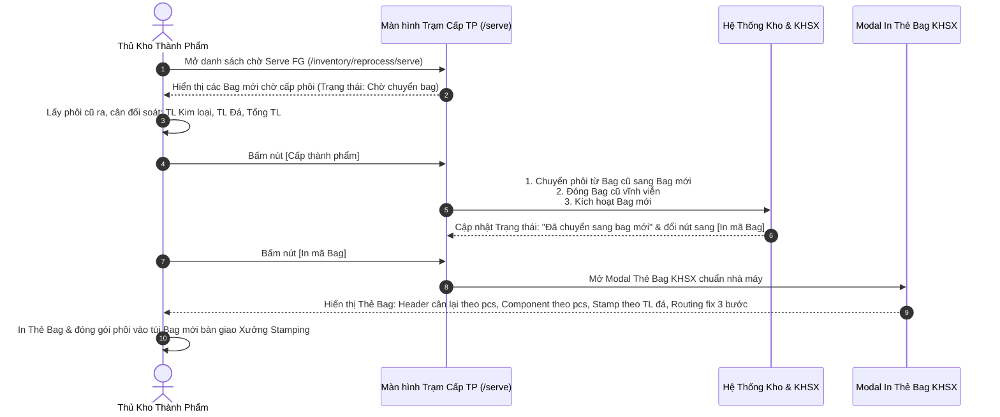

# CS5.E3.US-03: Trạm Cấp Thành Phẩm (Serve FG) - Chuyển Từ Bag Cũ Sang Bag Mới & In Thẻ Bag KHSX

> **Mã Story:** `CS5.E3.US-03` (hay `US-KTP-03`)  
> **Epic:** CS5.Epic 3: Chờ Xử Lý Lại (Kho Thành Phẩm)  
> **Module / Feature:** Kho Thành Phẩm / Trạm Cấp Thành Phẩm & In Thẻ Bag KHSX  
> **Actor chính:** Thủ kho Thành phẩm tại Trạm Cấp Thành Phẩm (Serve FG)  
> **Tài liệu tham chiếu:** [Prototype Vercel: https://dungseva.vercel.app/inventory/reprocess/serve](https://dungseva.vercel.app/inventory/reprocess/serve) | [Localhost: http://localhost:3000/inventory/reprocess/serve](http://localhost:3000/inventory/reprocess/serve)  
> **Trạng thái:** `Ready for Review`  

---

## 1. USER STORY *

*   **Là một (As a):** Thủ kho Thành phẩm tại Trạm Cấp Thành Phẩm (Serve FG)
*   **Tôi muốn (I want):** 
    1. Tiếp nhận danh sách các lô phôi thuộc đơn hàng mới đã được KHSX lập kế hoạch tại màn hình **Trạm Cấp Thành Phẩm (`/inventory/reprocess/serve`)**.
    2. Thực hiện đối soát trọng lượng thực tế (TL Kim loại, TL Đá, Tổng TL) giữa phôi lấy ra từ két kho cũ và thông số yêu cầu của Bag mới.
    3. Bấm nút **`[Cấp thành phẩm]`** để xác nhận chuyển phôi từ **Bag cũ sang Bag mới** của đơn hàng mới và đóng Bag cũ vĩnh viễn trên hệ thống.
    4. Sau khi cấp thành phẩm thành công, hệ thống chuyển sang nút **`[In mã Bag]`** để tôi có thể in Thẻ Bag KHSX mới theo đúng format chuẩn nhà máy kim hoàn (2 cột, tiêu đề xanh đậm `#1e40af`, Barcode Code 128, cân lại trọng lượng theo pcs, component theo pcs, mã stamp theo TL đá, routing fix 3 bước lấy từ đơn hàng).
*   **Để (So that):** Bàn giao đúng và đủ phôi vật lý kèm Thẻ Bag KHSX chuẩn xác sang Xưởng Stamping (khắc logo, stamp đá, tẩy xi), bảo đảm quy trình sản xuất làm mới thông suốt và không bị sai lệch số liệu.

---

## 2. TIÊU CHÍ CHẤP NHẬN (ACCEPTANCE CRITERIA - AC) *

*   **AC 1: Hiển thị danh sách Bag chờ cấp phôi**
    *   **Given (Biết rằng):** KHSX đã phân tách lệnh làm mới cho đơn hàng SO2608011.
    *   **When (Khi):** Thủ kho mở màn hình `/inventory/reprocess/serve`.
    *   **Then (Thì):** Hệ thống hiển thị danh sách các Bag mới với trạng thái `Chờ chuyển bag` (badge vàng, hiển thị trên 1 dòng `min-w-[170px] whitespace-nowrap`).
    *   **And (Và):** Cột thao tác hiển thị duy nhất nút **`[Cấp thành phẩm]`** (màu xanh rêu).

*   **AC 2: Thao tác Cấp thành phẩm (Đóng Bag cũ & Chuyển Bag mới)**
    *   **Biết rằng (Given):** Thủ kho đã lấy phôi cũ ra khỏi két và đối soát trùng khớp trọng lượng thực tế.
    *   **Khi (When):** Thủ kho bấm nút **`[Cấp thành phẩm]`** tại dòng tương ứng.
    *   **Thì (Then):** Hệ thống thực hiện chuyển phôi vào Bag mới, đóng Bag cũ vĩnh viễn.
    *   **And (Và):** Cột TRẠNG THÁI đổi sang badge xanh `Đã chuyển sang bag mới`.
    *   **And (Và):** Cột THAO TÁC chuyển từ nút `[Cấp thành phẩm]` sang nút **`[In mã Bag]`**.

*   **AC 3: In Thẻ Bag KHSX mới chuẩn định dạng nhà máy**
    *   **Biết rằng (Given):** Lô hàng đã ở trạng thái `Đã chuyển sang bag mới`.
    *   **When (Khi):** Thủ kho bấm nút **`[In mã Bag]`**.
    *   **Then (Thì):** Modal in hiển thị chuẩn 100% format nhà máy:
        - Layout 2 cột, tiêu đề xanh `#1e40af`, viền bảng đen mảnh, Barcode Code 128.
        - Khối Header cân lại theo tổng pcs trong lô (TL đá, TL kim loại, Tổng TL).
        - Component Cast và Component Đá nhân tỷ lệ theo số pcs trong lô.
        - Bảng Stamp hiển thị đúng mã Stamp ứng với TL đá của lô.
        - Danh sách bước thực thi hiển thị chính xác Routing Fix 3 bước lấy từ đơn hàng.

*   **AC 4: Tinh giản giao diện không có icon máy in thừa**
    *   **Given (Biết rằng):** Lô hàng đang ở trạng thái `Chờ chuyển bag`.
    *   **Then (Thì):** Cột thao tác không hiển thị icon máy in phụ trước khi cấp phôi, chỉ hiển thị duy nhất nút `[Cấp thành phẩm]`.

---

## 3. THIẾT KẾ (UX/UI) *

*   **Link Prototype:** [Vercel Production: https://dungseva.vercel.app/inventory/reprocess/serve](https://dungseva.vercel.app/inventory/reprocess/serve) | [Localhost: http://localhost:3000/inventory/reprocess/serve](http://localhost:3000/inventory/reprocess/serve)
*   **Ảnh đính kèm:**
    *   *Ảnh 1: Màn hình Trạm Cấp TP với trạng thái phẳng và nút thao tác tinh giản:*
      
        

    *   *Ảnh 2: Format Thẻ In Bag KHSX Chuẩn Nhà Máy (Khổ A4/nhãn barcode):*
      
        

---

## 4. QUY TẮC NGHIỆP VỤ (BUSINESS RULES) *

*   **BR-SERVE-01 (Đóng Bag cũ & Chuyển Bag mới):** Thao tác `[Cấp thành phẩm]` chuyển toàn bộ phôi vật lý sang mã Bag mới, đồng thời khóa đóng Bag cũ vĩnh viễn trên hệ thống.
*   **BR-SERVE-02 (Cập nhật hiển thị trạng thái):** Cột TRẠNG THÁI chuyển từ `Chờ chuyển bag` (vàng) sang `Đã chuyển sang bag mới` (xanh ngọc, hiển thị phẳng trên 1 dòng duy nhất `whitespace-nowrap min-w-[170px]`).
*   **BR-SERVE-03 (Quy chuẩn Thẻ Bag KHSX):** Thẻ Bag in ra bắt buộc hiển thị: Cột trái (Thông tin SP, Barcode Code 128, Trọng lượng cân lại theo pcs, Thông tin đơn hàng, Component Cast & Đá); Cột phải (Component HTJ, Routing Fix 3 bước, Bảng Stamp).
*   **BR-SERVE-04 (Mã Stamp theo TL Đá):** Hệ thống tự động gán mã Stamp theo dải trọng lượng đá của lô để xưởng khắc chính xác tại công đoạn Stamping.

---

## 5. DANH MỤC DỮ LIỆU & RÀNG BUỘC

### 5.1 Màn hình Trạm Cấp Thành Phẩm (`/inventory/reprocess/serve`)

| Fields (Tên trường) | Type (Kiểu dữ liệu) | Required (Bắt buộc) | Default value (Giá trị mặc định) | Rules (Quy tắc & Nghiệp vụ) |
| :--- | :--- | :---: | :--- | :--- |
| **STT** | Integer | Có | Tự tăng | Số thứ tự dòng hiển thị |
| **Mã Lô Mới** | Text / Font-mono | Có | Tự động sinh | Mã lô mới của đơn hàng mới (VD: `SO-261024-001`). Đưa lên trước để đối soát tác nghiệp. |
| **Mã SO Mới** | Text / Link | Có | Kế thừa | Mã đơn hàng mới được gán (VD: `SO2608011`). Click mở chi tiết đơn trong QLĐH. |
| **Khách Hàng Mới** | Text | Có | Kế thừa | Tên khách hàng đặt đơn mới. |
| **Mã Item** | Text / Font-mono | Có | Kế thừa | Mã 30 ký tự định danh mẫu sản phẩm. |
| **Chủng Loại** | Text | Có | Kế thừa | Nhẫn, Bông tai, Vòng tay, Mặt dây... |
| **TL Metal (g)** | Decimal | Có | Kế thừa | Trọng lượng kim loại của 1 pcs (4 số lẻ). |
| **TL Đá (g)** | Decimal | Có | Kế thừa | Trọng lượng đá của 1 pcs (4 số lẻ, nếu không có đá hoặc = 0 hiển thị `0.0000`, tuyệt đối không để dấu `—`). |
| **Tổng TL (g)** | Decimal | Có | Kế thừa | Tổng trọng lượng 1 pcs = TL Metal + TL Đá. |
| **Mã Lô Cũ** | Text / Font-mono | Có | Kế thừa | Mã phôi cũ trong két kho CXLL (VD: `SO-260800061`). Chuyển về sau làm thông tin truy vết. |
| **Mã SO Cũ** | Text / Font-mono | Có | Kế thừa | Mã đơn hàng cũ đã bị hủy. |
| **Khách Hàng Cũ** | Text | Có | Kế thừa | Mã và tên khách hàng cũ của lô phôi hủy. |
| **Trạng Thái** | Enum / Badge | Có | `Chờ chuyển bag` | `Chờ chuyển bag` (vàng) hoặc `Đã chuyển sang bag mới` (xanh ngọc). |
| **Thao Tác** | Action / Button | — | — | Khi `Chờ chuyển bag`: Nút `[Cấp thành phẩm]`. Khi `Đã chuyển`: Nút `[In mã Bag]`. |

---

## 6. LUỒNG NGHIỆP VỤ (MERMAID FLOW)

