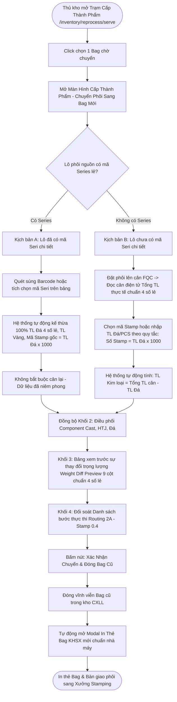

# CS5.E3.US-03: Trạm Cấp Thành Phẩm (Serve FG) - Chuyển Phôi Sang Bag Mới (Hỗ Trợ Có Series & Chưa Có Series)

> **Mã Story:** `CS5.E3.US-03` (hay `US-KTP-03`)  
> **Epic:** CS5.Epic 3: Chờ Xử Lý Lại (Kho Thành Phẩm)  
> **Module / Feature:** Kho Thành Phẩm / Trạm Cấp Thành Phẩm & Điều Phối Chuyển Phôi Sang Bag Mới  
> **Actor chính:** Thủ kho Thành phẩm tại Trạm Cấp Thành Phẩm (Serve FG)  
> **Tài liệu tham chiếu:** [Prototype Vercel: https://dungseva.vercel.app/inventory/reprocess/serve](https://dungseva.vercel.app/inventory/reprocess/serve) | [Localhost: http://localhost:3000/inventory/reprocess/serve](http://localhost:3000/inventory/reprocess/serve)  
> **Trạng thái:** `Ready for Review`  

---

## 1. USER STORY *

*   **Là một (As a):** Thủ kho Thành phẩm tại Trạm Cấp Thành Phẩm (Serve FG)
*   **Tôi muốn (I want):** 
    1. Tiếp nhận danh sách các Bag mới chờ cấp phôi làm mới theo kế hoạch sản xuất (KHSX) tại màn hình **Trạm Cấp Thành Phẩm (`/inventory/reprocess/serve`)**.
    2. Nhấp chọn một Bag để mở **Màn Hình Cấp Thành Phẩm (Serve FG) — Chuyển Phôi Sang Bag Mới** với 4 Khối tác nghiệp trực quan và bảo toàn dữ liệu.
    3. Hệ thống tự động phân loại và hỗ trợ xử lý linh hoạt cho 2 trường hợp:
       * **Kịch bản A (Lô đã có mã Series chi tiết):** Quét súng Barcode hoặc chọn mã Series lẻ đã niêm phong từ trước, kế thừa 100% trọng lượng (TL Đá, TL Vàng, Tổng TL) và mã Stamp gốc, **không bắt buộc phải cân lại**.
       * **Kịch bản B (Lô chưa có mã Series):** Bắt buộc đặt phôi lên cân điện tử FQC để cân lại tổng trọng lượng thực tế và chọn lại mã Stamp theo từng PCS (1 PCS tương ứng 1 Stamp). Quy tắc chuẩn: **`Số Stamp = TL Đá × 1000`** (Ví dụ: `0.0012` ➔ `Stamp = 1.2`; `0.0004` ➔ `Stamp = 0.4`). Hệ thống tự động tính: `TL Kim Loại = Tổng TL (Cân) - TL Đá (Từ Stamp)`.
    4. Toàn bộ thông số trọng lượng (kim loại, đá, tổng) **chỉ lấy đúng 4 số sau dấu thập phân** (Ví dụ: `0.0012`, `0.0123`, `0.0004`, `0.0130`, `0.0134`, `0.0269`...).
    5. Kiểm tra sự điều phối linh kiện (Khuôn đúc, Bán thành phẩm HTJ, Phụ liệu đá) giữa Lô Nguồn và Bag Đích, đối soát dữ liệu qua **Bảng xem trước sự thay đổi trọng lượng (Weight Diff Preview 9 cột)** và lộ trình 5 bước thực thi (Routing 2A).
    6. Bấm nút **`[Xác Nhận Chuyển & Đóng Bag Cũ]`** để hoàn tất việc chuyển phôi, đóng vĩnh viễn Bag cũ trong kho CXLL và in Thẻ Bag KHSX mới chuẩn định dạng nhà máy kim hoàn.
*   **Để (So that):** Bàn giao đúng và đủ phôi vật lý kèm Thẻ Bag KHSX chuẩn xác sang Xưởng Stamping (khắc logo, stamp đá, tẩy xi), bảo đảm quy trình sản xuất làm mới thông suốt và số liệu kế toán - kho - xưởng không bao giờ bị sai lệch.

---

## 2. TIÊU CHÍ CHẤP NHẬN (ACCEPTANCE CRITERIA - AC) *

### 2.1 View 1: Danh Sách Chờ Serve Finish Good (FG)
*   **AC 1: Hiển thị danh sách Bag chờ cấp phôi**
    *   **Given (Biết rằng):** KHSX đã phân tách lệnh làm mới cho đơn hàng mới (VD: SO2608011).
    *   **When (Khi):** Thủ kho mở màn hình `/inventory/reprocess/serve`.
    *   **Then (Thì):** Hệ thống hiển thị danh sách các Bag mới với đầy đủ thông tin: Mã Lô Mới, Mã SO Mới, Khách Hàng Mới, Mã Item, Chủng Loại, TL Kim Loại (4 số lẻ), TL Đá (4 số lẻ), Tổng TL (4 số lẻ), Mã Lô Cũ, Mã SO Cũ, Khách Hàng Cũ, Trạng Thái.
    *   **And (Và):** Cột thao tác hiển thị nút **`[Cấp thành phẩm]`** (màu xanh rêu) cho Bag đang ở trạng thái `Chờ chuyển bag`, hoặc nút **`[In mã Bag]`** cho Bag đã hoàn tất.

### 2.2 View 2: Màn Hình Cấp Thành Phẩm — Chuyển Phôi Sang Bag Mới (4 Khối)
*   **AC 2: Thông tin Lô Nguồn & Bag Đích Side-by-side**
    *   **Given (Biết rằng):** Thủ kho mở màn hình Cấp thành phẩm cho 1 Bag (VD: Bag mới `SO-261024-003`).
    *   **Then (Thì):** Banner tiêu đề xanh rêu đậm hiển thị rõ: `MÃ ITEM`, `CHỦNG LOẠI`, `Đơn hàng mới: SO2608011`.
    *   **And (Và):** Khối Side-by-side hiển thị đối chiếu trực diện: Lô Nguồn (SO123456 / SO-260800063) ➔ Mũi tên chuyển kèm badge `Chuyển: 2/8 pcs` ➔ Bag Đích (SO2608011 / SO-261024-003, Tuổi vàng 75W).

*   **AC 3: Xử lý Kịch bản A (Lô đã có mã Series chi tiết)**
    *   **Given (Biết rằng):** Lô phôi nguồn đã được dán tem niêm phong Series chi tiết theo từng chiếc.
    *   **When (Khi):** Thủ kho kích hoạt chế độ **Có Seri (Chọn PCS)**:
    *   **Then (Thì):** Khối 1 hiển thị tiêu đề `1. CHỌN SERIES` kèm badge xanh: `Kịch bản A: Lô đã có mã Seri chi tiết (Kế thừa 100%, không cần cân & chọn lại Stamp)`.
    *   **And (Và):** Bảng danh sách 8 Series hiển thị chuẩn 4 số sau thập phân:
        - `Mã Stamp gốc`: `0.4` (Vì `TL Đá = 0.0004` ➔ `Stamp = 0.0004 × 1000 = 0.4`).
        - `TL Đá (Lượng)`: `0.0004`.
        - `TL Vàng (Lượng)`: `0.0131` / `0.0130`.
        - `Tổng TL Psc (Lượng)`: `0.0135` / `0.0134`.
    *   **And (Và):** Cho phép quét súng Barcode vào ô tìm kiếm hoặc click chọn trực tiếp Checkbox của từng mã Seri (VD: `0123456A-01`, `0123456A-02`).
    *   **And (Và):** Khi đã chọn đủ số lượng (2/2 PCS), hệ thống tự động khóa các dòng còn lại với trạng thái `Khóa (Đã đủ SL)` và hiển thị badge `Không bắt buộc cân lại (Dữ liệu đã niêm phong)`.

*   **AC 4: Xử lý Kịch bản B (Lô chưa có mã Series — Cân lại & Chọn Stamp)**
    *   **Given (Biết rằng):** Lô phôi nguồn chưa có mã Series chi tiết lẻ.
    *   **When (Khi):** Thủ kho kích hoạt chế độ **Chưa có Seri (Cân lại)**:
    *   **Then (Thì):** Khối 1 hiển thị tiêu đề `1. CÂN KIỂM TRA PHÔI GỐC & CHỌN MÃ STAMP` kèm warning banner vàng cam: `Lô phôi cũ chưa có mã Seri lẻ + Kế hoạch chọn xuất 2 PCS. Bắt buộc đặt phôi lên cân điện tử để cân lại & chọn Mã Stamp theo PCS!`.
    *   **And (Và):** Khối Bàn cân FQC hiển thị Trọng lượng chuẩn lý thuyết (`0.0269 Lượng`: Vàng LT `0.0261`, Đá LT `0.0008`) và Màn hình LED màu đen điện tử hiển thị Tổng trọng lượng cân thực tế (`0.0269 Lượng`, có nút `[Đọc Cân Điện Tử]`).
    *   **And (Và):** Bảng phân bổ Stamp: Cho phép chọn mã Stamp (`0.4`, `0.8`, `1.2`, `1.5`, `2.0`, `2.4`), nhập TL Đá/PCS (4 số lẻ) và số lượng PCS (ràng buộc: Tổng SL Stamp = SL Chuyển = 2 PCS).
    *   **And (Và):** Tự động đồng bộ 2 chiều: Chọn mã Stamp ➔ tự tính `TL Đá = Mã Stamp / 1000`; Nhập TL Đá ➔ tự tính `Mã Stamp = TL Đá × 1000`.
    *   **And (Và):** Khối kết quả tính toán tức thì theo công thức bảo toàn:
        - Tổng TL (Cân): `0.0269 Lượng`.
        - Trọng lượng Đá (Từ Stamp): `0.0004 × 2 = 0.0008 Lượng`.
        - Trọng lượng Kim loại: `0.0269 - 0.0008 = 0.0261 Lượng`.

*   **AC 5: Khối 2 — Điều phối Component Bag theo SL Series đã chọn**
    *   **Then (Thì):** Hệ thống hiển thị bảng Component so sánh 2 cột:
        - Cột Lô Nguồn (Xuất đi 2 PCS): Khuôn Cast còn lại 6/8 Cái; HTJ chấu đúc còn lại 2/3 Cái, hạt nối còn lại 10/12 Hạt; Phụ liệu đá trừ tương ứng. Trọng lượng còn lại: Tổng `0.0807 L` (Gốc `0.1076 L`), Đá `0.0024 L`, Kim loại `0.0783 L`.
        - Cột Bag Đích (Nhận 2 PCS): Nhận +2 Cái Khuôn Cast, Nhận +1 HTJ, Nhận Đá tương ứng. Trọng lượng nhận: Tổng `+0.0269 L`, Đá `+0.0008 L`, Kim loại `+0.0261 L`.

*   **AC 6: Khối 3 — Bảng xem trước sự thay đổi trọng lượng (Weight Diff Preview 9 cột)**
    *   **Then (Thì):** Hiển thị bảng đối soát 9 cột chuẩn chỉ, toàn bộ số liệu lấy đúng 4 số sau thập phân:
        - Thông số trọng lượng | ĐVT (Lượng) | Lô Nguồn (Trước, Chuyển -, Sau) | Bag Đích (Trước, Nhận +, Reject -, Sau).
        - Tổng Trọng Lượng: `0.1076` | `-0.0269` | `0.0807` | `0.0000` | `+0.0269` | `—` | `0.0269`.
        - Trọng Lượng Đá: `0.0032` | `-0.0008` | `0.0024` | `0.0000` | `+0.0008` | `—` | `0.0008`.
        - Trọng Lượng Kim Loại: `0.1044` | `-0.0261` | `0.0783` | `0.0000` | `+0.0261` | `—` | `0.0261`.

*   **AC 7: Khối 4 — Danh sách bước thực thi (Routing 2A)**
    *   **Then (Thì):** Hiển thị 5 bước gia công liên thông xưởng:
        1. WC-0111: Serve FG (Đang thực hiện)
        2. WC-0013: Stamping (Xưởng: Stamp 0.4)
        3. WC-0020: Polishing (Đánh bóng)
        4. WC-0153: Platting (Xi mạ)
        5. WC-0147: Packing in (Đóng gói)

*   **AC 8: Xác nhận chuyển & Đóng Bag cũ**
    *   **When (Khi):** Thủ kho bấm nút **`[Xác Nhận Chuyển & Đóng Bag Cũ]`** (ở Topbar hoặc Footer).
    *   **Then (Thì):** Hệ thống cập nhật trạng thái Bag mới sang `Đã chuyển sang bag mới`, đóng vĩnh viễn Bag cũ trong kho CXLL, hiển thị thông báo thành công và tự động mở Modal In Thẻ Bag KHSX mới.

---

## 3. THIẾT KẾ (UX/UI) *

*   **Link Prototype Vercel:** [https://dungseva.vercel.app/inventory/reprocess/serve](https://dungseva.vercel.app/inventory/reprocess/serve)
*   **Link Localhost:** [http://localhost:3000/inventory/reprocess/serve](http://localhost:3000/inventory/reprocess/serve)

---

## 4. QUY TẮC NGHIỆP VỤ (BUSINESS RULES) *

*   **BR-SERVE-01 (Phân loại xử lý Lô có Seri vs Không Seri):**
    *   Nếu Lô đã có mã Series chi tiết (Kịch bản A): Dữ liệu trọng lượng và mã Stamp của từng chiếc đã được niêm phong từ trước. Thủ kho chỉ cần chọn đúng mã Series lẻ (hoặc quét barcode), hệ thống kế thừa 100% dữ liệu, không bắt buộc cân lại.
    *   Nếu Lô chưa có mã Series chi tiết (Kịch bản B): Bắt buộc phải đặt lên cân điện tử FQC để cân lại tổng trọng lượng thực tế và chọn lại mã Stamp theo số lượng PCS chuyển.
*   **BR-SERVE-02 (Quy tắc mã Stamp theo trọng lượng đá):**
    *   **`Số Stamp = TL Đá (Lượng) × 1000`** (Ví dụ: `0.0012 Lượng` ➔ `Mã Stamp = 1.2`; `0.0004 Lượng` ➔ `Mã Stamp = 0.4`).
    *   Một PCS tương ứng với 1 Stamp đá.
    *   Có thể có nhiều PCS dùng chung một mã Stamp (chọn mã Stamp + nhập số lượng PCS).
    *   Ràng buộc bắt buộc: `Tổng số lượng PCS của các dòng Stamp = Tổng số lượng PCS chuyển sang Bag mới`.
*   **BR-SERVE-03 (Bảo toàn trọng lượng & Quy chuẩn 4 số sau thập phân):**
    *   Mọi thông số trọng lượng (Tổng TL, TL Đá, TL Kim Loại) **bắt buộc hiển thị đúng 4 chữ số sau dấu thập phân** (đơn vị Lượng vàng, VD: `0.0004`, `0.0130`, `0.0269`...). Tuyệt đối không để 5 chữ số lẻ.
    *   `Tổng TL Đá = Tổng (TL Đá/PCS × Số lượng PCS của từng dòng Stamp)`
    *   `TL Kim Loại = Tổng Trọng Lượng (Cân thực tế) - Tổng TL Đá`
*   **BR-SERVE-04 (Bảo toàn linh kiện Component):**
    *   Toàn bộ cấu trúc linh kiện (Khuôn đúc Cast, Bán thành phẩm HTJ, Phụ liệu đá) được trừ chính xác từ Lô Nguồn theo tỷ lệ số PCS xuất và cộng sang Bag Đích.
*   **BR-SERVE-05 (Đóng Bag cũ vĩnh viễn):**
    *   Sau khi bấm `[Xác Nhận Chuyển & Đóng Bag Cũ]`, Bag cũ trong kho CXLL sẽ bị hủy nhãn và chuyển sang trạng thái đóng vĩnh viễn, không cho phép cấp trùng lặp.

---

## 5. DANH MỤC DỮ LIỆU & RÀNG BUỘC (DATA DICTIONARY)

### 5.1 Bảng Danh Sách Seri (Kịch bản A)

| Tên trường | Kiểu dữ liệu | Bắt buộc | Mô tả & Ràng buộc |
| :--- | :--- | :---: | :--- |
| **Chọn** | Checkbox | Có | Click để chọn mã Seri. Khóa khi đã đủ số lượng PCS chuyển. |
| **Mã Seri (Niêm phong)** | Text / Mono | Có | Mã định danh duy nhất của từng sản phẩm lẻ (VD: `0123456A-01`). |
| **Mã Stamp gốc** | Text | Có | Mã Stamp đã gán: `Số Stamp = TL Đá × 1000` (VD: `0.4` ứng với `TL Đá = 0.0004`). |
| **TL Đá (Lượng)** | Decimal (4 số lẻ) | Có | Trọng lượng đá niêm phong của PCS (VD: `0.0004`). |
| **TL Vàng (Lượng)** | Decimal (4 số lẻ) | Có | Trọng lượng kim loại niêm phong của PCS (VD: `0.0131` hoặc `0.0130`). |
| **Tổng TL Psc (Lượng)** | Decimal (4 số lẻ) | Có | Tổng trọng lượng 1 PCS = TL Vàng + TL Đá (VD: `0.0135` hoặc `0.0134`). |
| **Trạng thái** | Badge | Có | `Đã chọn` (xanh lá), `Khả dụng`, hoặc `Khóa (Đã đủ SL)` (xám). |

### 5.2 Bảng Phân Bổ Stamp (Kịch bản B)

| Tên trường | Kiểu dữ liệu | Bắt buộc | Mô tả & Ràng buộc |
| :--- | :--- | :---: | :--- |
| **STT** | Integer | Có | Số thứ tự dòng Stamp (#1, #2...). |
| **Mã Stamp** | Select | Có | Chọn từ danh mục: `0.4`, `0.8`, `1.2`, `1.5`, `2.0`, `2.4`... Tự động gán `TL Đá = Mã Stamp / 1000`. |
| **TL Đá / 1 PCS (Lượng)** | Decimal (4 số lẻ) | Có | Trọng lượng đá của 1 chiếc theo mã Stamp (VD: `0.0004`, `0.0012`...). Nhập vào tự động tính `Mã Stamp = TL Đá × 1000`. |
| **Số lượng (PCS)** | Integer | Có | Số lượng sản phẩm mang mã Stamp này. |
| **Tổng TL Đá (Lượng)** | Decimal (4 số lẻ) | Có | Tự động tính = `TL Đá / 1 PCS × Số lượng (PCS)`. |
| **Thao tác** | Button | — | Nút icon thùng rác để xóa dòng (chỉ xóa khi có > 1 dòng). |

---

## 6. LUỒNG NGHIỆP VỤ LIÊN THÔNG (MERMAID WORKFLOW)

