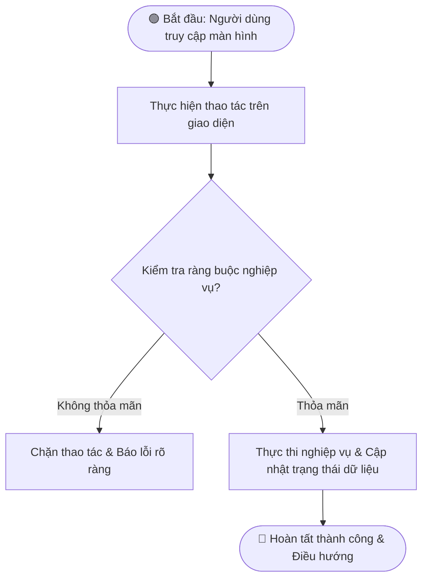

# [Mã US]: [Tên Module] - [Tên User Story]

> **Mã Story:** `US-[MODULE]-[XX]`  
> **Epic:** [Tên Epic - Ví dụ: Epic 03: Chờ Xử Lý Lại / Epic 02: Quản Trị Đơn Hàng]  
> **Module / Feature:** [Tên Module] / [Tên Tính năng cụ thể]  
> **Actor chính:** [Vai trò người dùng thao tác chính - Ví dụ: Quản lý Kho thành phẩm, Sale Admin...]  
> **Tài liệu tham chiếu:** [Link Figma / Prototype / API Spec nếu có]  
> **Trạng thái:** `Draft` / `Ready for Review` / `Approved`

---

## 1. USER STORY *

*   **Là một (As a):** [Vai trò người dùng thao tác chính]
*   **Tôi muốn (I want):** 
    1. [Mục tiêu 1...]
    2. [Mục tiêu 2...]
    3. [Mục tiêu 3...]
*   **Để (So that):** [Lợi ích, giá trị mang lại cho doanh nghiệp và vận hành hệ thống]

---

## 2. TIÊU CHÍ CHẤP NHẬN (ACCEPTANCE CRITERIA - AC) *

*   **AC 1: [Tên kịch bản 1 - Luồng chính / Happy Path]**
    *   **Given (Biết rằng):** [Điều kiện tiền đề, ngữ cảnh bắt đầu trước khi thao tác]
    *   **When (Khi):** [Hành động kích hoạt, tương tác của người dùng trên giao diện]
    *   **Then (Thì):** [Kết quả đầu ra mong đợi, phản hồi của hệ thống và trạng thái dữ liệu]
    *   **And (Và):** [Hiệu ứng bổ sung, thông báo Toast, cập nhật badge...]

*   **AC 2: [Tên kịch bản 2 - Luồng ngoại lệ & Chặn lỗi ràng buộc (Validation / Guard)]**
    *   **Biết rằng (Given):** [Điều kiện khi dữ liệu hoặc trạng thái không thỏa mãn quy tắc]
    *   **Khi (When):** [Người dùng thực hiện thao tác trên giao diện]
    *   **Thì (Then):** [Hệ thống chặn thao tác và hiển thị thông báo lỗi cụ thể]

*   **AC 3: [Tên kịch bản 3 - Thao tác chọn nhiều / Hàng loạt (Batch Actions)]**
    *   **Biết rằng (Given):** [Ngữ cảnh người dùng cần thao tác trên nhiều bản ghi cùng lúc]
    *   **Khi (When):** [Người dùng tick chọn Checkbox nhiều dòng và bấm nút hành động chung]
    *   **Thì (Then):** [Hệ thống thực thi đồng thời và phản hồi kết quả tổng hợp]

*   **AC 4: [Tên kịch bản 4 - Thao tác số lượng lẻ / Tùy biến phân bổ]**
    *   **Biết rằng (Given):** [Ngữ cảnh xử lý số lượng một phần của bản ghi (VD: 2/4 pcs)]
    *   **Khi (When):** [Người dùng nhập số lượng lẻ cần xử lý]
    *   **Thì (Then):** [Hệ thống tách bản ghi, xử lý đúng số lượng nhập và giữ lại phần còn lại]

---

## 3. THIẾT KẾ (UX/UI) *

*   **Link Figma / Prototype:** [Đường dẫn URL prototype / màn hình tương ứng]
*   **Ảnh đính kèm:** 
    *   *(Chèn ảnh chụp màn hình UI, mockup hoặc modal popup tại đây)*

---

## 4. QUY TẮC NGHIỆP VỤ (BUSINESS RULES) *

*   **BR-[MODULE]-01 ([Tên Quy tắc 1]):** [Nội dung quy tắc, công thức tính toán, điều kiện ràng buộc cốt lõi].
*   **BR-[MODULE]-02 ([Tên Quy tắc 2]):** [Quy tắc chuyển đổi trạng thái dữ liệu, chốt chặn nghiệp vụ giữa các phân hệ].
*   **BR-[MODULE]-03 ([Tên Quy tắc 3]):** [Quy chuẩn định dạng số, mã vạch, màu sắc hoặc phân quyền thao tác].

---

## 5. DANH MỤC DỮ LIỆU & RÀNG BUỘC

### 5.1 Màn hình [Tên màn hình / Popup / Drawer]

| Fields (Tên trường) | Type (Kiểu dữ liệu) | Required (Bắt buộc) | Default value (Giá trị mặc định) | Rules (Quy tắc & Nghiệp vụ) |
| :--- | :--- | :---: | :--- | :--- |
| **[Tên trường 1]** | Text / Varchar | Có | Rỗng | Độ dài tối đa 50 ký tự, không chứa ký tự đặc biệt. |
| **[Tên trường 2]** | Dropdown / Enum | Có | Giá trị đầu tiên | Danh sách giá trị: `Option A`, `Option B`. |
| **[Tên trường 3]** | Number / Decimal | Tùy chọn | `0` | Định dạng số lẻ 4 chữ số thập phân (`0.0000`), không âm. |
| **Checkbox** | Boolean | Không | `Unchecked` | Cho phép tick chọn từng dòng hoặc chọn tất cả tại header. |
| **Thao tác** | Action / Button | — | — | Kích hoạt modal hoặc thực thi hành động tương ứng. |

---

## 6. LUỒNG NGHIỆP VỤ (MERMAID FLOW)

